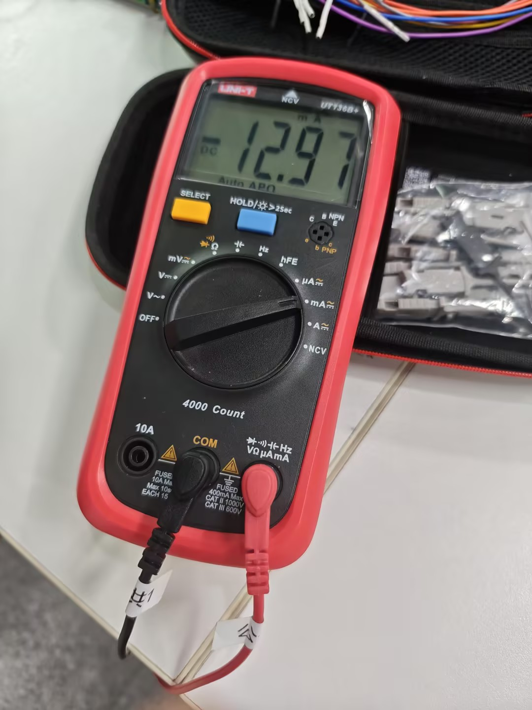
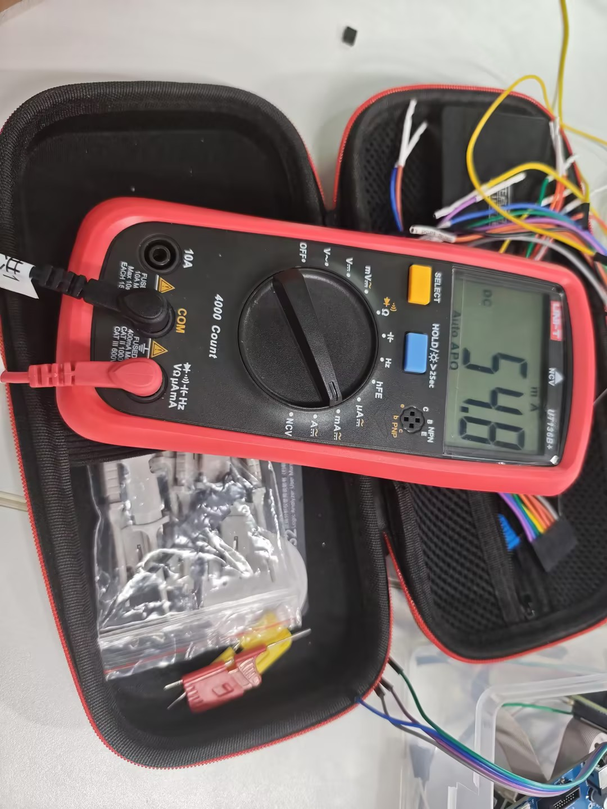

c


缺少hal_entry.c


start: 0
end: 50
end - start: 50
g_task_0_counter: 15962781
g_task_1_counter: 15979792
Delta: 17011
g_task0_handle: 0x204e3940 <g_task0_ctrl>
g_task1_handle: 0x204e38e0 <g_task1_ctrl>
完成了 FreeRTOS 的第一阶段验证


任务间同步，先验证信号量 Semaphore
### 目标：
Task A 周期性释放一个信号量
Task B 等待这个信号量
Task B 收到信号量后计数加 1

**修改文件**

改这个文件：

```
C:\Users\TPSZ-1300194\FSPSmartConfigurator\e2studio\src\new_thread0_entry.c
```

**2. 在文件顶部增加头文件**

```
#include "semphr.h"
```

**3. 增加全局变量**

放在原来那些 `g_task_0_counter` 附近：

```
SemaphoreHandle_t g_test_sem = NULL;

volatile uint32_t g_sem_give_count = 0;
volatile uint32_t g_sem_take_count = 0;
volatile uint32_t g_sem_error_count = 0;

TaskHandle_t g_sem_give_task_handle = NULL;
TaskHandle_t g_sem_take_task_handle = NULL;
```

**4. 增加两个任务函数**

```
void sem_give_task_entry(void * pvParameters)
{
    FSP_PARAMETER_NOT_USED(pvParameters);

    while (1)
    {
        vTaskDelay(100U);

        if (pdPASS == xSemaphoreGive(g_test_sem))
        {
            g_sem_give_count++;
        }
        else
        {
            g_sem_error_count++;
        }
    }
}

void sem_take_task_entry(void * pvParameters)
{
    FSP_PARAMETER_NOT_USED(pvParameters);

    while (1)
    {
        if (pdPASS == xSemaphoreTake(g_test_sem, portMAX_DELAY))
        {
            g_sem_take_count++;
        }
        else
        {
            g_sem_error_count++;
        }
    }
}
```

**5. 在 `new_thread0_entry()` 里创建信号量和两个任务**

建议放在你原来时间片验证完成之后，也就是 `vTaskDelete(g_task0_handle);`、`vTaskDelete(g_task1_handle);` 后面。

加入：

```
g_test_sem = xSemaphoreCreateBinary();
assert(NULL != g_test_sem);

BaseType_t task_create_result;

task_create_result = xTaskCreate(sem_give_task_entry,
                                 "sem give",
                                 256,
                                 NULL,
                                 1,
                                 &g_sem_give_task_handle);
assert(pdPASS == task_create_result);

task_create_result = xTaskCreate(sem_take_task_entry,
                                 "sem take",
                                 256,
                                 NULL,
                                 1,
                                 &g_sem_take_task_handle);
assert(pdPASS == task_create_result);
```

**6. Watch 面板添加这些变量**

```
g_sem_give_count
g_sem_take_count
g_sem_error_count
g_test_sem
g_sem_give_task_handle
g_sem_take_task_handle
```

**7. 正确现象**

运行后应该看到：

```
g_sem_give_count = 1, 2, 3, 4...
g_sem_take_count = 1, 2, 3, 4...
g_sem_error_count = 0
```

`give_count` 和 `take_count` 基本相等，最多差 1，这就是正确现象。说明一个任务释放信号量，另一个任务能被唤醒执行。


# g_sem_give_count: 33
g_sem_take_count: 33
g_sem_error_count: 0
g_test_sem: 0x204e0108 <ucHeap+8>
g_sem_give_task_handle: 0x204e0560 <ucHeap+1120>
g_sem_take_task_handle: 0x204e09d0 <ucHeap+2256>


任务 A 可以通过信号量通知任务 B
任务 B 可以阻塞等待信号量
信号量对象创建成功
动态内存分配正常
FreeRTOS 任务间同步机制正常

# Mutex 互斥量验证


g_mutex_task0_count: 276
g_mutex_task1_count: 276
g_mutex_shared_counter: 552
g_mutex_error_count: 0

- 多任务运行与时间片调度。
- 二值信号量的 Give/Take 同步。
- Mutex 对共享资源的互斥保护。

# FreeRTOS 队列通信 Queue
创建一个生产者任务周期性发送递增数据，再由消费者任务接收并校验数据顺序。重点观察发送次数、接收次数、最后发送值、最后接收值和错误次数。


**验证目标**

创建两个事件位：

```
#define EVENT_BIT_TASK0    (1U << 0)
#define EVENT_BIT_TASK1    (1U << 1)
```

运行三个任务：

1. 任务0每隔一段时间设置 `EVENT_BIT_TASK0`。
2. 任务1设置 `EVENT_BIT_TASK1`。
3. 等待任务调用 `xEventGroupWaitBits()`，必须等两个事件位都出现后才继续运行。

流程如下：

```
任务0设置 BIT0 ─┐
                ├─ 两个事件都到达 → 等待任务解除阻塞
任务1设置 BIT1 ─┘
```
BIT0 不是硬件引脚，也不是某个外设寄存器，而是 FreeRTOS在内存中管理的一个软件状态位

任务0每隔100 Tick设置一次 BIT0：

```
vTaskDelay(100U);
xEventGroupSetBits(g_test_event_group, EVENT_BIT_TASK0);
```

任务1每隔150 Tick设置一次 BIT1，所以任务0设置得更快：

```
任务0次数 ÷ 任务1次数 ≈ 150 ÷ 100 = 1.5
26 ÷ 17 ≈ 1.53
```

# 验证 FreeRTOS软件定时器（Software Timer）


Use Timers          Enable，打开软件定时器

g_timer_create_ok: 1
g_timer_start_ok: 1
g_timer_callback_count: 13
g_timer_last_tick: 2650
g_timer_period_ticks: 200
g_timer_error_count: 0


```
创建200 Tick软件定时器
        ↓
启动软件定时器
        ↓
Timer Service Task开始计时
        ↓
经过200 Tick
        ↓
调用test_timer_callback()
        ↓
记录当前Tick并增加回调次数
        ↓
由于pdTRUE，自动重新开始下一个200 Tick周期
```
# 任务挂起与恢复
1. Worker任务：每10 Tick增加一次计数。
2. Control任务：周期性挂起Worker，确认计数停止，再恢复Worker，确认计数继续增加。
# Tickless Idle低功耗模式
## FSP配置

打开 Tickless Idle低功耗模式

测量方式


注：测量时要拔掉调试器


正常模式下电流值


# 多任务并发运行，串口打印各任务执行状态


遇到的问题：heap不足
把10240换成16384

TaskA：在 `2006` 而不是严格的 `2003` 也正常。因为 TaskA 和 TaskC 在约 2003 tick 同时上报状态，串口日志任务需要逐条发送