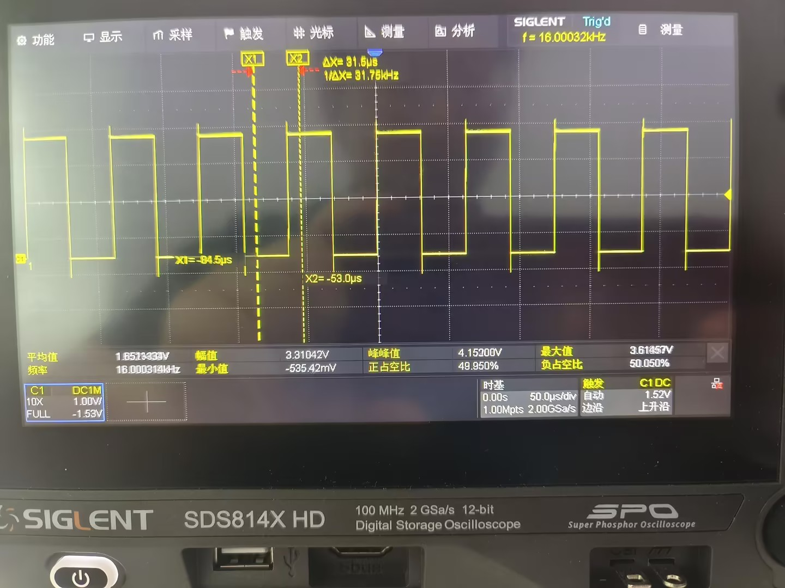
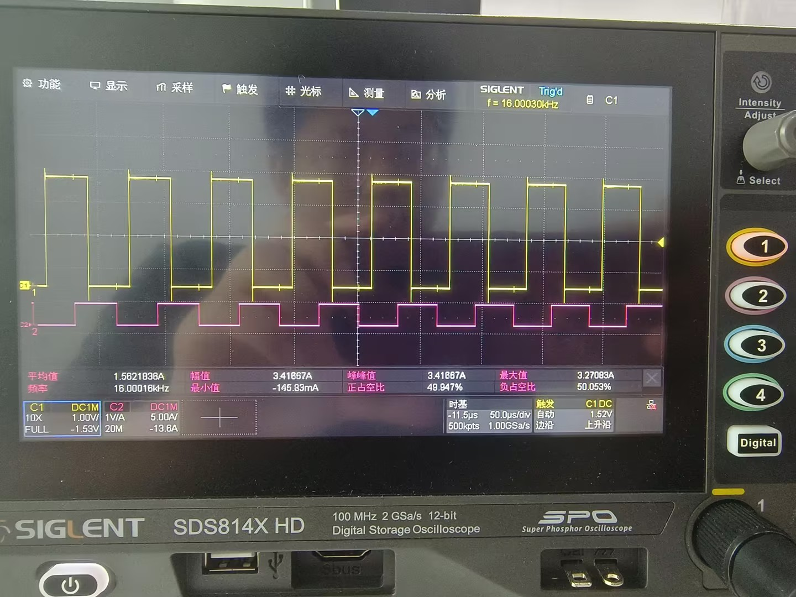
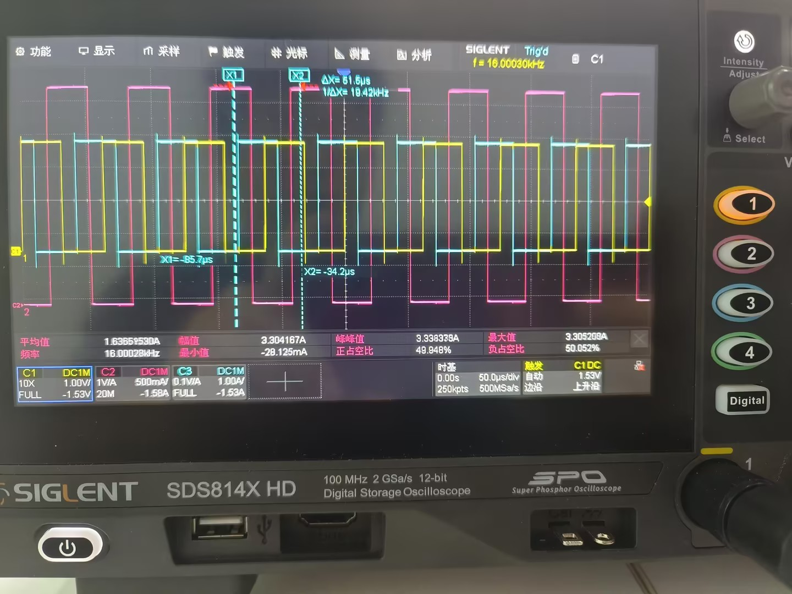
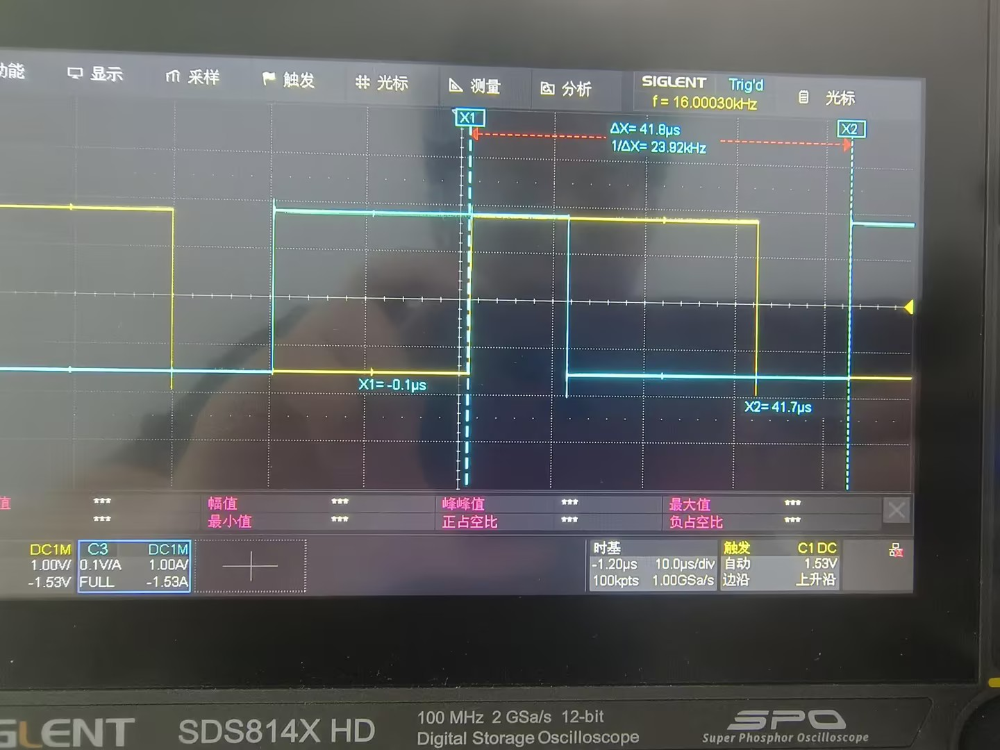
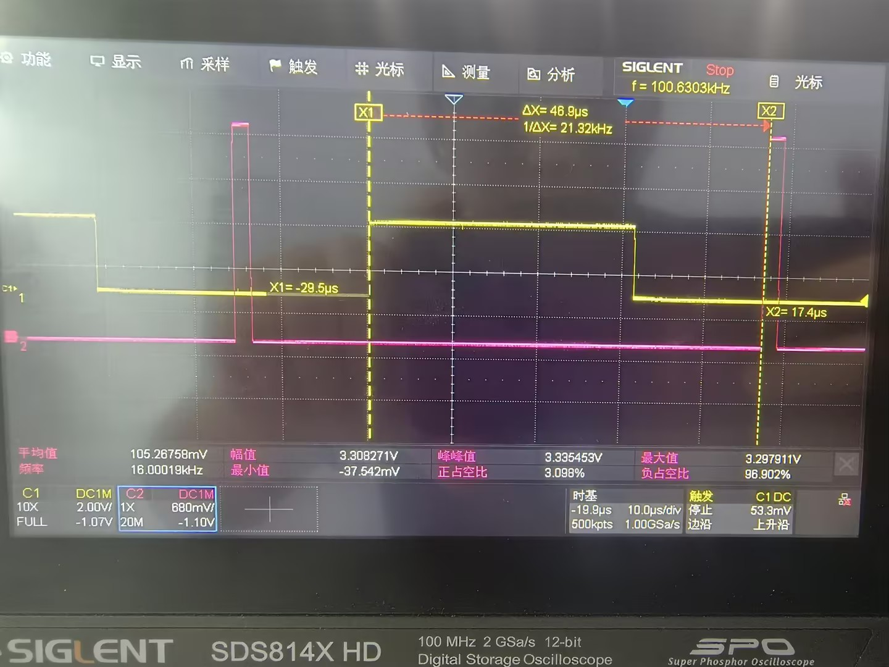

### L4-04：PWM-Diag 高精度PWM与ADC触发（pwm_diag_advanced_ep）

  

| 项目        | 描述                                                                                                                      |
| --------- | ----------------------------------------------------------------------------------------------------------------------- |
| **功能目标**  | 利用PWM-Diag子系统生成高精度PWM波形，并精确触发ADC采样，构建电机控制核心时基                                                                           |
| **涉及外设**  | PWBA、PWGC（96ch）、PWSD、ADCK、PIC                                                                                           |
| **关键技术点** | ① PWBA时钟分频配置 ② PWGC PWM周期/占空比/相位设置 ③ PWGC A/D转换触发时机配置（PWGCnOCL） ④ PWSD队列管理（8深度） ⑤ PWSD→ADCK自动触发链路 ⑥ 中断聚合与掩码 ⑦ 多PWGC通道同步 |
| **验证方法**  | 示波器观察PWM输出波形和ADC触发点位置关系；多通道PWM相位差验证                                                                                     |
| **参考现有**  | pwm_diag_ep                                                                                                             |


PWM频率 = PWMCLK ÷ (Period + 1)
`PWMCLK0 Prescaler/BRS0 = 0`，所以 PWMCLK0 就等于 P040，也就是当前配置的40 MHz。由


占空比最大值为 `0x8000`所以把改成0x4000


预期频率：20 kHz
可以逆推
   有效PWM时钟
= 16 kHz  × (0x07CF + 1)
= 16 kHz × 2000
= 32 MHz  所以P040实际上是32Mhz
修改两项

如果 `g_timer1` 保持Low，它相对于 `g_timer0` 是反相波形。示波器比较三路上升沿时，会额外表现出约180°反相，不利于验证设定的120°相位差。
我们为了演示三相120°相位差，计算：

```
一个周期 = 2000个计数
120°偏移 = 2000 × 120° ÷ 360°
          ≈ 667
          = 0x029B
```






- `ΔX = 20.6 µs`
- PWM频率为 `16.00031 kHz`

先计算周期：

```
T = 1 ÷ 16.00031 kHz
  ≈ 62.499 µs
```

再计算相位差：

```
相位差 = ΔX ÷ T × 360°
       = 20.6 ÷ 62.499 × 360°
       ≈ 118.7°
```

所以当前测量结果是：

```
C2比C1滞后约119°
```

# 加第三路
当PWSD的ADC触发等待队列装满时，允许产生中断通知CPU
240÷360×2000 ≈1333
`0x0535 = 1333`，代表约240°偏移：




41.8÷62.499×360≈240°

# ADC触发


err = R_PWM_DIAG_ADConvResultRead(g_timer0.p_ctrl, &result);
results[0] = result;

err = R_PWM_DIAG_ADConvResultRead(g_timer1.p_ctrl, &result);
results[1] = result;

err = R_PWM_DIAG_ADConvResultRead(g_timer2.p_ctrl, &result);
results[2] = result;


在 [r_pwm_diag.c  中：

```
uint32_t channel = p_instance_ctrl->p_cfg->channel;

*p_result =
    R_PWSD0->PWDDIR[channel].PWDDIR_b.PWSD0PWDDR;
```

出现问题，ADC没有触发
测量P10_3和AP0都是3.3v，代码没有问题，问题应该出在FSP配置


```
g_adc_result_low[0] = 8
```

8的十六进制和二进制是：

```
8 = 0x0008
  = 0000 0000 0000 1000
```

右移3位恢复原始 ADC 码：

```
8 >> 3 = 1
```

也就是说，ADC 实际测得的原始码只有1，几乎就是0 V。

理想情况下可能是0，但由于 ADC 零点误差、线路噪声和量化误差，出现1非常正常。


```
32752 >> 3 = 4094
```

12位 ADC 的满量程是4095，因此4094已经非常接近满量程：

```
原始结果：4094
满量程：  4095
```

这与 AP0_0 实际测到约3.3 V 完全对应。


# PWM 与 ADC 触发点的精确位置  


把timer0延迟换成0x2000

把timer1延迟换成0x6000


#### 示波器上观察ADC触发


ΔX = 46.9μs        T=1/16Mhz=62.5μs
触发比例：46.9/62.5=75.04%
所以PWM输出波形和ADC触发点位置关系验证完成


