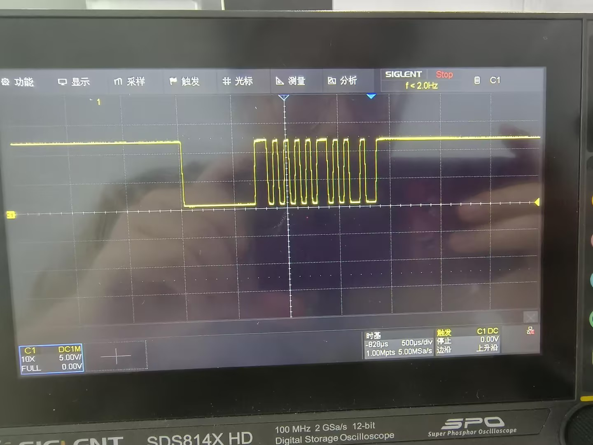

# 图莫斯软件配置

选择LIN1

# FSP


### 根据芯片上丝印可以看出FSP配置应该选择channel5，用跳线帽连接P10_2和LIN_RXD;P10_1和LIN_TXD#


g_lin_slave_ready: true
g_lin_slave_init_status: FSP_SUCCESS
g_lin_slave_rx_count: 0
g_lin_slave_tx_count: 0
g_lin_slave_error_count: 0
g_lin_slave_rx_data: [8]
g_lin_slave_tx_data: [8]


# 问题
时钟频率不正确导致的波特率不匹配，**波特率不匹配会导致接收端在错误的时间点采样电平**，从而把原本正确的 0、1 读错，所以接收到的数据无法通过校验，自然也就不能正常回显。

## Break/Sync/PID验证

Break是主节点拉低总线的一段长低电平，用来通知所有从节点“新帧开始”
Sync它形成交替变化的位序列，让从节点测量实际位宽、实现波特率同步
PID由6位ID和2位奇偶校验组成，不一定等于帧ID


# 从机模式

## 选择从机响应


ID 0x24：
MCU主机 → Break + Sync + PID + 8字节数据 + 校验和
图莫斯  → 接收数据（从机读）

ID 0x25：
MCU主机 → Break + Sync + PID
图莫斯  → A5 5A 11 22 33 44 55 66 + 校验和（从机写）


LIN的帧ID是6位，范围及用途如下：

- `0x00～0x3B`：普通通信帧，可由项目自行分配。
- `0x3C`：诊断主请求帧，固定用途。
- `0x3D`：诊断从响应帧，固定用途。
- `0x3E～0x3F`：保留，不应使用。


### FSP配置

`Master schedule continuous mode`就是“主机调度表连续循环模式”。


## 诊断帧
| ID     | 名称             | 方向       |
| ------ | -------------- | -------- |
| `0x3C` | Master Request | 主机发送诊断请求 |
| `0x3D` | Slave Response | 从机返回诊断响应 |
### 标准校验与增强校验

两者都使用“逐字节求和、处理进位、最后按位取反”的算法，区别在于参与计算的内容。

标准校验（Classic Checksum）：

```
Checksum = 只计算Data1～Data8
```

增强校验（Enhanced Checksum）：

```
Checksum = 计算PID + Data1～Data8
```

### 诊断帧必须用标准校验

这是LIN协议的固定规则


地址为 `0x0F` 的从节点NAD，对“读取产品标识（SID 0xB2，Identifier 0）”作出肯定响应，并返回
NAD（Node Address for Diagnostics）就是 LIN 从节点的“诊断地址”


## LIN睡眠命令与唤醒检测
由 MCU 主节点发送规范的休眠命令，再产生 LIN 唤醒脉冲并确认通信恢复
### 配置SLP P10_0
应该初始为高电平，不然LIN会直接进入休眠


- `360.6 μs`的孤立低电平是唤醒脉冲。当前配置为7 Tbits，在19200 bit/s下理论值为：

```
7 × (1 / 19200) ≈ 364.6 μs
```

## 波特率自适应


# 
事件触发帧的目的，是“只有从节点的数据发生变化时才响应”，用来减少 LIN 总线占用。

它不是 MCU 的外部中断，而是一种 LIN 报文调度方式。


- MCU周期发送 ID `0x30` 帧头。
- 图莫斯只响应一次。
- MCU收到 `A6 11 22 33 44 55 66 77`。
- `g_lin_event_rx_count = 1`。
- `g_lin_event_detected = true`。
- `g_lin_event_response_matches = true`。
- `g_lin_event_bus_error_count = 0`。
- 后续单次响应消耗后，从机保持静默，符合“无新事件不响应”