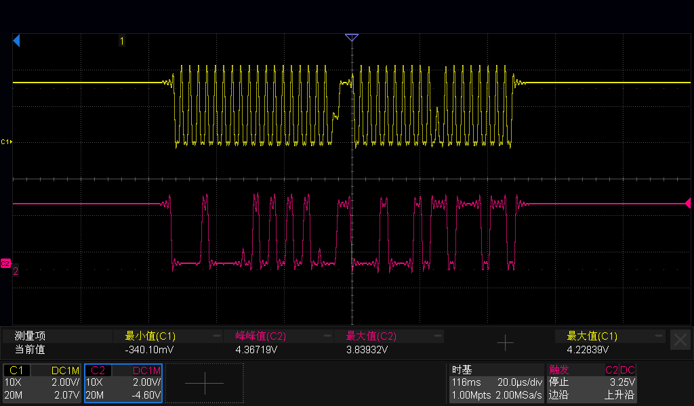
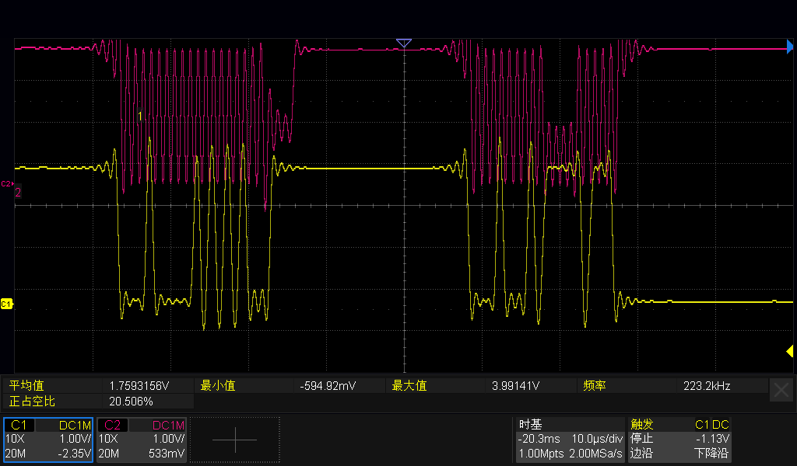
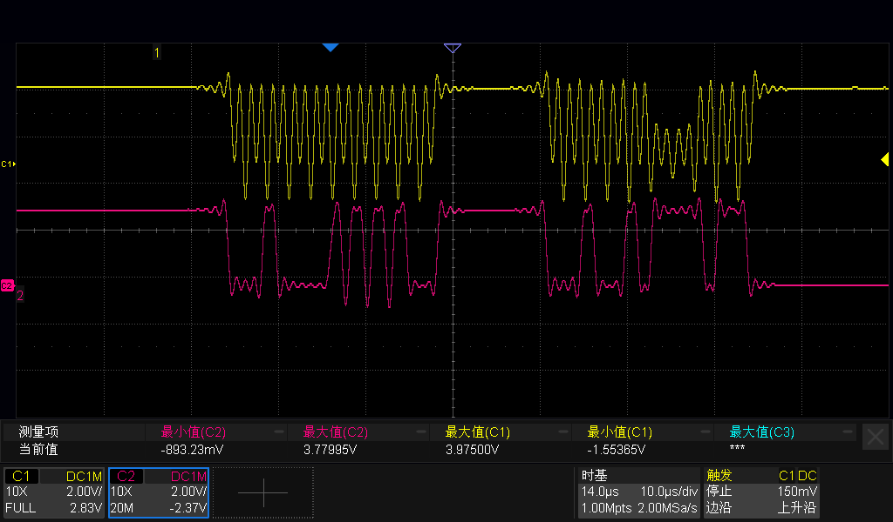
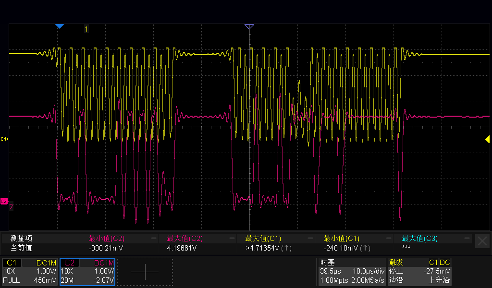

### L5-04：RI3C I3C 主从与带内中断（ri3c_i3c_intr_ep）

  
| 项目        | 描述                                                                                                             |
| --------- | -------------------------------------------------------------------------------------------------------------- |
| **功能目标**  | 实现I3C SDR通信和带内中断（IBI），支持现代车载传感器接口                                                                              |
| **涉及外设**  | RI3C（I3C模式 + I2C兼容模式）                                                                                          |
| **关键技术点** | ① I3C主/从模式 ② SDR单数据率通信 ③ 带内中断（IBI）- 从设备主动请求 ④ 动态地址分配（DAAS） ⑤ Master Ship Request ⑥ I2C遗留设备兼容（1Mbps） ⑦ FIFO缓冲传输 |
| **验证方法**  | 主从模式互测；从设备发起IBI验证中断响应；混合I2C/I3C设备通信                                                                            |
| **参考现有**  | i3c_master_ep, i3c_slave_ep                                                                                    |

## 问题一：安装的编译链不匹配

```c
Extracting support files...
[ERROR] Toolchain configured for project is not currently available. Please add/enable toolchain through Renesas Toolchain Management or select a different toolchain for this project.
11:07:13 **** 项目r_i3c_master_u5l4_ep配置Debug的仅清理的构建 ****
make -r -j8 clean
make: *** No rule to make target 'clean'. Stop.
"make -r -j8 clean"以退出代码2结尾。构建可能不完整。
11:07:13 Build Failed. 1 errors, 0 warnings. (took 304ms)
```
修正 Master 工程的构建路径：

```
错误：${workspace_loc:/IIC_DMA}/Debug
正确：${workspace_loc:/r_i3c_master_u5l4_ep}/Debug
```


```
R7F711001EBBB
257-pin
```
用的是和100pin不一样的外设引脚

GDB Server for Renesas targets.

Version For R-Car U5L [Alpha7] (Dec 17 2025 15:00:49)

  

  
```c
GDB Server for Renesas targets.

Version For R-Car U5L [Alpha7] (Dec 17 2025 15:00:49)

  

  

Starting server with the following options:

Raw options : C:\Users\TPSZ-1300194\.eclipse\com.renesas.platform_1223251604\DebugComp\\rcarmcu\e2-server-gdb -g E2LITE -t R7F711001 -uConnectionTimeout= 30 -uClockSrc= 0 -uAllowClockSourceInternal= 1 -uInteface= SWD -uIfSpeed= auto -w 0 -z 33 -uResetBeginConnection= 0 -uNoReset= 1 -uLowPower= 0 -uDisconnectionMode= 1 -uWakeupAllCores= 0 -uEnableSciBoot= 1 -uneedAuthentication= 0 -uocdID= FFFFFFFFFFFFFFFFFFFFFFFFFFFFFFFFFFFFFFFFFFFFFFFFFFFFFFFFFFFFFFFF -uresetOnReload= 1 -n 0 -uMapMode= 0 -uInitialiseRAM= 1 -uFlashBp= 0 -uMultiDeviceSync= 0 -usupplyVoltageASP= 0 -uhookWorkRamSize= 0x400 -ueraseRomOnDownload= 0 -ueraseDataRomOnDownload= 0 -uExternalFlashEnable= 0 -uTraceMTB= 0 -uTraceSizeMTB= 1024 -uProgReWriteIRom= 0 -uProgReWriteDFlash= 0 -uOSRestriction= 0 -uTimeMeasurementEnable= 1 -uDWTEnable= 0 -uSWOSelectCore= CPU0 -uMemRegion= 0x40000000:0x40000:DATA_FLASH:e -l -uCore= CPU0|enabled|256|main -uSyncMode= async -uTraceCore= CPU0 -uFirstGDB= main --gdbVersion= 13.2

  

Connecting to E2LITE, ARM target

GDBServer endian : little

Target power from emulator : Off

Starting target connection

GDB action 'connect to target', has failed with error report, Error 0x00000100: The specified parameter is incorrect.

  

force_kill_gdb()

Disconnected from the Target Debugger.
```


调试配置里是调试器提供电源修改成外部供电


## FSP配置
### master配置


U5L硬件不支持 Hot-Join，所以把 `ACK Hot-Join Requests` 关闭。数据手册第346页对此有明确说明。

`Transfer Mode = Normal` 表示使用普通FIFO，第一阶段最容易调试。


### slave配置


1. 第75页表2.10说明：

|PODCEn|PODCn|输出方式|
|---|---|---|
|0|0|Push-pull|
|0|1|Emulated N-channel Open Drain|
|1|0|Push-pull|
|1|1|Emulated P-channel Open Drain|


3C/I2C总线的开漏阶段要求设备能够主动拉低线路，释放后由上拉电阻恢复高电平，因此需要 N沟道开漏


###  I3C Master/Slave双板通信

- SDR读写
- ENTDAA动态地址分配
- Slave主动发起IBI
- Master响应IBI
- Normal FIFO传输
- 

### Mastership Request（主控权请求）
#### slave FSP配置

**Secondary Master = Enabled**  
表示该I3C节点具有“次级主机”能力，也就是它除了能作为从设备通信外，还允许在特定条件下接管总线，成为当前主机。
Secondary Master
      │
      │ ① 发起主机权请求
      ▼
Current Master
      │
      │ ② 接受请求
      │ ③ 向Secondary Master发送GETACCMST
      ▼
Secondary Master
      │
      │ ④ 返回自己的动态地址
      ▼
Current Master
      │
      │ ⑤ 发送STOP并释放总线
      ▼
Secondary Master成为新的Current Master


**Mastership Request 实际交接成功**：
```
g_getaccmst_received = true
g_secondary_master_active = true
g_i3c_error = false
```

含义：

- 原 Slave 收到了原 Master 发出的 `GETACCMST`
- 原 Slave 已成功切换成新 Master
- 切换过程中没有 I3C 错误

### Master


## I2C遗留设备兼容（1Mbps）

### I2C slave配置


```
Standard-mode       = 100 kHz
Fast-mode           = 400 kHz
Fast-mode Plus      = 1 MHz
```
所以选择 Fast-mode Plus = 1Mhz
### master中配置

**要将Legacy inclusive打开，并且把Secondary Master关闭


线路正被芯片/短路主动拉低


但 Master的160 ns高电平需要调整到至少260 ns，建议300 ns


加入上拉电阻后
‘

### slave是不是没选10bit

**无关**

### Clock Strectching

时钟延展”或“时钟拉伸”。

它的作用是：当从机暂时没有准备好接收或发送下一个字节时，从机主动把 SCL 拉低，通知主机“先等一下”
在275行打断点，烧录启动程序
程序随后停在第275行，此时设备表已经写入，可以观察：

```
R_RI3C0->DATBAS0_b.DVSTAD
R_RI3C0->DATBAS0_b.DVTYP
g_legacy_i2c_status
```


   - `DVSTAD`：目标设备的静态地址。期望为 `0x08`。
- `DVTYP`：目标设备类型。期望为 `1`，表示 Legacy I²C；`0` 表示 I3C
排除：

- Master设备地址设置错误
- 7位/10位地址错误
- Master把Slave当成I3C设备


### 降速


### 不接SDA和SCL


### 没接上拉电阻

### 重新焊接上拉电阻


- 第二个数据应该是 `0x22`，波形却再次出现 `0x11`；
- 没有完成10字节传输，也没有产生正常结束回调。
- 


### 换成CPU传输方式


### 换回1Mhz又出问题


#### 问题原因

又出现变化


测试点接触不良

### 400khz

`NTST = 0x00000009` 表示：

```
CMDQEF = 1：命令队列已经空
TDBEF0 = 1：0xAA 已从发送缓冲区取走
RSPQFF = 0：没有生成传输完成响应
TEF = 0：没有传输错误
TABTF = 0：没有传输中止
```

也就是说，Master确实发送了 `0xAA`，但当前代码把：

```
R_I3C_Write(..., true);
```

设置成了保留总线、不产生STOP。随后程序又等待：

```
while ((!g_write_complete) && (!g_i3c_error))
```

由于写事务尚未正式结束，`g_write_complete` 不会产生，程序也就永远不会执行后面的 `R_I3C_Read()`。因此只看到一个 `AA`。

对于目前这种“等待写完成后再调用读”的程序，Master第301行必须改回：

```
g_legacy_i2c_status = R_I3C_Write(&g_i3c_ctrl,
                                  g_legacy_i2c_write_data,
                                  sizeof(g_legacy_i2c_write_data),
                                  false);
```

读取仍保持：

```
R_I3C_Read(..., false);
```

这样实际时序是：

```
START → 08 Write → AA → STOP
START → 08 Read → BB → STOP
```

从机在第一个 STOP 后得到 `RX_COMPLETE`，设置返回值 `0xBB`；Master随后才能开始读。


寄存器判断是slave端的问题还是master


### 实际波形图

读数据`10111011``0xBB`最后一位`1`Master NACK，表示只读取一个字节

### 1Mhz

同时逻辑分析仪读到的是`0xFD`而不是`0xBB`，说明Slave在1 MHz下没有及时准备好发送数据。驱动来不及完成：

```
RX_COMPLETE
→ 判断收到AA
→ 准备BB
→ TX_REQUEST
→ 装载DRT
```

Master就已经开始读了。未准备好时硬件倾向于送出连续的`1`，所以出现接近`0xFF`的`0xFD`；随后Slave发送状态没有正常结束，SDA未释放。

最直接的解决方法是在Master写完`0xAA`后，开始读取前增加约`20 μs`等待时间。位置是在Master的写完成等待循环之后、`R_I3C_Read()`之前：

```
while ((!g_write_complete) && (!g_i3c_error))
{
    __WFI();
}

if (g_i3c_error)
{
    goto legacy_i2c_end;
}

R_BSP_SoftwareDelay(20U, BSP_DELAY_UNITS_MICROSECONDS);

g_read_complete = false;
```

这样Slave有足够时间处理`RX_COMPLETE`并预装`0xBB`。当前挂死的总线需要先复位或重新上电Slave，使SDA恢复高电平，再测试。


默认空闲数据`0xFF`，说明Slave在1 MHz下没有按照预期把`0xBB`送入移位发送过程。最后SDA持续为低，说明Slave RIIC仍停留在发送状态，没有正常处理Master的NACK和STOP。


## 单个板子做


### 自回环

#### 换1kΩ上拉电阻



释放后的SCL上升不完整，部分高电平可能没有达到有效逻辑高门限


300—500



####


① 上升的 RC 曲线**还没爬到顶就被下一个边沿截断**；② 两股力量在**分压**（上拉 vs 一个错误驱动的推挽低，或两个推挽打架）；③ 被**电平转换器/钳位**卡在中间。