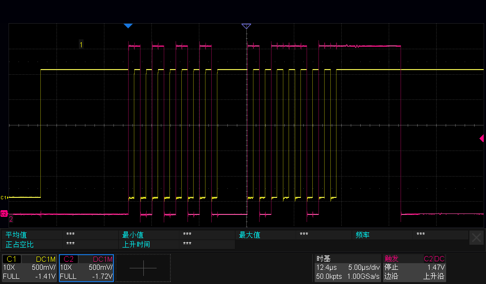

# 速度限制

# FSP配置
## 添加CSIH组件

`CSIH0SC`和`CSIH0SO`需要快速切换：

- 驱动能力太低，SCLK、MOSI的上升/下降沿会变慢；
- 负载、跳线和寄生电容越大，边沿越容易失真；
- 设置为Medium可以提高引脚充放电能力，帮助满足高速SPI的时序要求。
所以Drive Capacity要设置为Medium，说明书规定SC和SO的寄存器PDSCn_m=1。

## **SSE function（SSE功能）**

**值：Input signal CSIHTSSI is disabled（输入信号CSIHTSSI被禁用）**

- **SSE** = Serial Status Enable（串行状态使能）
- **CSIHTSSI** = CSIH Transmit Start Signal Input（发送启动信号输入）
- **作用**：控制是否使用外部信号来触发数据传输
- **禁用时（当前）**：由软件/CPU控制传输启动
- **启用时**：可以通过外部引脚信号来触发传输，实现硬件同步

### SPI模式选择

### FSP错误中断配置问题

## FIFO 模式环回

片选的窄脉冲反复打断
## ** CS behavior（片选行为）值：Chip select signal returns to the inactive level**
这个选项控制**片选信号（Chip Select, CS）在数据传输过程中的行为**：

- **含义**：片选信号会在每次数据传输后返回到非激活电平（通常是高电平）
- **作用**：
    - 控制CS信号在发送数据字节之间是否保持激活状态
    - 设置为"返回非激活电平"时，每发送一个数据单元，CS都会拉高一次
    - 如果设置为保持激活，则CS会在整个传输过程中保持低电平

## DMA
### CSIH改回直接访问

### 开启 Transfer API支持

### 添加两个DMA并设置中断

### 使用 DMA后，CSIH本身的两个CPU中断优先级必须关闭

## 现象

## 压力测试
