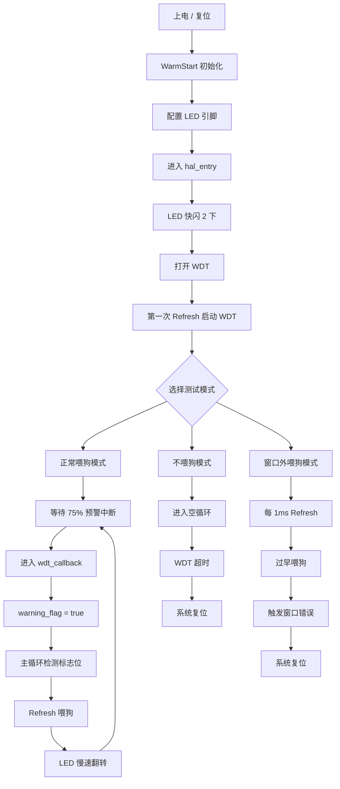

| 项目        | 描述                                                                                           |     |
| --------- | -------------------------------------------------------------------------------------------- | --- |
| **功能目标**  | 配置WDTB实现系统监控，验证窗口看门狗的中断和复位功能                                                                 |     |
| **涉及外设**  | WDTB、ECM                                                                                     |     |
| **关键技术点** | ① 窗口看门狗周期配置 ② 75%溢出中断（预警喂狗） ③ 窗口打开周期设置 ④ 任意计数器值中断 ⑤ WDTB溢出到ECM的错误通知链路 ⑥ 喂狗窗口内刷新 vs 窗口外刷新对比测试 |     |
| **验证方法**  | 正常喂狗时系统稳定运行；故意不喂狗验证复位发生；窗口外喂狗验证错误检测                                                          |     |
| **参考现有**  | wdt_u5l4_ep                                                                                  |     |


## **ECM = Error Control Module（错误控制模块）**
### **ECM的主要功能：**

1. **错误信号收集**
    - 接收来自各种外设模块的错误通知（如WDTB溢出、时钟异常、RAM/ROM错误等）
    
        
2. **错误响应处理**
    - 根据配置，ECM可以采取多种操作
     
        - 设置错误管脚输出（Error Pin）
        - 生成中断信号
        - 触发系统复位
3. **延时定时器功能**
    - ECM内置延时定时器，可以配置在错误发生后延迟一定时间再生成复位或输出信号
        
  


根据项目描述，**"WDTB溢出到ECM的错误通知链路"** 是指：

- 当看门狗定时器（WDTB）溢出时 → 发送错误信号给ECM → ECM根据配置产生中断或复位


**窗口外喂狗**是指在不允许的时间点喂看门狗，会导致系统复位。这是**窗口看门狗**（Window Watchdog）的重要特性


FSP配置说明


也就是 **正常喂狗模式**。

**正常现象**

下载运行后应该看到：

1. LED 快闪 2 下  
    这表示系统刚启动，程序进入了 `hal_entry()`。
    
2. 然后 LED 持续慢速翻转  
    大概每次 WDT 75% 预警中断来一次，LED 状态翻转一次。
    
3. 系统不会反复重启  
    也就是说不会一直重复“快闪 2 下、快闪 2 下、快闪 2 下”。
    

这说明：

- WDT 已经启动
- WDT 75% 预警中断能进来
- 程序在预警中断后及时喂狗
- 系统没有触发 WDT 复位

**如果你切换成不喂狗模式**

改成：

```
#define WDT_TEST_MODE WDT_TEST_NO_FEED
```

现象应该是：

1. LED 快闪 2 下
2. 然后不再正常翻转
3. 过一会系统复位
4. 再次看到 LED 快闪 2 下

也就是循环出现：

```
快闪2下 -> 等待 -> 复位 -> 快闪2下 -> 等待 -> 复位
```

这说明 WDT 没有被刷新，超时后触发复位。

**如果切换成窗口外喂狗模式**

改成：

```
#define WDT_TEST_MODE WDT_TEST_WINDOW_ERROR
```

现象应该是：

1. LED 快闪 2 下
2. 很快复位
3. 又重新快闪 2 下

它会比“不喂狗模式”复位得更快，因为它是故意太早喂狗，触发窗口错误。

所以最简单判断：

```
一直慢慢翻转 = 正常喂狗成功
反复快闪2下 = 系统发生复位
快闪2下后很快重启 = 窗口外喂狗错误
```

你先测试 `WDT_TEST_NORMAL_FEED`，如果 LED 快闪 2 下后能一直慢慢翻转，就是当前实验成功。

我在 [hal_entry.c](C:/Users/TPSZ-1300194/FSPSmartConfigurator/L1_05_wdt_system_monitor_ep/src/hal_entry.c) 里加了这个宏：

```
#define LED_TOGGLE_WARNING_COUNT (4U)
```


# 闪烁间隔太大


现在逻辑是：**WDT 每次 75% 预警都正常喂狗，但 LED 每 4 次预警才翻转一次**。这样不会影响看门狗刷新，只是让 LED 闪烁变慢。

当前大概现象：

```
启动快闪 2 下
然后 LED 大约 0.8 秒翻转一次
```

如果你还想更慢，把 `4U` 改成 `6U` 或 `8U` 就行。


代码通过 LED 显示系统状态，并提供三种测试模式：

```c
#define WDT_TEST_NORMAL_FEED   (0)
#define WDT_TEST_NO_FEED       (1)
#define WDT_TEST_WINDOW_ERROR  (2)
```

WDT结构体
```c
struct WDTDev
{
    const wdt_instance_t * p_instance;
    volatile bool warning_flag;
    volatile uint32_t warning_count;

    fsp_err_t (*Init)(WDTDev * const p_dev);
    fsp_err_t (*Refresh)(WDTDev * const p_dev);
};
```
WDT回调函数
```c
void wdt_callback(wdt_callback_args_t * p_args)
{
    FSP_PARAMETER_NOT_USED(p_args);

    g_wdt_dev.warning_flag = true;
    g_wdt_dev.warning_count++;
}
```
LED记录电平
```c
static void LedWrite(LedDev * p_dev, bsp_io_level_t level)
{
    p_dev->level = level;
    R_IOPORT_PinWrite(&g_ioport_ctrl, p_dev->pin, level);
}
```
LED翻转函数
```c
static void LedToggle(LedDev * p_dev)
{
    if (BSP_IO_LEVEL_LOW == p_dev->level)
    {
        p_dev->Write(p_dev, BSP_IO_LEVEL_HIGH);
    }
    else
    {
        p_dev->Write(p_dev, BSP_IO_LEVEL_LOW);
    }
}
```
第一次 `Refresh` 用来启动 WDT 计数。设置的 WDT 是软件触发启动模式，所以必须先刷新一次，它才开始运行。
```c
return p_dev->Refresh(p_dev);
```
**应用初始化**

```c
static void WDTAppInit(WDTApp * p_app)
{
    p_app->p_led->Blink(p_app->p_led, 2, 100);

    fsp_err_t err = p_app->p_wdt->Init(p_app->p_wdt);
    if (FSP_SUCCESS != err)
    {
        ErrorTrap();
    }
}
```

程序启动后先让 LED 快闪 2 下，表示系统启动。

然后初始化 WDT。

如果 WDT 初始化失败，就进入：

```c
ErrorTrap();
```

也就是死循环停住。


打开 WDT 设备，并使用 g_wdt0_cfg 这份配置初始化它
