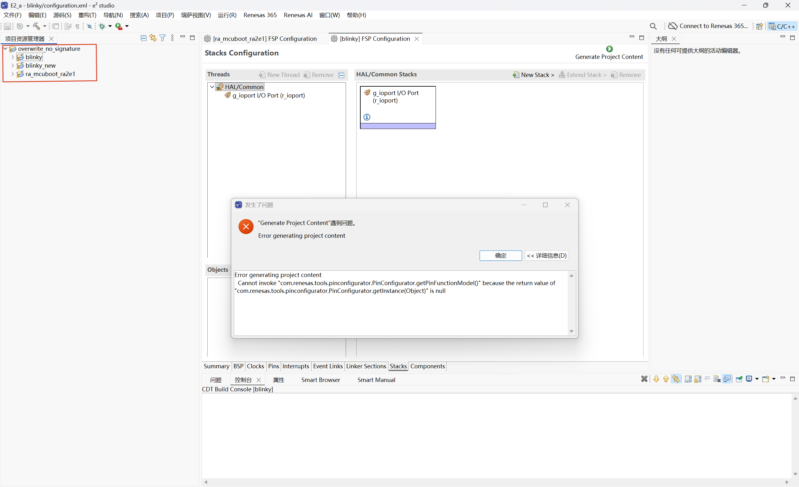

# 2026-10-10｜RA2L1 HSI 配置记录与 MCUboot 编译排错


## 9. MCUboot 编译验证：目标与环境

### 9.1 本次验证范围

本次只完成 **Bootloader、初始应用和升级应用的编译与镜像打包**，不进行烧录、运行或实板升级验证。

虽然笔记保存在 RA2L1 目录下，但本次沿用示例的 **RA2E1 默认配置**。编译完成不代表工程已经适配此前提到的 RA2L1 `R7FA2L1AB2DFM` 板。

| 项目 | 本次使用值 |
| --- | --- |
| 示例 | `overwrite_no_signature` |
| 目标芯片 | `R7FA2E1A92DFM` |
| FSP | `6.5.0` |
| IDE | e² studio `v2026-04.2` 配套安装 |
| 工具链 | GNU Arm `13.2.Rel1` |
| 构建配置 | `Debug` |
| 升级模式 | `Overwrite Only` |
| 防降级 | 已启用 |
| 初始应用版本 | `1.0.0` |
| 升级应用版本 | `2.0.0` |

工作区：

```text
D:\RenesasWorkspaces\RA2E1
```

三个源工程所在目录：

```text
D:\R2AL1\r11an0516eu0140-ra2-bootloader\RA2_secure_bootloader\overwrite_no_signature
```

Solution 配置文件：

```text
D:\RenesasWorkspaces\RA2E1\mcuboot_solution\solution.xml
```

### 9.2 四个工程分别负责什么

| 工程 | 作用 | 主要输出 |
| --- | --- | --- |
| `ra_mcuboot_ra2e1` | Bootloader，负责启动应用及处理升级镜像 | `Debug/ra_mcuboot_ra2e1.elf`、`.sbd` |
| `blinky` | 初始应用 | `Debug/blinky.elf`、`blinky.bin.signed` |
| `blinky_new` | 升级应用，使用更高版本号 | `Debug/blinky_new.elf`、`blinky_new.bin.signed` |
| `mcuboot_solution` | 统一内存布局，并组织已关联工程的构建 | `build/mcuboot_solution.sbd` |

MCUboot 是 Bootloader 软件框架。Solution 是配置与构建工程，不是第四个需要运行的固件。

本次“不带签名验证”表示未使用私钥生成数字签名、未通过对应公钥验证镜像来源。应用仍需打包为 MCUboot 格式，包含镜像头、版本、SHA-256 信息和相应尾部标记。输出扩展名仍为 `.bin.signed`，不能仅凭文件名判断是否使用了数字签名。

## 10. 排错起点：缺少 HEADER_SIZE

客户最初反馈了工程生成/配置问题，随后本机复现了 `blinky` 打包错误。下面保留客户原始截图；不能仅凭该截图认定所有报错都由同一原因造成。



本机遇到的明确错误为：

```text
ERROR: Could not find HEADER_SIZE macro in bsp_linker_info.h.
```


错误发生在 **Boot Image Build** 阶段：C 代码编译和链接可以已经成功，但镜像打包尚未完成。

原示例使用 FSP 5.2.0，迁移到 6.5.0 后，需要通过 **FSP Solution** 定义 MCUboot 的槽位和镜像头。仅保留旧版 `BootloaderDataFile` 变量，不能代替新版 Solution 内存配置。

`BootloaderDataFile` 是历史排查项；新版构建过程中，Bootloader 信息也可保存在 `.sbd` 包内的 `cfg/bootloader.bld`。因此，不应把“必须在 Debug 中看到独立 `.bld` 文件”作为本次 FSP 6.5.0 流程的唯一判断标准。

**本次修复方法：** 建立 Solution、关联 `.sbd`、配置内存分区，再让工具自动生成 `HEADER_SIZE` 和 `SLOT_SIZE`。不手动修改生成文件 `bsp_linker_info.h`。

## 11. 步骤一：准备 Bootloader 和初始应用

1. 在 e² studio 中打开工作区 `D:\RenesasWorkspaces\RA2E1`，确认三个示例工程均已导入。
2. 分别打开 `ra_mcuboot_ra2e1`、`blinky` 的 `configuration.xml`，检查 **Summary/BSP** 中显示的 FSP 版本。
3. 如果仍为旧版，切换至 `6.5.0`，按迁移提示完成配置更新。
4. 保存配置，点击 **Generate Project Content**。
5. 右键 `ra_mcuboot_ra2e1` → **构建项目（Build Project）**。
6. 展开其 **Debug**，确认生成 `ra_mcuboot_ra2e1.elf` 和 `ra_mcuboot_ra2e1.sbd`。
7. 构建 `blinky`，确认能够生成 `blinky.elf` 和 `blinky.sbd`。此时若仍提示缺少 `HEADER_SIZE`，继续执行下面的 Solution 配置；这不表示打包已经成功。


## 12. 步骤二：创建 FSP Solution

### 12.1 打开正确的创建入口

进入：

```text
文件（File）
→ 新建（New）
→ C/C++ Project
→ All
→ Renesas FSP Solution Project (Advanced)
```

如果先进入“新建 → 其他”，应从 C/C++ 类别进入 **C/C++ Project** 模板页，再选择上述 Advanced 模板。直接在“其他”的过滤框搜索 `Solution`，不一定能找到该模板。


### 12.2 选择初始应用并完成创建

1. 进入 Advanced 模板向导。
2. 在 **Project** 中选择 `blinky`，作为本次 Bootloader → 初始应用链的末端工程。
3. 将 Solution 工程命名为 `mcuboot_solution`，完成向导。
4. 左侧确认出现 `mcuboot_solution`，并打开其 `solution.xml`。

本次初始链中只显示了 `blinky`，因此下一步手动补入 Bootloader 引用。


### 12.3 补齐工程关联

1. 保存并关闭 Solution 图形配置页，避免编辑器中的旧内容覆盖文件修改。
2. 右键 `solution.xml` → **打开方式（Open With）→ 文本编辑器（Text Editor）**。
3. 搜索 `<raSmartBundles>`，使该段内容如下；Bootloader 放在 `blinky` 前面：

```xml
<raSmartBundles>
  <bundle>${workspace_loc:/ra_mcuboot_ra2e1}/Debug/ra_mcuboot_ra2e1.sbd</bundle>
  <bundle>${workspace_loc:/blinky}/Debug/blinky.sbd</bundle>
</raSmartBundles>
```

4. 保存文件。选中 Solution 工程，按 **F5** 刷新。
5. 若弹出文件已在外部修改的提示，选择 **Replace editor content**，加载磁盘上的新内容。

`${workspace_loc:/工程名}` 指 e² studio 工作区登记的工程位置，不要求源文件实际保存在工作区目录下。


## 13. 步骤三：配置 FLASH 和 RAM 分区

### 13.1 本次最终布局

打开 Solution 的 **Memories** 页面。这里填写的 **Start 是绝对地址**；XML 中的 `offset` 则是相对所属资源起点的偏移。

FLASH 资源起点为 `0x00000000`，因此 FLASH 的 Start 与 offset 数值相同。RAM 资源起点为 `0x20004000`，例如 `offset="0x2000"` 对应 Start `0x20006000`。

| FLASH 分区 | Start | Size | 含义 |
| --- | --- | --- | --- |
| `FLASH_CM23_B` | `0x00000000` | `0x4000` | Bootloader，16 KB |
| `__BL_0_P_H` | `0x00004000` | `0x100` | 主镜像头，256 B |
| `FLASH_CM23` | `0x00004100` | `0x7F00` | 主应用区域 |
| `__BL_0_S_H` | `0x0000C000` | `0x100` | 次镜像头，256 B |
| `__BL_0_S_I` | `0x0000C100` | `0x7F00` | 次镜像区域 |

主槽与次槽各占 `0x8000`，即 32 KB；这里包含镜像头和尾部打包开销，不等于可以使用 32 KB 的应用代码空间。当前为 Overwrite Only 模式，不配置 Scratch 分区。

| RAM 分区 | Start | Size |
| --- | --- | --- |
| `RAM_CM23_B` | `0x20004000` | `0x2000`，8 KB |
| `RAM_CM23` | `0x20006000` | `0x2000`，8 KB |

这些大小是本次 RA2E1 编译验证所用配置，不是所有 MCUboot 工程的固定值。

### 13.2 添加三个自定义镜像分区

1. 在 Memories 中选中 **FLASH 资源行**，点击 **Add Partition**。
2. 在 **New Partition** 中，按下表分别添加三个分区。
3. 每次填写完毕后点击 **确定**，再添加下一项。

| Name | Start | Size | Core | Security |
| --- | --- | --- | --- | --- |
| `__BL_0_P_H` | `0x4000` | `0x100` | `CM23` | `Undefined` |
| `__BL_0_S_H` | `0xC000` | `0x100` | `CM23` | `Undefined` |
| `__BL_0_S_I` | `0xC100` | `0x7F00` | `CM23` | `Undefined` |

名称以两个下划线 `__` 开头。主应用区域使用工具已有的 `FLASH_CM23`，不另外创建 `__BL_0_P_I`。


### 13.3 修改主应用区域并重新排序

1. 找到 `FLASH_CM23` 行，将 **Start** 设置为 `0x4100`、**Size** 设置为 `0x7F00`。
2. 按 Enter 提交。该界面可能自动顺延后续分区，因此需要再次检查三个自定义分区。
3. 按顺序修正 Start：`__BL_0_P_H` 为 `0x4000`，`__BL_0_S_H` 为 `0xC000`，`__BL_0_S_I` 为 `0xC100`。
4. 点击右侧 **Sort Partitions**，按地址从小到大排序。
5. 核对 13.1 的 FLASH 表格，按 **Ctrl+S** 保存。

本次曾因 `FLASH_CM23`（`0x4100`）排在 `__BL_0_P_H`（`0x4000`）前面出现红叉，排序后消失。若排序后仍有红叉，应悬停查看提示，继续检查重叠、大小和地址。


### 13.4 补齐 Bootloader 默认分区

本次手动补入 `.sbd` 引用后，Solution 仍未自动显示 Bootloader 默认分区，因此需要补齐。以下 XML 是**本次工程最终分区清单**，可用于逐项比对。

1. 保存并关闭 Solution 图形配置页。
2. 通过 **打开方式 → 文本编辑器** 打开 `solution.xml`。
3. 找到 `<raPartitions>…</raPartitions>`，先备份，再将这一整个段落替换为下面内容。不要将整段重复追加。
4. 保留文件中的其他配置段落。
5. 保存、刷新，并重新打开 Memories 检查。

```xml
<raPartitions>
  <memory Pname="CM23" name="RAM_CM23_B" offset="0x0" parent="RAM" security="" size="0x2000"/>
  <memory Pname="CM23" name="FLASH_CM23_B" offset="0x0" parent="FLASH" security="" size="0x4000"/>
  <memory Pname="CM23" name="DATA_FLASH_CM23_B" offset="0x0" parent="DATA_FLASH" security="" size="0x0"/>
  <memory Pname="CM23" name="OPTION_SETTING_OFS0_CM23_B" offset="0x0" parent="OPTION_SETTING_OFS0" security="" size="0x4"/>
  <memory Pname="CM23" name="OPTION_SETTING_OFS1_CM23_B" offset="0x0" parent="OPTION_SETTING_OFS1" security="" size="0x4"/>
  <memory Pname="CM23" name="OPTION_SETTING_SECMPU_CM23_B" offset="0x0" parent="OPTION_SETTING_SECMPU" security="" size="0x0"/>
  <memory Pname="CM23" name="OPTION_SETTING_OSIS_CM23_B" offset="0x0" parent="OPTION_SETTING_OSIS" security="" size="0x0"/>
  <memory Pname="CM23" name="RAM_CM23" offset="0x2000" parent="RAM" security="" size="0x2000"/>
  <memory Pname="CM23" name="DATA_FLASH_CM23" offset="0x0" parent="DATA_FLASH" security="" size="0x0"/>
  <memory Pname="CM23" name="OPTION_SETTING_OFS0_CM23" offset="0x0" parent="OPTION_SETTING_OFS0" security="" size="0x0"/>
  <memory Pname="CM23" name="OPTION_SETTING_OFS1_CM23" offset="0x0" parent="OPTION_SETTING_OFS1" security="" size="0x0"/>
  <memory Pname="CM23" name="OPTION_SETTING_SECMPU_CM23" offset="0x0" parent="OPTION_SETTING_SECMPU" security="" size="0x0"/>
  <memory Pname="CM23" name="OPTION_SETTING_OSIS_CM23" offset="0x0" parent="OPTION_SETTING_OSIS" security="" size="0x0"/>
  <memory Pname="CM23" name="__BL_0_P_H" offset="0x4000" parent="FLASH" security="" size="0x100" userDefined="true"/>
  <memory Pname="CM23" name="FLASH_CM23" offset="0x4100" parent="FLASH" security="" size="0x7F00"/>
  <memory Pname="CM23" name="__BL_0_S_H" offset="0xC000" parent="FLASH" security="" size="0x100" userDefined="true"/>
  <memory Pname="CM23" name="__BL_0_S_I" offset="0xC100" parent="FLASH" security="" size="0x7F00" userDefined="true"/>
</raPartitions>
```

`FLASH_CM23_B`、`RAM_CM23_B` 等是默认分区；`__BL_…` 是自定义镜像分区。不要给默认分区补上 `userDefined="true"`。

## 14. 步骤四：设置 SmartBundle 和初始应用版本

### 14.1 Bootloader 与 blinky 引用同一个 Solution

对 `ra_mcuboot_ra2e1` 和 `blinky` 分别检查一次：

1. 右键工程 → **属性（Properties）**。
2. 进入 **C/C++ 构建（C/C++ Build）→ 构建变量（Build Variables）**。
3. 配置选择 **Debug**。
4. 查找 `SmartBundle`：已有则点击 **编辑**，没有则点击 **添加**。
5. 设置以下内容，点击 **确定 → 应用并关闭**。

| 字段 | 填写内容 |
| --- | --- |
| 变量名 | `SmartBundle` |
| 类型 | 文件（File） |
| 值 | `${workspace_loc:/mcuboot_solution}/build/mcuboot_solution.sbd` |

此处是“构建变量”，下一小节的版本号则在“环境”页面设置，两者不要混淆。


### 14.2 设置 blinky 的版本号

1. 右键 `blinky` → **属性 → C/C++ 构建 → 环境（Environment）**。
2. 配置选择 **Debug**。
3. 添加或编辑 `MCUBOOT_IMAGE_VERSION`，值设为 `1.0.0`。已有同名变量时直接修改。
4. 点击 **应用并关闭**。

本次不使用数字签名或加密，不需要配置 `MCUBOOT_IMAGE_SIGNING_KEY`、`MCUBOOT_IMAGE_ENC_KEY`。

### 14.3 构建 Solution

1. 保存所有配置。
2. 右键 `mcuboot_solution` → **构建项目（Build Project）**。
3. 检查 Solution 的 `build/mcuboot_solution.sbd` 是否更新。
4. 检查 Bootloader 和 `blinky` 的输出是否更新。
5. 打开 `blinky/Debug/bsp_linker_info.h`，搜索 `SIGN_SCRIPT_PY`，应看到：

```c
#ifdef SIGN_SCRIPT_PY
#define HEADER_SIZE 0x00000100
#define SLOT_SIZE 0x00008000
#endif
```

这说明镜像头大小和槽位大小已从内存布局生成。若接下来出现 Python 缺库错误，按下一节处理。

## 15. 步骤五：解决 Python 缺少 click

### 15.1 识别错误阶段

本次出现的错误为：

```text
Captured Defines:
#define HEADER_SIZE 0x00000100
#define SLOT_SIZE 0x00008000

ModuleNotFoundError: No module named 'click'
```

宏已经正确生成；这次失败原因是执行打包脚本的 Python 缺少依赖。

### 15.2 确认 Python 路径

打开 PowerShell，执行：

```powershell
python -c "import sys; print(sys.executable)"
python -m pip --version
```

本机确认使用的解释器为：

```text
C:\Users\TPSZ-1300194\AppData\Local\Python\pythoncore-3.14-64\python.exe
```

如果电脑上安装了多个 Python，应把依赖安装到 e² studio 打包命令实际调用的那一个解释器中。

### 15.3 一次安装工程所需依赖

在本机 PowerShell 中执行：

```powershell
& 'C:\Users\TPSZ-1300194\AppData\Local\Python\pythoncore-3.14-64\python.exe' -m pip install -r 'D:\R2AL1\r11an0516eu0140-ra2-bootloader\RA2_secure_bootloader\overwrite_no_signature\ra_mcuboot_ra2e1\ra\mcu-tools\MCUboot\scripts\requirements.txt'
```

工程清单包含 `cryptography`、`intelhex`、`click`、`cbor2`、`pyyaml` 和 `dilithium-py`。按清单安装可避免只补 `click` 后又遇到其他缺库错误。

安装后验证：

```powershell
& 'C:\Users\TPSZ-1300194\AppData\Local\Python\pythoncore-3.14-64\python.exe' -c "import click, cryptography, intelhex, cbor2, yaml, dilithium_py; print('MCUboot dependencies: OK')"
```

预期输出：

```text
MCUboot dependencies: OK
```

### 15.4 重新构建并检查初始镜像

1. 回到 e² studio，右键 `blinky` → **构建项目**。
2. 查看 **Boot Image Build** 控制台，确认不再出现缺库异常。
3. 在 `blinky/Debug` 中确认生成 `blinky.bin.signed`，且修改时间为本次构建时间。
4. 本次镜像大小应为 **32768 字节（32 KB）**，版本为 **1.0.0**。

仅看到前面的 `0 errors, 0 warnings` 或末尾 `Build finished`，还不足以判断打包成功；应同时核对最终文件。本机 FSP 6.5.0 附带打包脚本的末尾存在无条件 `sys.exit(1)`，退出状态和文件生成结果可能不一致。本次未修改该脚本，最终以输出镜像的实际内容校验作为补充证据。


## 16. 步骤六：构建升级应用 blinky_new

### 16.1 更新 FSP 并关联内存布局

1. 打开 `blinky_new` 的 `configuration.xml`。
2. 将旧的 FSP **5.2.0** 更新为 **6.5.0**，保存并点击 **Generate Project Content**。
3. 右键 `blinky_new` → **属性 → C/C++ 构建 → 构建变量**，配置选择 **Debug**。
4. 添加或编辑 `SmartBundle`，类型为 **文件**，值为：

```text
${workspace_loc:/mcuboot_solution}/build/mcuboot_solution.sbd
```

5. 点击 **确定 → 应用并关闭**。


`blinky_new` 是 `blinky` 的替代升级版本，两者使用同一套应用链接地址。本次仍保留 Solution 中原来的 Bootloader → `blinky` 构建链，单独构建 `blinky_new`，不额外分配第三个应用槽。

### 16.2 将升级版本设置为 2.0.0

1. 右键 `blinky_new` → **属性 → C/C++ 构建 → 环境**。
2. 配置选择 **Debug**。
3. 编辑 `MCUBOOT_IMAGE_VERSION`，将值从 `1.0.0` 改为 `2.0.0`。
4. 点击 **应用并关闭**。


Bootloader 已启用防降级，因此升级镜像使用高于初始应用的版本号。版本号来自该环境变量，不会因工程名包含 `_new` 自动增加。

**配置范围：** 本次验证的是 Debug。检查时 `blinky_new` 的 Release 配置仍为 `1.0.0`，后续若改用 Release，需要单独核对 SmartBundle 和版本变量。

### 16.3 构建并确认输出

1. 右键 `blinky_new` → **构建项目**。
2. 在 Boot Image Build 日志中确认：

```text
Packaging application image with version from environment variable MCUBOOT_IMAGE_VERSION: 2.0.0
```

3. 在 `blinky_new/Debug` 中确认生成 `blinky_new.elf` 和 `blinky_new.bin.signed`。
4. 检查镜像为本次输出，大小为 **32768 字节**，镜像头中的版本为 **2.0.0**。

## 17. 本次编译验证结果与完成标准

| 工程 | 已确认的输出 | 结果 |
| --- | --- | --- |
| `ra_mcuboot_ra2e1` | `Debug/ra_mcuboot_ra2e1.elf` | 已生成 |
| `blinky` | `Debug/blinky.elf`、`Debug/blinky.bin.signed` | 镜像 32 KB，版本 `1.0.0`，SHA-256 校验通过 |
| `blinky_new` | `Debug/blinky_new.elf`、`Debug/blinky_new.bin.signed` | 镜像 32 KB，版本 `2.0.0`，SHA-256 校验通过 |
| `mcuboot_solution` | `build/mcuboot_solution.sbd` | 已生成并用于分区配置 |

本次最终检查项：

- [x] FSP 6.5.0 的 Solution 内存布局已生效。
- [x] 自动生成 `HEADER_SIZE = 0x100`、`SLOT_SIZE = 0x8000`。
- [x] Python 打包依赖已安装，导入检查通过。
- [x] 初始应用和升级应用均生成最终 MCUboot 镜像。
- [x] 两个镜像版本分别为 `1.0.0`、`2.0.0`，内容哈希校验通过。

**本次任务到此完成：RA2E1 默认配置、Debug 模式下的编译与打包已验证。未进行 RA2L1 适配、下载、启动或实板升级测试。**
