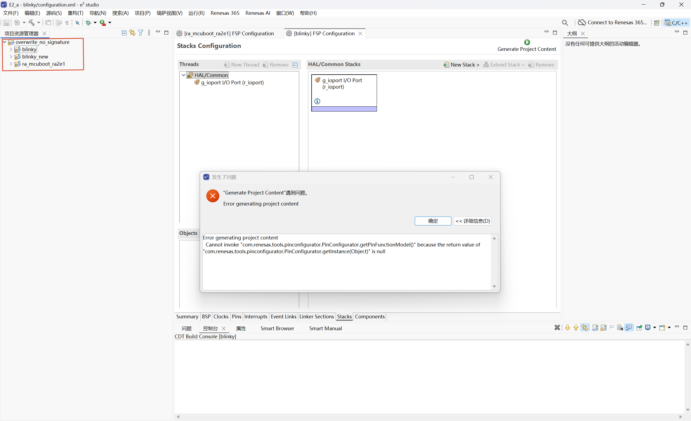

# RA2L1 HSI 引脚配置与自检记录

## 1. 重点引脚配置变更

### 1.1 P004/60：充电器反接检测

| 项目 | 配置 |
| --- | --- |
| 功能 | 充电器反接检测 |
| 信号类型 | GPIO 输入 / IRQ3 |
| 有效电平 | 高有效 |
| 原配置 | IRQ3，下降沿 |
| 修改后 | IRQ3，上升沿 |

P004 可以保留 IRQ3 功能，但由于信号为高有效，触发沿应设置为上升沿。


### 1.2 P003/61：过流状态检测

| 项目 | 配置 |
| --- | --- |
| 功能 | 过流状态检测 `OC_DET` |
| 信号类型 | GPIO 输入 |
| 有效电平 | 高有效 |
| 原配置 | ADC0 AN03 |
| 修改后 | 删除 AN03，改为 GPIO 输入 |
| 外部阈值 | 400 A（160 mV，由外部硬件产生） |

软件检测到 P003 为高后，将 P113 拉高并锁存，用于切断放电 MOS。当前代码采用故障锁存策略：即使 P003 随后恢复为低，P113 仍保持使能，直到复位或执行明确的故障清除流程。

### 1.3 P014/53：放电 MOS 温感

| 项目 | 配置 |
| --- | --- |
| 功能 | 放电 MOS 温感 `D_NTC` |
| 原配置 | DAC0 输出 |
| 修改后 | ADC0 AN009 |


当前代码可以采集 AN009 并计算 NTC 电阻：

```text
R_D_NTC = V_D_NTC × 10 kΩ / (VCC_3V3 - V_D_NTC)
```

如需进一步换算为温度（℃），还需要客户提供 NTC 型号、`R25/B 值`或温阻表。

### 1.4 P100/48：比较器输入

| 项目 | 配置 |
| --- | --- |
| 功能 | 比较器输入 |
| 原配置 | IIC1 SCL |
| 修改后 | ACMPLP0 `CMPIN0` |


已添加比较器模块，但仅根据引脚表无法确定参考源、参考电压和比较阈值。当前 `Input Voltage` 和 `Reference Voltage` 未完成有效配置，因此测试会显示 `ACMPLP0 is not ready`。

### 1.5 P101/47：充放电 MOS 驱动电源开关

| 项目 | 配置 |
| --- | --- |
| 功能 | MOS 驱动电源使能 |
| 信号类型 | GPIO 输出，高有效 |
| 原配置 | IIC1 SDA |
| 修改后 | GPIO 输出，初始低 |


系统启动时 P101 保持低电平。通过串口输入以下命令后，P101 才会拉高：

```text
MOS PWR ON
```

关闭命令：

```text
MOS PWR OFF
```

### 1.6 P502/51：外部温感

| 项目 | 配置 |
| --- | --- |
| 功能 | 外部温感 `TD_A` |
| 原配置 | GPIO 输出，初始低 |
| 修改后 | ADC0 AN018 |


---

## 2. 中断与数字输入配置

| 引脚 | 用途 | 最终配置 | 有效电平/说明 |
| --- | --- | --- | --- |
| P001/63 | CAN 唤醒 MCU | IRQ7，上升沿 | 高有效 |
| P000/64 | 4G 唤醒 MCU | IRQ6，上升沿 | 高有效 |
| P411/12 | 充电电压唤醒 | IRQ4，上升沿 | 高有效 |
| P208/20 | ACC 状态检测 | GPIO 输入 | 高有效 |
| P207/21 | 充电 12 V 状态检测 | GPIO 输入 | 高有效 |
| P303/29 | 电池包选中开关检测 | GPIO 输入 | 高有效 |
| P302/30 | 电池包地址线检测 | GPIO 输入 / IRQ5 | 高有效；需要唤醒时使用 IRQ5 |
| P215/6 | 负载状态检测 | GPIO 输入 | 低有效 |
| P204/24 | AFE 报警输入 | GPIO 输入 | 低有效；该脚不能直接配置外部 IRQ |
| P214/7 | 通用输入 | GPIO 输入 | 输入专用端口；有效极性未定义 |

GPIO 与 IRQ 的关系
> IRQ 引脚本质上仍然可以读取高低电平，但还具备边沿触发中断能力。需要 MCU 在休眠状态下被外部信号唤醒时，应使用 IRQ；仅需要周期读取状态时，配置为普通 GPIO 输入即可。

由于引脚表没有给出内部上拉要求，当前没有启用内部上拉。是否需要上拉或下拉应以外部电路为准。

---

## 3. GPIO 输出及安全初始状态

未明确给出初始状态的普通输出，暂按“初始低”处理；安全相关信号按照有效电平设置为非使能状态。

| 引脚      | 用途                  | 有效电平 | 初始状态               |
| ------- | ------------------- | ---- | ------------------ |
| P103/45 | 4G DTR / GPIO 输出    | 未明确  | 低                  |
| P403/4  | 4G PWRKEY / GPIO 输出 | 未明确  | 低                  |
| P112/37 | Flash nWP / GPIO 输出 | 未明确  | 低（建议结合 Flash 手册确认） |
| P400/1  | 4G 模块工作电源使能         | 高有效  | 低                  |
| P304/28 | 系统工作电源使能            | 高有效  | 低                  |
| P101/47 | MOS 驱动电源使能          | 高有效  | 低                  |
| P501/50 | MCU 工作状态指示          | 高有效  | 低                  |
| P410/13 | MCU 唤醒 AFE          | 高有效  | 低                  |
| P104/44 | 保险丝点爆低端             | 低有效  | **高**              |
| P500/49 | 保险丝点爆高端             | 高有效  | 低                  |
| P105/43 | 过流检测功能开关            | 高有效  | 低                  |
| P113/38 | 放电 MOS 切断开关         | 高有效  | 低                  |
| P107/41 | 负载检测功能开关            | 高有效  | 低                  |
| P106/42 | 充电电压检测开关            | 高有效  | 低                  |
| P409/14 | AFE 硬件复位            | 低有效  | **高**              |
| P002/62 | 预留 GPIO 输出          | 未明确  | 低；最终用途和安全电平待确认     |

### P409 控制时序

P409 为低有效控制信号，空闲时必须保持高电平：

- 拉低约 12 ms：执行 AFE 复位（满足“超过 8 ms”要求）。
- 拉低约 40 ms：执行 AFE 关断（满足“超过 32 ms”要求）。

串口命令：

```text
AFE RESET
AFE SHUTDOWN
```

---

## 4. 通信与模拟外设配置

### 4.1 SPI1 / Flash 接口

| 引脚 | SPI 功能 | 配置 |
| --- | --- | --- |
| P109/34 | MOSI | SPI1 MOSI |
| P110/35 | MISO | SPI1 MISO |
| P111/36 | CLK | SPI1 RSPCK |
| P301/31 | CS | SPI1 `SSLB2_B` |

当前程序执行的是物理回环测试：发送固定字节后，要求 MISO 返回完全相同的数据。它不是自适应回环，也不会自动识别 Flash。

根据 CPK-RA2L1 评估板原理图，回环测试时可在断电状态下短接：

```text
J2-2（P109/MOSI） ↔ J2-3（P110/MISO）
```

也可以短接：

```text
J14-1（P109/MOSI） ↔ J15-3（P110/MISO）
```

使用真实 SPI Flash 时不得短接 MOSI 与 MISO，应根据 Flash 型号连接四根信号，并将测试改为读取 JEDEC ID（通常使用命令 `0x9F`）。

### 4.2 ADC0

| 引脚 | 信号 | ADC 通道 |
| --- | --- | --- |
| P012/55 | 充电电压采样 | AN007 |
| P013/54 | 充电 MOS 温感 | AN008 |
| P014/53 | 放电 MOS 温感 | AN009 |
| P015/52 | 3.3 V 模拟电压采样 | AN010 |
| P502/51 | 外部温感 | AN018 |

当前 FSP 配置使用 `AVCC0/AVSS0` 作为 ADC 参考。代码按 3300 mV 参考电压换算，硬件上 AVCC0、P015 和模拟分压关系仍需实测确认。

### 4.3 比较器

| 引脚 | 功能 |
| --- | --- |
| P100/48 | ACMPLP0 CMPIN0 |
| P102/46 | ACMPLP1 CMPIN1 |

比较器参考源、参考电压和输出判定阈值未在引脚表中说明，需要客户或原理图补充后才能完成配置和功能测试。

### 4.4 IIC0 / AFE

| 引脚 | 功能 |
| --- | --- |
| P408/15 | IIC0 SCL |
| P407/16 | IIC0 SDA |

当前测试只确认 IIC0 主机驱动能够初始化。若要验证实际通信，还需要 AFE 型号、I²C 地址、寄存器地址及预期返回值。

### 4.5 SCI0 / UART

| 引脚 | 功能 |
| --- | --- |
| P205/23 | TXD0 |
| P206/22 | RXD0 |

FSP 中应配置为 `No Flow Control`，因为引脚表只分配了 TX/RX，没有分配 RTS/CTS。

---

## 5. 串口工具设置与测试命令

### 5.1 串口参数

```text
波特率：115200
数据位：8
停止位：1
校验：无
流控：无
发送模式：文本（不要勾选“16进制”）
发送后缀：CRLF（\r\n，即 0D 0A）
```


### 5.2 UART 测试


输入：

```text
UART TEST
```

出现以下信息表示 MCU 已成功接收命令并返回结果：

```text
[UART TEST]
UART command received and response transmitted.
UART TEST PASS
```

### 5.3 常用命令

| 命令 | 作用 |
| --- | --- |
| `UART TEST` | 测试串口双向通信 |
| `CHG REV TEST` | 读取 P004 充电器反接状态 |
| `INPUT TEST` | 读取全部数字输入状态 |
| `OC TEST` | 读取 P003 过流状态和 P113 锁存状态 |
| `MOS TEMP TEST` | 读取 P014/AN009 并计算 NTC 电阻 |
| `MOS PWR ON` | P101 拉高，开启 MOS 驱动电源 |
| `MOS PWR OFF` | P101 拉低，关闭 MOS 驱动电源 |
| `AFE RESET` | P409 拉低约 12 ms |
| `AFE SHUTDOWN` | P409 拉低约 40 ms |
| `CMP TEST` | 读取比较器状态 |
| `SPI TEST` | 执行 SPI 物理回环测试 |
| `I2C TEST` | 检查 IIC0 初始化状态 |
| `ALL TEST` | 顺序执行当前菜单内的全部测试 |
| `BACK` | 返回主菜单 |


---

## 6. ALL TEST 结果分析

| 项目 | 当前结果 | 结论 |
| --- | --- | --- |
| UART | PASS | TX/RX 双向通信正常 |
| CHG REV | PASS（读取成功） | P004 当前为高，表示反接检测有效；若未模拟反接，需要检查外部电路 |
| INPUTS | PASS（读取成功） | 需根据当前台架状态判断各输入电平是否合理 |
| OC INPUT | PASS | P003 低、P113 低，当前无过流；尚未验证实际高电平触发和锁存 |
| MOS TEMP | PASS（采样成功） | VCC_3V3 计算值仅 1592 mV，明显偏低，需要实测 P015 和 AVCC0 |
| CMP | FAIL | 比较器输入/参考源配置未完成 |
| SPI | FAIL | 未连接物理回环线；接真实 Flash 时应改为 JEDEC ID 测试 |
| I2C | PASS（初始化） | 未执行实际 AFE 总线事务 |


### 问题：
程序卡在 RTC 初始化，等待 `RCR2.RESET` 位自动清零，但RTC没有得到有效的32.768 kHz时钟，所以一直停在这个 `while` 循环


### 解决办法：

- 双击打开 `configuration.xml`。
- 进入 `BSP` 页面。
- 找到 `Subclock Populated`。
- 从 `Enabled` 改成 **Disabled**。
- 点击 `Generate Project`。
- 重新编译、下载。


### 问题：客户用的是E2
### 解决办法：
将这三个复位设置选择为否


按照之前的引脚表，ADC应使用 **ADC0，开启5个通道，软件触发、单次扫描**。当前时间片代码每100ms启动一次采样。

|引脚|物理脚号|ADC通道|用途|
|---|---|---|---|
|P012|55|AN007|充电电压采集|
|P013|54|AN008|充电MOS温感|
|P014|53|AN009|放电MOS温感|
|P015|52|AN010|3.3V模拟电源采集|
|P502|51|AN018|外部温感|

**1. 配置引脚**

打开 `configuration.xml → Pins → Peripherals → ADC → ADC0`：

- 将ADC0设置为 `Enabled`。
- 将上述5个通道分别分配到对应引脚。
- 各引脚应显示 `Analog mode`。
- P014原来的 `DAC0/DA0` 功能需要取消。

P003/61脚用于过流状态检测，保持 **GPIO Input**，不要配置为AN003。

**2. 配置ADC驱动**

进入 `Stacks`，选择已有的 `g_adc0 ADC (r_adc)`。如果没有，添加 `New Stack → Analog → ADC (r_adc)`，不要重复添加。

按以下内容设置，具体名称可能随FSP版本略有不同：

|配置项|设置|
|---|---|
|Name|`g_adc0`，与现有代码一致|
|Unit|`0`|
|Resolution|`12-bit`|
|Data Alignment|`Right`，右对齐|
|Scan Mode|`Single Scan`，单次扫描|
|Trigger Source|`Software`，软件触发|
|Channel Scan Mask|仅勾选 `7、8、9、10、18`|
|Scan End Interrupt Priority|`Disabled`|
|Callback|`NULL`|
|Averaging / Addition|暂不启用|
|Temperature Sensor / Internal Reference采样|暂不启用|

现有代码通过 `R_ADC_ScanStatusGet()` 轮询扫描是否结束，因此不需要ADC扫描完成中断。

**3. 参考电压先保持原设置**

当前使用：

```
AVCC0 / AVSS0
```

引脚表虽然列出了 `VREFH0/VREFL0`，但不能仅凭这个就切换参考源。需要客户确认原理图接法和实际参考电压。

代码目前按 **3300mV参考电压**换算；如果实际参考不是3.3V，电压和NTC电阻计算都会有偏差。

**4. 生成并验证**

保存后点击 `Generate Project Content`。重新构建、下载时，务必使用当前工作区的ELF，避免再次加载微信目录旧程序。

调试时观察：

```
g_hsi_adc_raw[0]    // P012，充电电压
g_hsi_adc_raw[1]    // P013，充电MOS温感
g_hsi_adc_raw[2]    // P014，放电MOS温感
g_hsi_adc_raw[3]    // P015，3.3V电源采集
g_hsi_adc_raw[4]    // P502，外部温感
g_hsi_adc_values_valid
```

12位ADC原始值范围为 `0～4095`。注意：P106是充电电压检测使能，当前默认低；如果硬件采样电路需要它拉高才能工作，仅配置ADC并不能保证读到有效充电电压。


AFE模块导致发烫？
先禁用
14 15 16 24


## 客户提出工程步骤问题，已经编译出错



`BootloaderDataFile` 是否指向当前 Bootloader 工程生成的 `.bld` 文件？？


## 编译Blinky遇到的问题


## 确定生成


## 


## 


## 入口


## 


## 选中关联


修改方式是在 `<raSmartBundles>` 中，**把 Bootloader 的 `.sbd` 引用加到原有 `blinky` 条目前面**：

```
<raSmartBundles>
  <bundle>${workspace_loc:/ra_mcuboot_ra2e1}/Debug/ra_mcuboot_ra2e1.sbd</bundle>
  <bundle>${workspace_loc:/blinky}/Debug/blinky.sbd</bundle>
</raSmartBundles>
```


## 


## 添加Flash


## 设置**New Partition** 窗口

### 其他两个
|Name|Start|Size|Core|Security|
|---|---|---|---|---|
|`__BL_0_S_H`|`0xC000`|`0x100`|`CM23`|`Undefined`|
|`__BL_0_S_I`|`0xC100`|`0x7F00`|`CM23`|`Undefined`|
这三个分别是：**主镜像头、次镜像头、次应用区**。


## 修改FLASH_CM23


## 点击属性

## 

## 补齐 Bootloader 分区
- 左侧右键 [solution.xml](D:/RenesasWorkspaces/RA2E1/mcuboot_solution/solution.xml) → **打开方式（Open With）→ 文本编辑器（Text Editor）**。
- 搜索 `<raPartitions>`，紧接着它加入以下内容：

```
    <memory Pname="CM23" name="RAM_CM23_B" offset="0x0" parent="RAM" security="" size="0x2000"/>
    <memory Pname="CM23" name="FLASH_CM23_B" offset="0x0" parent="FLASH" security="" size="0x4000"/>
    <memory Pname="CM23" name="DATA_FLASH_CM23_B" offset="0x0" parent="DATA_FLASH" security="" size="0x0"/>
    <memory Pname="CM23" name="OPTION_SETTING_OFS0_CM23_B" offset="0x0" parent="OPTION_SETTING_OFS0" security="" size="0x4"/>
    <memory Pname="CM23" name="OPTION_SETTING_OFS1_CM23_B" offset="0x0" parent="OPTION_SETTING_OFS1" security="" size="0x4"/>
    <memory Pname="CM23" name="OPTION_SETTING_SECMPU_CM23_B" offset="0x0" parent="OPTION_SETTING_SECMPU" security="" size="0x0"/>
    <memory Pname="CM23" name="OPTION_SETTING_OSIS_CM23_B" offset="0x0" parent="OPTION_SETTING_OSIS" security="" size="0x0"/>
```

4. 找到原来的 **`name="RAM_CM23"`** 那一行，将整行改成：

```
    <memory Pname="CM23" name="RAM_CM23" offset="0x2000" parent="RAM" security="" size="0x2000"/>
```

## 

## 

## `1.0.0`，还需要改为 `2.0.0`


## 
