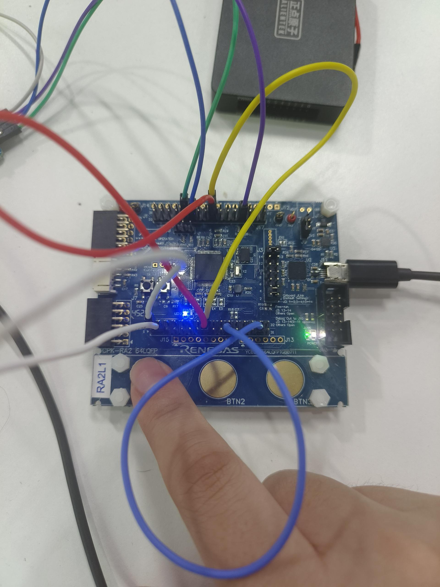
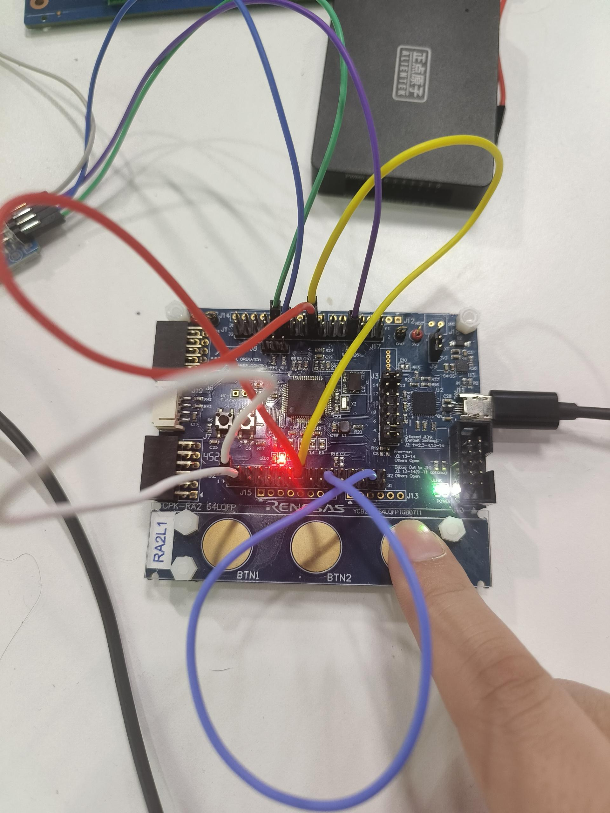
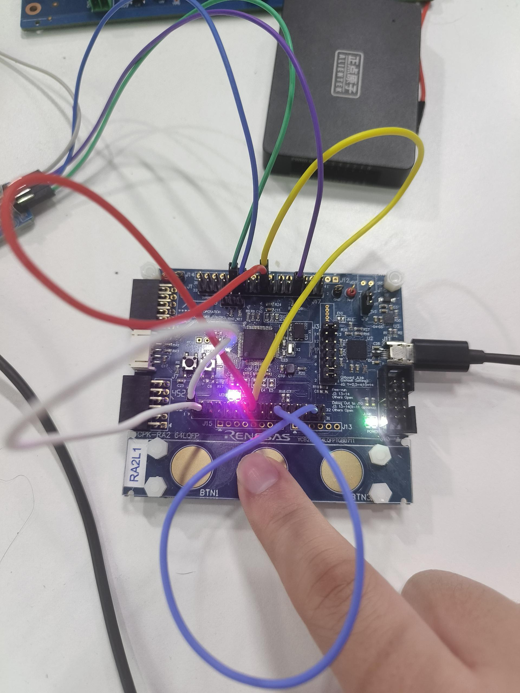

# RA2L1 案例工程验证

## 1. Blinky 示例工程验证

### 1.1 清理并构建工程


导入示例工程后，先执行“清理项目”，再重新构建项目。

### 1.2 构建错误：缺少 FSP 3.5.0 软件包


原始 Blinky 示例工程基于 FSP 3.5.0 创建。当前 e² studio 中没有安装对应的软件包，因此无法提取 CMSIS/FSP 组件并直接构建该工程。

### 1.3 处理方案：使用当前 FSP 重新创建工程

不继续使用依赖 FSP 3.5.0 的旧工程，改为在当前已安装的 FSP 环境中重新创建 RA2L1 工程，并按照示例功能配置触摸模块和 LED。

## 2. 三个电容触摸按键控制 LED

### 2.1 验证目标

使用 RA2L1 的 CTSU 电容触摸功能检测三个触摸按键，并实现以下 LED 控制效果：

| 触摸操作 | `button_status` | LED现象 |
|---|---:|---|
| 未触摸 | 0 | LED1、LED2熄灭 |
| 按住 Button00 | 1 | LED1点亮 |
| 按住 Button01 | 2 | LED2点亮 |
| 按住 Button02 | 4 | LED1、LED2同时点亮 |

### 2.2 创建 RA2L1 CTSU 测试工程


创建与实际MCU型号匹配的 RA2L1 工程，使用当前已经安装的 FSP，并选择无RTOS的裸机工程模板。

## 3. FSP 硬件配置

### 3.1 配置 CTSU 触摸引脚


本工程使用三个自电容触摸通道：

| QE按键 | CTSU通道 | MCU引脚 |
|---|---|---|
| Button00 | TS32 | P012 |
| Button01 | TS33 | P013 |
| Button02 | TS28 | P015 |

这三个通道与实际触摸板上的三个电极连接关系一致，因此在QE中分别分配给三个Button。

### 3.2 配置 LED GPIO引脚


将两个板载LED引脚配置成GPIO输出模式，初始输出低电平：

| LED | MCU引脚 | 初始配置 |
|---|---|---|
| LED1 | P502 | Output, Initial Low |
| LED2 | P501 | Output, Initial Low |

### 3.3 添加 Touch 中间件


在 `Stacks` 页面选择：

`New Stack → CapTouch → Touch (rm_touch)`

添加后，FSP会同时添加 `Touch (rm_touch)` 中间件和底层 `CTSU (r_ctsu)` 驱动。

### 3.4 添加 CTSU 收发 DTC 驱动


启用 `Support for using DTC`，然后分别添加：

- DTC Driver for Transmission
- DTC Driver for Reception

DTC负责在CTSU寄存器和内存之间传输测量数据，减少CPU参与数据搬运的开销。

### 3.5 配置 CTSU 驱动属性


主要配置如下：

- 扫描启动方式：Software
- DTC支持：Enabled
- 自动判断模式：Disabled
- 中断优先级：Priority 2
- TSCAP及三个TS通道分配正确

## 4. 安装并打开 QE for Capacitive Touch

### 4.1 安装 QE for Capacitive Touch 扩展


在Renesas Software Installer中选择 `QE for Capacitive Touch`，完成安装并重启 e² studio。

### 4.2 信任瑞萨更新站点

勾选瑞萨官方更新站点，然后继续安装。


### 4.3 在 QE 中选择目标工程


在 `CapTouch Workflow (QE)` 的 `Select a Project` 中选择 `RA2L1_CTSU_Test`。

### 4.4 创建触摸接口配置


选择自电容检测方式并创建新的Touch I/F配置。

### 4.5 添加三个触摸按钮


在Touch I/F画布中添加三个Button。

### 4.6 分配触摸通道并配置串联电阻


通道分配如下：

- Button00 → TS32
- Button01 → TS33
- Button02 → TS28
- 各通道串联电阻值：560 Ω

配置正确后，三个Button由红色变为绿色。

### 4.7 生成触摸接口配置


点击 `Create` 保存Touch I/F配置，然后生成工程内容并构建工程，为自动调谐做好准备。

## 5. QE 自动调谐

### 5.1 连接开发板并启动调谐

保持J-Link与开发板连接，在 `Start Tuning (Emulator)` 中点击 `Start Tuning`。

### 5.2 问题：自动调谐窗口没有出现

CPU停在地址 `0x0000008C` 的启动代码，尚未运行到QE设置的调谐断点 `0x00000514`，因此不会进入触摸测量窗口。


检查调试配置、主函数断点、时钟和看门狗设置后，重新启动调谐。


### 5.3 测量触摸灵敏度

操作顺序必须是：

**按住触摸按钮 → 保持触摸并按电脑空格键 → 松开手指**


QE依次测量三个按钮，全部测量完成且没有Overflow或Warning/Error后，继续完成调谐。


### 5.4 输出调谐参数文件


点击 `Output Parameter Files`，生成以下文件：

- `qe_gen/qe_touch_define.h`
- `qe_gen/qe_touch_config.h`
- `qe_gen/qe_touch_config.c`

这些文件保存CTSU测量参数、触摸阈值和Touch中间件配置。

### 5.5 输出触摸示例代码


进入 `Coding → Implement Program`，点击 `Show Sample → Output to a File`，生成：

`qe_gen/qe_touch_sample.c`

## 6. 触摸程序接入与状态验证

### 6.1 在 `hal_entry()` 中启动触摸程序

在 `src/hal_entry.c` 顶部声明QE示例函数：

```c
void qe_touch_main(void);
```

在 `hal_entry()` 中调用：

```c
void hal_entry(void)
{
    qe_touch_main();
}
```

`qe_touch_main()` 会打开Touch中间件，并在循环中持续启动扫描、等待扫描完成和读取按键状态。

### 6.2 添加 `button_status` 观察表达式

在调试器的Expressions窗口中添加：

```c
button_status
```


### 6.3 问题：触摸后数值没有变化


原因包括：

- CPU处于 `Suspended` 状态，触摸扫描没有继续执行。
- `button_status` 没有启用实时刷新。
- 松开按钮后才查看数值，此时状态已恢复为0。

### 6.4 启用实时刷新并验证按键状态

右键 `button_status`，选择 `Enable Real-time Refresh`，将刷新间隔设置为100 ms或200 ms，然后让CPU保持 `Running`。


| 操作 | `button_status`数值 |
|---|---:|
| 未触摸 | 0 |
| 按住 Button00 | 1 |
| 按住 Button01 | 2 |
| 按住 Button02 | 4 |

`button_status` 是位掩码：bit0、bit1和bit2分别表示Button00、Button01和Button02。

## 7. QE 图形化监控验证

### 7.1 启用 CapTouch 监控

保持程序运行，在 `Monitoring → Start Monitoring (Emulator)` 中打开监控视图，然后点击 `Enable Monitoring`。

### 7.2 触摸状态与曲线现象


三个按钮在 `CapTouch Board Monitor` 中均能正确响应；在 `CapTouch Status Chart` 中，触摸计数越过阈值时判定为按下。

## 8. 触摸按键控制 LED

### 8.1 LED 控制逻辑

触摸状态读取成功后，根据 `button_status` 的位状态控制两个板载LED：

```c
err = RM_TOUCH_DataGet(g_qe_touch_instance_config01.p_ctrl, &button_status, NULL, NULL);
if (FSP_SUCCESS == err)
{
    bsp_io_level_t led1_level =
        (0U != (button_status & ((1ULL << 0) | (1ULL << 2)))) ?
        BSP_IO_LEVEL_HIGH : BSP_IO_LEVEL_LOW;

    bsp_io_level_t led2_level =
        (0U != (button_status & ((1ULL << 1) | (1ULL << 2)))) ?
        BSP_IO_LEVEL_HIGH : BSP_IO_LEVEL_LOW;

    R_IOPORT_PinWrite(&g_ioport_ctrl,
                      BSP_IO_PORT_05_PIN_02,
                      led1_level);

    R_IOPORT_PinWrite(&g_ioport_ctrl,
                      BSP_IO_PORT_05_PIN_01,
                      led2_level);
}
```

### 8.2 代码说明

- `RM_TOUCH_DataGet()`：读取本轮触摸扫描的识别结果，并写入 `button_status`。
- `button_status & (1ULL << 0)`：判断Button00是否按下。
- `button_status & (1ULL << 1)`：判断Button01是否按下。
- `button_status & (1ULL << 2)`：判断Button02是否按下。
- LED1连接P502，由 `BSP_IO_PORT_05_PIN_02` 控制。
- LED2连接P501，由 `BSP_IO_PORT_05_PIN_01` 控制。
- Button02参与两个LED的判断条件，因此按住Button02时两个LED同时点亮。
- 所有按钮松开后，两个判断条件均为假，输出低电平，LED熄灭。

这段代码位于 `qe_gen/qe_touch_sample.c` 的 `RM_TOUCH_DataGet()` 成功分支中，每次触摸扫描完成后都会更新LED状态。

> [!NOTE]
> `qe_touch_sample.c` 是QE生成的示例文件。再次执行 `Show Sample → Output to a File` 时，自定义LED代码可能被覆盖，正式项目中建议将应用逻辑移到用户维护的源文件中。

### 8.3 LED 实际现象







三个触摸按键能够按照设计逻辑控制两个LED，说明CTSU触摸检测、QE调谐参数、Touch中间件和GPIO输出功能均正常。
