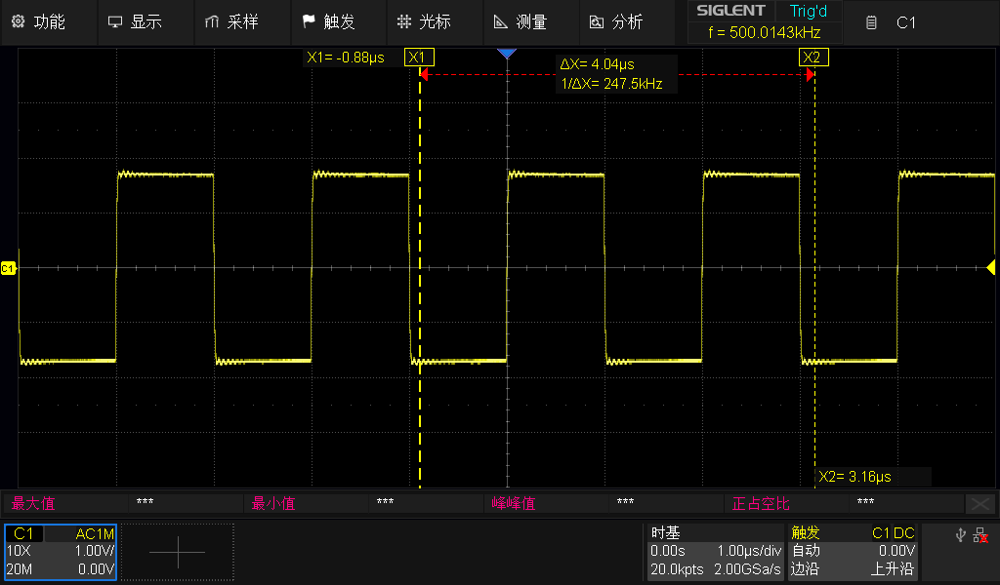

# D43L（RA6M3）+ E521.44 + E524.17 项目流程与问题整理

## 1. 时间片轮询
原来的 SPI 测试大致是：

```c
for (uint32_t timeout = 0U; timeout < 1000U; timeout++)
{
    if (g_spi_transfer_done)
    {
        break;
    }

    R_BSP_SoftwareDelay(1U, BSP_DELAY_UNITS_MILLISECONDS);
}
```

CPU 会一直留在这个 `for` 循环中，直到 SPI 完成或等满 1000 ms。在此期间，主循环不能去运行其他任务。GPIO 原来甚至可能这样等待 10 秒。

因此，为了提升效率可以使用时间片轮询的写法。


```c
while (1)
{
    if (BOOT_STATE_READY != g_boot_state)
    {
        poll_hardware_start();
    }
    else if (!g_self_test_complete)
    {
        poll_active_test();
    }
    else
    {
        __NOP();
    }

    R_BSP_SoftwareDelay(TIME_SLICE_MS, BSP_DELAY_UNITS_MILLISECONDS);
}
```
通过软件延时1ms，作为时间基准，来完成任务。
不同的任务可以分配不同的时间。

### 1.1细节事项
#### 1.1.1 任务的周期并不是从上电开始算的，而是从“系统就绪”开始算，所以可以使用一个局部变量来存储运行到当前位置的时间快照。
#### 1.1.2 可以用系统的滴答时钟或则其他定时器作为时钟源，再通过一个循环遍历任务函数，把任务函数写进一个结构体中，循环中判断有没有满足函数执行的时间条件。
#### 1.1.3 判断用减法的原因：因为uint32约49.7天就会溢出，如果用加法的方式写判断语句就会出错，而减法则会返回正常值，哪怕当前运行时间溢出了。
#### 1.14 如果一个时间片任务的运行周期是1ms，而运行程序周期是2ms，该怎么办？
*首先可以增加时间周期，保存余量，其次就是可以把任务拆成多个小步骤*


## 2. D43L项目硬件与开发环境

### 2.1 MCU与调试信息

| 项目 | 内容 |
| --- | --- |
| MCU完整型号 | R7FA6M3AH3CFP |
| MCU系列 | RA6M3 |
| 内核 | Arm Cortex-M4 |
| 调试接口 | SWD |
| J-Link设备名 | R7FA6M3AH |
| e² studio工作区 | `D:\RenesasWorkspaces\RA6M3` |

### 2.2 新建工程与连接调试器


成功连接调试器：


### 2.4 DSI协议学习

DSI3（Distributed Systems Interface，第3代分布式系统接口）主要用于汽车传感器与主控制器之间的通信，具有布线少、实时性强、适合多节点连接等特点。

- **主从通信**：主机下发命令，从机返回状态或测量数据；下行通常采用电压调制，上行采用电流响应。
- **三种常用模式**：CRM用于配置和命令应答，PDCM按TDMA时隙周期上传测量数据，DM用于设备发现和地址分配。
- **多节点与可靠性**：同一通道可连接多个从设备，帧中带有地址和CRC，便于区分节点并检查通信错误。
- **本项目中的关系**：D43L（RA6M3）通过SPI控制E521.44，E521.44作为DSI3主机，再通过DSI0/DSI1与E524.17通信；RA6M3不直接产生DSI3波形。

## 3. 硬件连接

### 3.1 D43L与E521.44连接
x
| D43L引脚 | 板上位置 | E521.44接口 | 作用 |
| --- | --- | --- | --- |
| P411 | H4.4 | MOSI | SPI主机输出 |
| P410 | U4拆除后的2脚或3脚焊盘 | MISO | SPI主机输入 |
| P412 | H4.3 | SCK | SPI时钟 |
| P413 | H4.6 | CSB | SPI片选，低有效 |
| P504 | H5.5 | CLKREF | 500 kHz参考时钟 |
| P708 | 板上引出位置 | RESB | E521.44复位，低有效 |
| P508 | 板上引出位置 | RFC | E521.44就绪状态 |
| P307 | H5.4 | INTB | 中断状态，低有效 |
| P200 | 板上引出位置 | DAB | PDCM数据可用，低有效 |
| 3.3 V | 3V3测试点或SWD VREF网络 | MCU_VCC | E521.44数字电源 |
| GND | 任意可靠GND | GND | 共地 |


硬件连接现场记录：


### 3.2 E521.44与E524.17连接

- E524.17接口定义：1为电源、2为DSI3、3为GND。
- E521.44板上丝印对应关系：CN1对应DSI1，CN2对应DSI0。
- 当前软件流程使用DSI0时，传感器应接CN2；如果接CN1，软件中的通道必须同步改为DSI1。

丝印与通道确认记录：


### 3.3 串口与按钮

| 功能 | RA6M3引脚 | 配置 |
| --- | --- | --- |
| 用户按钮 | P001 | GPIO输入，按下为低电平 |
| SCI9 TXD | P109 | 连接USB转串口模块RXD |
| SCI9 RXD | P110 | 连接USB转串口模块TXD |
| 串口地 | GND | 与USB转串口模块共地 |

串口参数：115200 bit/s、8位数据、无校验、1位停止位。

## 4. e² studio与FSP配置

### 4.1 引脚总体配置


### 4.2 GPT13产生CLKREF

E521.44需要外部参考时钟。使用RA6M3的GPT13，在P504输出500 kHz、50%占空比的方波。


GPT配置记录：


示波器测得的P504输出波形：



### 4.3 SPI0配置

SPI0用于D43L与E521.44通信。连接引脚为P410～P413，片选由GPIO控制。


### 4.4 INTB、DAB及其他GPIO

P307配置为E521.44的INTB输入：


`DAB`是Data Available Bar，低电平表示E521.44的接收缓冲区存在尚未读取的PDCM数据。

DSI相关配置记录：


### 4.5 UART与按钮配置

- 添加`UART (r_sci_uart)` Stack。
- 实例名：`g_uart0`。
- 通道：SCI9。
- TXD9：P109；RXD9：P110。
- 回调函数：`uart_callback`。
- P001配置为GPIO输入，IRQ设为None。
- P109/P110与JTAG复用冲突时，将Debug接口从JTAG改为SWD。

## 5. 芯片启动与基础通信验证

### 5.1 E521.44必要启动流程

1. 启动500 kHz CLKREF。
2. 将RESB拉低并保持5 ms。
3. 在复位期间确认RFC为低。
4. 释放RESB。
5. 等待RFC变高，表示E521.44启动完成。


RFC验证记录：


### 5.2 SPI帧与CRC

E521.44 SPI通信以16位字为单位。完整命令必须以CRC命令字和主机SPI CRC结束。不能只发送寄存器命令而省略CRC收尾，否则E521.44内部CRC状态会与下一条命令不同步。

### 5.3 读取E521.44芯片ID

验证结果：

```text
CHIP_ID_LOW       = 59028   = 0xE694
CHIP_ID_HIGH      = 31      = 0x001F
CHIP_ID           = 2090644 = 0x001FE694
LastEchoWord      = 8194    = 0x2002
```

`0x2002`是读取地址`0x0002`的命令回显，说明E521.44正确接收了SPI读寄存器命令。


### 5.4 配置DSI3 Chip Time

当前使用3 μs Chip Time：

```c
E52144A_WriteRegister(DSI_CFG, 0x0031U);
```

## 6. E524.17地址扫描与CRM通信

### 6.1 CRM命令格式

E521.44通过DSI3发送32位CRM命令，而不是直接发送E521.44寄存器地址。

```text
┌──────────┬──────────┬──────────────┬──────────┐
│ PhysAddr │ CMD      │ Data         │ CRC      │
│ 4 bit    │ 4 bit    │ 16 bit       │ 8 bit    │
└──────────┴──────────┴──────────────┴──────────┘
```

常用CMD：

- `0x1`：启动标准测量。
- `0x2`：启动高级测量。
- `0x8`：配置数据访问。

### 6.2 扫描物理地址

不能假定E524.17物理地址固定为1。软件依次扫描地址1～6，并采用第一个返回有效CRM响应的物理地址。

地址读取测试曾使用RAM地址`0x00`、`0x02`、`0x04`和`0xCE`；访问时应使用有效的偶数地址。


### 6.3 CRM返回数据解析示例


```text
RxData[1] = 0x3400
```

这是Read CRM、DSI0命令回显，与发送的`TxData[0] = 0x3400`一致，说明SPI命令正确。

```text
RxData[2] = 0x0008
```

- 错误位均为0。
- 返回符号数为8。
- E521.44已经收到完整的E524.17 CRM响应。

失败时曾读到`0x2000`，表示响应符号数为0；有效响应后变为`0x0008`。

```text
RxData[3] = 0x1528
RxData[4] = 0x0F6E
RxData[5] = 0xB32B
```

拆分后的DSI3数据为：

```text
0x15  0x28  0x0F  0x6E
```

- `0x15`高4位为1：物理地址为1。
- `ComErr=0`：通信命令无错误。
- `HwErr=1`：传感器报告了历史硬件状态错误。
- `Status=01`：命令已经执行。
- `0x28、0x0F`：读取的16位RAM数据`0x280F`。
- `0x6E`：E524.17 DSI响应CRC。
- `0xB32B`：E521.44 SPI返回帧的MISO CRC。


## 7. TDMA与标准测量流程

### 7.1 完整执行顺序

```text
启动500 kHz CLKREF
→ RESB拉低5 ms
→ 释放RESB并等待RFC变高
→ 打开SPI0
→ 验证E521.44 SPI通信
→ 初始化中断状态和DSI_CFG
→ 扫描E524.17物理地址
→ 上传单传感器TDMA
→ 验证TDMA
→ 发送STA标准测量命令
→ 启动有限数量PDCM周期
→ 等待DAB变低
→ 读取PDCM缓冲区
→ 解析F6/F7回波帧
→ 选择有效TLH并计算距离
```

E524.17当前按16个TDMA符号和F6/F7格式解析。一次测量读取25个PDCM周期。

测量现场记录：


### 7.2 距离计算公式

超声波传播时间包含去程和回程，因此：

$$
d=\frac{v\times t}{2}
$$

取声速$v=340\ \text{m/s}$，时间$t$以微秒为单位，距离以厘米表示：

$$
d_{cm}=t_{\mu s}\times0.017
$$


### 7.3 EchoType与TLH筛选

| EchoType | 名称 | 含义 |
| --- | --- | --- |
| 0 | TLH | 回波上升穿过阈值 |
| 1 | THL | 回波下降穿过阈值 |
| 2 | MIN | 阈值以上的局部最小值 |
| 3 | MAX | 阈值以上的局部最大值 |

```text
回波强度
   ^
   |             MAX
   |               /\
阈值|--------------/--\----------------
   |             ↑     ↓
   |            TLH   THL
   +----------------------------------> 时间
```

TLH最接近回波首次到达时刻。当前程序遍历所有F6/F7帧，选择时间戳最小的有效TLH作为一次测量的最终结果。

## 8. 按键触发与串口输出流程

1. 上电后只执行一次E521.44初始化、E524.17地址扫描和TDMA配置。
2. 主循环轮询P001。
3. P001由高变低并通过20 ms消抖后，触发一次测量。
4. 读取25个PDCM周期并筛选TLH。
5. SCI9输出物理地址、F6/F7帧号、PDCM序号、时间戳、回波高度和距离。
6. 松开按钮后才允许下一次触发，避免一次按键产生多次测量。

## 9. 软件代码分析
### 9.1 #define E52144_CHIP_TIME (3U)

**E524.17 传感器固件的回传（RCC）芯片时间是固定 3 µs**

### 9.2 写寄存器 `E52144A_WriteRegister`
Word0 = 0x5000 | 寄存器地址
Word1 = 写入数据
Word2 = 0x1000，CRC命令
Word3 = 前3个Word计算出的SPI CRC

### 9.3 上传TDMA `E52144A_UpTDMA`
Word0 = 0xB420   上传TDMA + 0x0400通道 + Fixed=1 + Packet=0
Word1 = 45       Slot开始时间
Word2 = 55       Slot结束时间
Word3 = 0x4010   CRC类型=1 + 16 symbols
Word4 = 0x1000   SPI CRC命令
Word5 = SPI CRC
### 9.4 标准测量命令 `E52144A_STA`
Word0 = 0x8401   Transmit CRM + 通道0x0400 + NR=1
Word1 = 0x0100   PhysAddr=0，CMD=0x01，Data1=0x00
Word2 = 0x1000   Data2=0x10，低字节为0
Word3 = 0x1000   E521.44 SPI CRC命令
Word4 = SPI CRC
### 9.5CRM发送、应答和地址扫描


## 10. 错误现象、原因与已尝试的解决办法

### 10.1 SPI偶发失败，重新断电后恢复

#### 现象


#### 原因

前面的E521.44寄存器读取帧没有使用CRC命令正确结束，导致E521.44内部CRC状态积累了上一条SPI数据。CRC状态错误不会直接改变E524.17，但会使D43L向E521.44发送CRM时校验失败。

#### 已尝试办法

- 所有SPI命令都以CRC命令字和计算出的主机CRC结束。
- 软件复位时同步复位SPI/CRC状态。
- 调试状态异常时对D43L、E521.44和传感器完整重新上电。

修改后记录：


### 10.2 E524.17地址无法识别

#### 可能原因

- 软件只尝试固定物理地址1。
- CRM发出后过早读取响应。
- E524.17接在CN1/DSI1，但软件使用DSI0，或反之。
- CRM缓冲区没有准备好。
- 传感器供电、DSI3或GND连接不正确。

#### 已尝试办法

- 扫描物理地址1～6。
- CRM发送与读取之间增加等待时间进行验证。
- 根据板上丝印确认CN1=DSI1、CN2=DSI0。
- 检查`RxData[2]`的响应符号数：`0x0008`表示收到8符号有效响应，`0x2000`表示没有响应符号。

### 10.3 INTB持续为低电平

#### 已尝试办法

初始化时清除E521.44中断状态和缓冲区中断状态：

```c
E52144A_WriteRegister(IRQ_STST,     0x1007U);
E52144A_WriteRegister(BUF_IRQ_STAT, 0x007FU);
```

然后等待INTB恢复为高电平。

### 10.4 E524.17返回HwErr=1

#### 诊断结果

```text
HwErrStatusInfo1 = 0x0001
HwErrStatusInfo2 = 0x0000
```

`StatusInfo1=1`对应Watchdog reset（Class 4），说明传感器记录过看门狗复位。


错误清单：


诊断现象：


#### 已尝试办法

- 清除E521.44的IRQ和缓冲区状态。
- 读取E524.17硬件错误状态，区分通信错误和历史硬件错误。
- PDCM帧有效性判断只拒绝`ComErr=1`；当`HwErr=1、ComErr=0`时仍允许解析回波。


处理后结果：


### 10.5 PDCM有数据但没有有效距离

#### 可能原因

- TDMA符号数仍按旧格式配置，不符合E524.17的16符号格式。
- 回波帧按错误的旧帧格式解析，未按F6/F7字段提取时间戳。
- 当前帧只有THL、MIN或MAX，没有TLH。
- 目标处于传感器近场盲区，真实回波被振铃或测量屏蔽时间覆盖。

#### 已尝试办法

- TDMA符号数改为16。
- 按F6/F7格式提取帧号、EchoType、EchoHeight和TimeStamp。
- 遍历全部25帧，选择最早的有效TLH。
- 使用较大平板从远到近测试，确认最小可靠测距范围。

### 10.6 近距离目标始终约为12 cm

12 cm对应约706 μs。若传感器的直接测量屏蔽时间约为704 μs，则更近的真实回波会落在换能器振铃或屏蔽区内，程序只能选到约12 cm附近的固定回波。

已采用的验证方法：观察最终TLH时间戳是否始终保持在约704～706 μs，并用平整目标从30 cm逐步移近，确认距离开始锁定的位置。

### 10.7 P109/P110与Debug引脚冲突

#### 现象


#### 解决办法

将Debug接口由JTAG改为SWD，释放P109和P110，供SCI9作为TXD/RXD使用。

## 11. 当前验证结论

- D43L能够产生E521.44所需的500 kHz CLKREF。
- RESB/RFC启动流程正常。
- SPI能够读取E521.44芯片ID。
- E521.44能够通过DSI0与E524.17交换CRM数据。
- 已确认传感器物理地址可通过扫描获得，测试传感器地址为1。
- PDCM能够返回F6/F7数据并提取TLH时间戳。
- 距离按声速和往返时间计算。
- 当前软件已转向P001单次触发测量，并通过SCI9输出结果。
