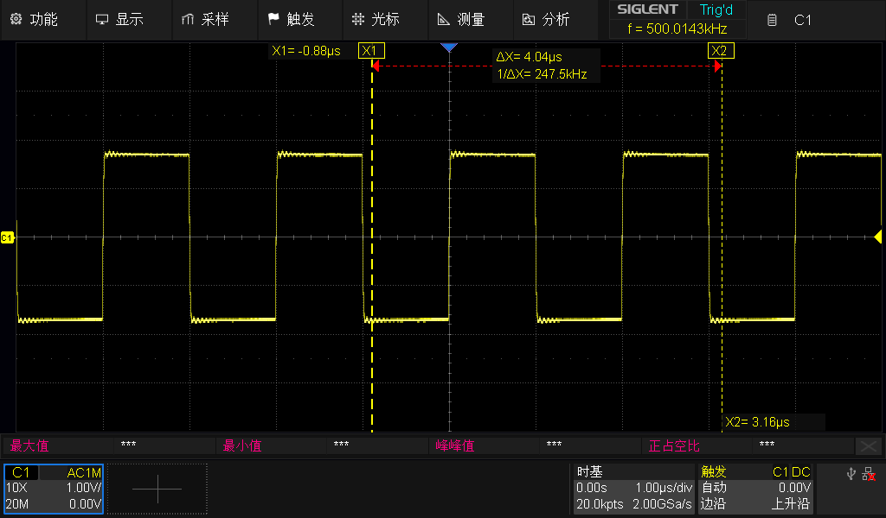

MCU完整型号：R7FA6M3AH3CFP
MCU系列：RA6M3
内核：Cortex-M4
调试接口：SWD
J-Link设备名：R7FA6M3AH
# 创建新工作区D:\RenesasWorkspaces\RA6M3


# 成功连接


# 引脚配置

# P504产生的PWM方波

## 配置RSPI0

## General PWM Timer（r_gpt）

## SPI

## 配置引脚P307作为

## DSI

## DAB

**DAB = "Data Available Bar"（数据可用，低有效）**，是 E521.44 的一个状态输出引脚（**Pin 14**），专门用来告诉 MCU："**我的接收缓冲区里有还没读走的数据**
## 可能错误的原因
E524.17 的物理地址不为 1

## 

## 当前只读取E524.17的RAM地址`0xCE`，现在换几个其他RAM地址，看传感器是否会返回数据
尝试0x00U、0x02U  注意必须使用偶数地址
0x04U

## 目前状况

可以确定物理地址是1
- bit0为1：DSI0的CRM缓冲区有一条未读数据。
- `0x0C00`：TDMA尚未定义，因为当前还处在地址扫描阶段，这部分暂时正常


```
RxData[1] = 0x3400
```

这是Read CRM、DSI0命令回显，与发送的`TxData[0]=0x3400`一致，说明SPI命令正确


```
RxData[2] = 0x0008
```

这是最关键的数据：

- 所有错误位均为0。
- 符号数为8。
- 说明E521.44确实收到了完整的E524.17 CRM响应。

之前失败时这里是`0x2000`，表示0个响应符号；现在已经变成有效响应。

```
RxData[3] = 0x1528
RxData[4] = 0x0F6E
```

拆成DSI3字节是：

```
0x15  0x28  0x0F  0x6E
```

含义：

- `0x15`高4位为`1`：E524.17物理地址是1。
- `0x15`低4位为`5`：
    - `ComErr=0`：通信命令没有错误。
    - `HwErr=1`：传感器报告了硬件状态错误。
    - `Status=01`：命令已经执行。
- `0x28、0x0F`：RAM地址`0x00`读取到的16位数据，即`0x280F`。
- `0x6E`：E524.17响应帧的DSI CRC。

```
RxData[5] = 0xB32B
```

这是整条E521.44 SPI返回帧的MISO CRC。


## 解决办法一
```
E52144A_WriteRegister(IRQ_STST,     0x1007U);
E52144A_WriteRegister(BUF_IRQ_STAT, 0x007FU);
```

## 解决办法二

### 错误清单

### 现象


```
HwErrStatusInfo1 = 0x0001
Watchdog reset，Class 4
```

## 结果


## 计算公式
超声波从换能器发出，到达目标后再反射回来，测量时间包含“去程+回程”，因此：

\[ 距离=\frac{声速\times 往返时间}{2} \]

设：

## 距离数据筛选
`EchoType=0` 表示超声波回波信号第一次“从阈值下面上升到阈值上面”的时刻，也叫TLH正向阈值穿越。

可以把回波波形想象成：

```
回波强度
   ^
   |             MAX（EchoType=3）
   |               /\
阈值|--------------/--\----------------
   |             ↑     ↓
   |            TLH   THL
   |          Type=0 Type=1
   +----------------------------------> 时间
```

各类型含义：

```
EchoType=0：TLH，上升穿过阈值
EchoType=1：THL，下降穿过阈值
EchoType=2：MIN，阈值以上的局部最小值
EchoType=3：MAX，阈值以上的局部最大值
```

TLH是回波刚刚变得足够强、第一次被传感器检测到的时刻，因此最接近“回波到达时间”，通常适合用来计算目标距离。
## 引脚冲突
把DEBUG引脚里的JTAG改为SWD

## 现象
