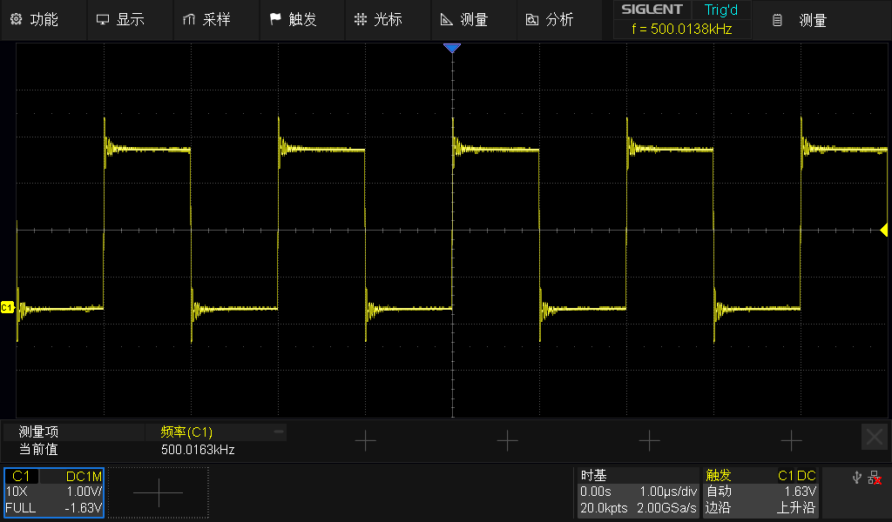

## 1. 直接上电按 RESET 后 E524.17 地址扫描失败


### 1.1 现象

板子直接上电并按下 RA6M3 的 RESET 按钮后，串口可以正常输出启动信息：

- RA6M3 已经正常启动；
- UART 可以正常工作；
- 程序已经通过 E521.44 的复位、RFC 和 INTB 检查；
- SPI 可以正常读取 E521.44 返回的数据。

但是，程序扫描 E524.17 地址时出现：

```text
[CRM] RxData[3]=0x1901
[CRM] RxData[3]=0x0000
...
[ERROR] E524.17 address not found.
```

增加 `RxData[2]` 打印和同地址重试后，又观察到：

```text
[CRM] RxData[2]=0x0008, RxData[3]=0x1D01
[WARN] E524.17 address=1 ComErr, retry 2/3.
...
[ERROR] E524.17 address=1 responded, but CRM status remained invalid.
```


### 1.2 返回数据说明

#### `RxData[2]=0x0008`

`RxData[2]` 是 E521.44 接收 CRM 数据包的状态：

- 高字节错误位为 0，表示 E521.44 没有检测到 CRC、长度等接收错误；
- 低字节为 `0x08`，表示收到了完整的 8 个 CRM 符号。

因此，`RxData[2]=0x0008` 说明 E521.44 已经完整收到 E524.17 的应答，SPI 和 DSI 通信链路基本正常。

#### `RxData[3]=0x1901`

| 数值 | 含义 |
| --- | --- |
| `0x1000` | 应答来自物理地址 1 |
| `0x0800` | `ComErr`，E524.17 保存了通信错误 |
| `0x0100` | 当前 CRM 命令有效并被执行 |
| `0x0001` | 读取到的 Slave ID 数据为 1 |

所以 `0x1901` 并不是没有传感器，而是地址 1 的传感器已经应答，但带有 `ComErr` 标志。

#### `RxData[3]=0x1D01`

| 数值 | 含义 |
| --- | --- |
| `0x1000` | 应答来自物理地址 1 |
| `0x0800` | `ComErr` 通信错误 |
| `0x0400` | `HwErr` 硬件错误总标志 |
| `0x0100` | 当前命令有效并被执行 |
| `0x0001` | Slave ID 为 1 |

`0x1D01` 说明地址 1 的 E524.17 确实存在，而且命令已经被执行，但芯片内部同时保存了 `ComErr` 和 `HwErr`。

#### 地址 2～6 的 `RxData[2]=0x2000, RxData[3]=0x0000`

这才表示相应地址没有收到传感器回应。当前硬件只有地址 1 的传感器，所以地址 2～6 没有应答是正常现象。

### 1.3 根本原因

RA6M3 的 RESET 按钮只会让主控重新启动。程序启动后还会复位 E521.44，但是 E524.17 仍然保持供电，不一定同步复位。

可能出现下面的过程：

```text
E524.17 正在工作
    ↓
按下 RA6M3 RESET，DSI 通信突然停止
    ↓
E521.44 被重新复位和初始化
    ↓
E524.17 记录 DSI 通信中断、同步异常或 CRC 异常
    ↓
E524.17 看门狗也可能复位，并留下 HwErr
    ↓
主控重新读取时得到 0x1901 或 0x1D01
```

这也能解释为什么连接调试器时不容易出现：调试器会改变程序的启动速度和停顿时间，使 E521.44、E524.17 和 DSI 总线有更多稳定时间。

### 1.4 为什么普通重试不能解决

原来的重试仍然发送 `CMD=0x8` 配置读取命令。该命令只能读取 RAM 数据，不能读取并清除错误状态。

因此：

```text
第一次读取：0x1D01
等待 50 ms
第二次读取：0x1D01
等待 50 ms
第三次读取：0x1D01
```

等待时间再长也不一定有用，因为错误位是芯片内部保存的状态，不是短暂的线路电平。

## 2. E524.17 地址扫描问题的解决方法

### 2.1 地址识别和状态判断分开

地址扫描不能把带有 `HwErr/ComErr` 的有效应答直接当成“地址不存在”。
- `RxData[2]` 表示收到完整的 8 符号数据包；
- `RxData[3]` 的高 4 位等于当前扫描地址；
- CRM 状态位为 `01b`，表示命令有效并已执行。

确认地址存在以后，再单独处理 `HwErr` 和 `ComErr`。

### 2.2 使用 `CMD=0xE Read Status`

说明书提到E524.17 的 `ComErr` 需要通过 `CMD=0xE` 读取通信错误状态才能清除。`HwErr` 只是一个总标志，必须读取详细状态才能判断具体原因。

当前程序修改为：

```text
扫描到地址 1，并收到 0x1901/0x1D01
    ↓
发送 CMD=0xE，选择状态地址 0 和 1
    ↓
启动 2 个 PDCM 周期
    ↓
读取状态地址 0：HwErrStatusInfo1、HwErrStatusInfo2
    ↓
读取状态地址 1：ComErrStatusInfo
    ↓
等待 50 ms
    ↓
重新发送 CMD=0x8 验证 CRM
```

状态读取时串口会输出：

```text
[RECOVERY] E524.17 address=1: read HwErr/ComErr status.
[STATUS] HwErr1=0x____, HwErr2=0x____.
[STATUS] ComErr=0x____.
```

### 2.3 TDMA 配置提前

`CMD=0xE` 的状态内容通过 PDCM 返回，因此必须先配置 E521.44 的 TDMA，再执行地址扫描和状态读取。

程序启动顺序调整为：

```text
初始化 E521.44
→ 配置 DSI_CFG
→ 上传 TDMA
→ 验证 TDMA
→ 扫描 E524.17 地址
→ 必要时读取并清除错误状态
→ 再次验证 CRM
```

### 2.4 给状态 PDCM 增加 DAB 超时

读取状态时等待 DAB 变低，增加了 100 ms 超时。如果状态帧没有返回，程序不会永久卡死，而是输出：

```text
[ERROR] Timeout waiting for E524.17 status PDCM.
```

如果收到的PDCM状态帧格式不正确，则输出：

```text
[ERROR] Invalid status PDCM: frame=0x____, packet=0x____.
```

### 2.5 恢复后的预期结果

如果错误只是 RESET 造成的通信中断或看门狗复位锁存，读取状态后再次验证应得到：

```text
[CRM] RxData[2]=0x0008, RxData[3]=0x1101
[READY] E524.17 address=1, press P001 to measure.
```

如果得到 `0x1501`，表示 `ComErr` 已经清除，但仍有 `HwErr`。需要查看打印出的 `HwErr1/HwErr2`：

- `HwErr1` bit0 为 1：通常表示 Watchdog reset；
- 其他位为 1：需要继续检查看门狗时钟、OTP、SRAM、EEPROM、寄存器校验等；
- `HwErr2` 非 0：需要检查供电、电压、换能器驱动、自检或配置参数CRC。

如果读取状态后仍然得到 `0x1D01`，说明错误仍在不断重新产生，应重点检查：

1. E521.44 到 E524.17 的 DSI 波形；
2. 3 μs Chip Time 和 `DSI_CFG=0x0031` 是否匹配；
3. PDCM 周期 2146 μs 是否稳定；
4. E524.17 的供电和地是否稳定；
5. RESET 时 E524.17 是否需要同步断电或执行软件复位；
6. `ComErrStatusInfo` 中具体是哪一个错误位反复出现。

### 2.6 `ComErrStatusInfo` 位说明

| 位 | 含义 |
| --- | --- |
| bit0 | PDCM 同步脉冲过短 |
| bit1 | 接收器进入错误状态 |
| bit2 | Discovery 脉冲无效 |
| bit3 | 收到的命令 CRC 错误 |
| bit4 | CRM 同步值连续 5 次超出 ±5% |
| bit5 | PDCM 同步值连续 5 次超出 ±5% |
| bit6 | `CLK_1US` 达到极限值，时钟同步范围异常 |

通过 `[STATUS] ComErr=0x____` 可以确定下一步应该检查 CRC、CRM 时序还是 PDCM 周期。

## 3. 使用 Zephyr 联通 D43L 硬件

### 3.1 当前环境

| 项目 | 配置 |
| --- | --- |
| Zephyr 工作区 | `D:\D43L_Zephyr` |
| 应用目录 | `D:\D43L_Zephyr\app_e52144` |
| Python 虚拟环境 | `D:\D43L_Zephyr\.venv` |
| Zephyr SDK | `D:\env\zephyr-sdk-1.0.1` |
| 开发板名称 | `tpi_hmi_d43l` |
| MCU | `R7FA6M3AH` |
| 下载器 | SEGGER J-Link |
| 调试输出 | J-Link RTT |

Zephyr 基础程序已成功编译、下载并运行：


### 3.2 J-Link RTT Viewer 设置

推荐配置：

| 项目 | 设置 |
| --- | --- |
| Connection | USB |
| Target Device | `R7FA6M3AH` |
| Target Interface | SWD |
| Speed | 4000 kHz |
| RTT Control Block | Auto Detection |


### 3.3 打开 PowerShell 并进入工作区

```powershell
cd D:\D43L_Zephyr
```


如当前终端尚未指定 Zephyr SDK，可执行：

```powershell
$env:ZEPHYR_SDK_INSTALL_DIR = "D:\env\zephyr-sdk-1.0.1"
```

SEGGER J-Link 配置：


检查 Python 和 west：

```powershell
.\.venv\Scripts\python.exe --version
.\.venv\Scripts\python.exe -m west --version
```


### 3.4 创建 Zephyr 应用

应用的主要文件结构：

```text
D:\D43L_Zephyr\app_e52144
├─ CMakeLists.txt
├─ prj.conf
├─ boards
│  └─ tpi_hmi_d43l.overlay
└─ src
   └─ main.c
```

创建应用目录：


创建 `CMakeLists.txt`：


`prj.conf` 用来启用 GPIO、PINCTRL、SPI、PWM、日志和 RTT 等功能；`main.c` 用来实现 E521.44 的引脚初始化和硬件测试。


检查应用文件：


### 3.5 编译和下载命令

完整重新编译：

```powershell
cd D:\D43L_Zephyr
.\.venv\Scripts\python.exe -m west build -p always -b tpi_hmi_d43l -d build\e52144 app_e52144 -- -DBOARD_ROOT=D:/D43L_Zephyr/app
```


下载前建议先关闭 RTT Viewer，避免 J-Link 被占用。下载命令：

```powershell
.\.venv\Scripts\python.exe -m west flash -d build\e52144 -r jlink
```


下载完成后重新打开 RTT Viewer，必要时按一次板载 RESET。

### 3.6 第一阶段硬件测试结果

设备树 overlay 完成以下配置：

| 信号 | RA6M3 引脚 | Zephyr 功能 |
| --- | --- | --- |
| SPI MISO | P410 | SPI0 MISO |
| SPI MOSI | P411 | SPI0 MOSI |
| SPI SCK | P412 | SPI0 RSPCK |
| SPI CSB | P413 | 手动 GPIO 片选，低有效 |
| CLKREF | P504 | GPT13 GTIOCA，500 kHz |
| RFC | P508 | GPIO 输入 |
| RESB | P708 | GPIO 输出，低有效 |
| INTB | P307 | GPIO 输入 |
| DAB | P200 | GPIO 输入 |

`main.c` 完成以下测试：

1. 检查 GPIO、SPI0 和 PWM13 设备是否就绪；
2. 拉低 RESB，使 E521.44 保持复位；
3. 使用 GPT13 在 P504 输出 500 kHz、50% 占空比的 CLKREF；
4. 维持复位 5 ms 后释放 RESB；
5. 等待 RFC 在 100 ms 内变高；
6. 每秒打印 RFC、INTB 和 DAB 的原始电平。


## 4. Zephyr 下 P504 没有 CLKREF 波形

### 4.1 现象

RTT 显示：

```text
CLKREF pwm_set returned success
```

但示波器在同一个 P504 测点没有测到波形，而 e² Studio 工程在该测点可以正常输出。因此可以排除示波器、探头和板卡走线问题，故障位于 Zephyr 软件配置。


### 4.2 寄存器诊断

在 `pwm_set()` 之后读取 GPT13 和 P504 寄存器，得到：

```text
GPT13: GTCR=0x00000001 CNT=77->110
GPT13: GTPR=239 GTCCRA=119 GTIOR=0x00000109
P504: PFS=0x00000004 PMR=0 PSEL=0
```

数据说明：

| 数据 | 结论 |
| --- | --- |
| `CNT=77->110` | GPT13 正在计数 |
| `GTPR=239` | 周期为 240 个 120 MHz 时钟，即 2 μs / 500 kHz |
| `GTCCRA=119` | 比较值对应约 50% 占空比 |
| `GTIOR=0x00000109` | GPT13 的 GTIOCA 输出已经启用 |
| `PFS=0x00000004` | P504 被配置成普通 GPIO 输出 |
| `PMR=0, PSEL=0` | P504 没有连接到 GPT13 外设功能 |

由此确定：**GPT13 内部运行正常，但 P504 的引脚复用在随后启动的代码中被覆盖，所以波形无法输出到引脚。**

### 4.3 根本原因

D43L 板级设备树把 P411、P412、P413、P708、P200、P307、P504 和 P508 同时定义成排针 LED。

初始化顺序为：

```text
PWM13驱动初始化
→ P504被设置为GPT13_GTIOCA
→ gpio-leds驱动随后初始化
→ P504又被设置成普通GPIO输出
→ GPT13继续计数，但P504没有波形
```

最初在 overlay 中仅给 LED 子节点添加：

```dts
status = "disabled";
```

但当前 `led_gpio` 驱动使用的是遍历全部子节点的宏，而不是只遍历 `status = "okay"` 的子节点。因此，这些已标记为 `disabled` 的 LED 子节点仍然进入初始化数组，相关引脚继续被配置成 GPIO。

这个问题不仅影响 P504，也会覆盖 P411/P412 的 SPI 复用，因此必须在进行 SPI 通信前彻底解决。

### 4.4 无效方案：禁用整个 `leds` 父节点

曾尝试：

```dts
&leds {
	status = "disabled";
};
```

这样可以阻止 `gpio-leds` 驱动初始化，但 D43L 板级代码仍包含：

```c
DEVICE_DT_GET(DT_NODELABEL(leds))
```

因此编译时 `app/bsp/src/d43l_bsp.c` 找不到对应设备，最终出现：

```text
ninja: build stopped: subcommand failed
FATAL ERROR: command exited with status 1
```

所以不能禁用整个 `leds` 父节点。

### 4.5 正确方案：删除冲突的 LED 子节点

保留 `leds` 父节点和真正的板载 LED，只在应用 overlay 中彻底删除与 E521.44 信号冲突的八个 LED 子节点：

```dts
/delete-node/ &h4_led_p412;
/delete-node/ &h4_led_p411;
/delete-node/ &h4_led_p413;
/delete-node/ &h4_led_p708;

/delete-node/ &h5_led_p200;
/delete-node/ &h5_led_p307;
/delete-node/ &h5_led_p504;
/delete-node/ &h5_led_p508;
```

最终 overlay 文件位于：

```text
D:\D43L_Zephyr\app_e52144\boards\tpi_hmi_d43l.overlay
```

### 4.6 修复结果

删除冲突的 LED 子节点后：

- `d43l_bsp.c` 仍能获得 `leds` 父设备，工程可以正常编译；
- `gpio-leds` 不再初始化八个 E521.44 信号引脚；
- P504 保持 `GPT13_GTIOCA` 功能；
- 示波器可以测到 CLKREF 波形；
- P411/P412 的 SPI0 复用也不会再被 LED 驱动覆盖。

正确的 P504 寄存器状态应满足：

```text
PMR=1
PSEL=3
```

CLKREF 预期参数：

| 项目 | 数值 |
| --- | --- |
| 频率 | 500 kHz |
| 周期 | 2 μs |
| 高电平时间 | 约 1 μs |
| 低电平时间 | 约 1 μs |
| 占空比 | 50% |

## 时钟波形


## SPI通信


## 实际波形


## 上传并激活 TDMA 配置。TDMA 决定 E521.44 如何接收 E524.17 的返回数据


## 现象

## STA 测量命令，并读取超声波测量的 PDCM 数据

## 上传Zephyr代码
### 遇到的问题

 之前裁剪配置时漏掉音频相关配置。
### 解决办法
在 [app.overlay](D:/HMI-D43L-APP_USS/app.overlay) **末尾加**：

```c
/* 不使用音频：同时关闭音频接口和它的时钟 */
&ssi0 {
	status = "disabled";
};

&ssi_audio_clk {
	status = "disabled";
};
```
## 编译成功

## 下载 观察现象

## 拉取文件


## 5. ADAS 产品学习：系统架构与器件选型
ADAS（Advanced Driver Assistance Systems，高级驾驶辅助系统）是利用摄像头、雷达、超声波、激光雷达等传感器感知车辆周围环境，并通过算法和控制系统实现预警、制动、转向、巡航、泊车等驾驶辅助功能的系统。
### 5.1 ADAS 产品布局与重点导入方向

- 蓝色：Design-in Opportunities，霆宝重点希望导入的产品
- 灰色：Others，暂时还没有导入的产品
### 5.2 系统供电路径与传感器接入架构
12/24 V车载电源
→ 理想二极管控制器
→ 前级Power Converter
→ 5 V
→ PMIC / DC-DC / LDO
→ ADAS主处理器
外围还有
- 高边开关
- 诊断型 LDO
- 电压监控
- 时钟发生器
摄像头通过 LVDS/SERDES 接入主处理器，同时安排视频信号转换/LVDS输出。
```
超声波传感器
↔ DSI-3
↔ Ultrasonic Master
↔ MCU
↔ 主处理器
```

对应 Elmos E521.42 和 E524.17，适合 APA 自动泊车和超声波雷达节点。
毫米波雷达通过 CAN 接入，激光雷达通过以太网 PHY 接入
### 5.3 车内通信与数据传输接口
- CAN FD
- 100M/1000M 车载以太网 PHY
- PCIe
- LVDS/MIPI
- DSI-3
### 5.4 产品分类与主要型号
| 类别         | 数量  | 主要型号                                                                               |
| ---------- | --- | ---------------------------------------------------------------------------------- |
| DC-DC/电源控制 | 10  | SA33103、SA24406、SA58258、SA26665、SA22307、SA26012、SA26020、RAA271041、DA9141、RAA271010 |
| 普通 LDO     | 5   | SA21345、SA21340FCA、NSR33X、NSR35X、TPL8031Q                                          |
| 诊断型高压 LDO  | 3   | TPL8771/2、HL8743、NSE570X                                                           |
| PMIC       | 6   | RAA271005、RAA271003、RAA271084、RAA271000、SA47301、SA47302                            |
| 理想二极管控制器   | 3   | SCT53600、TPS65R01Q、SA21904A                                                        |
| 高边开关       | 5   | NSE34050Q/S、TPS42S40XQ、HL8518、HL85416、HL85216                                      |
| 电压监控       | 2   | TPV8368、NSR7808                                                                    |
| MCU        | 2   | RH850-U2AX、AC787X                                                                  |
| 超声波/DSI-3  | 2   | E521.42、E524.17                                                                    |
| CAN FD收发器  | 7   | TPT1042、TPT1043、TPT1145、NCA1042、NCA1043、NCA1145、NCA1462                            |
| 车载以太网 PHY  | 2   | YT8011A、YT8010A                                                                    |
| 时钟/可配置逻辑   | 2   | 5P49V60、SLG46855                                                                   |
| LVDS反序列化   | 1   | LT934LMT                                                                           |
| 视频转换       | 4   | LT9211、LT8619C、LT7911D、LT6911C                                                     |
### 5.5 超声波测距原理

超声波测距利用声波的**往返传播时间（ToF）**计算障碍物距离：传感器发射超声波，声波遇到障碍物后反射，传感器接收回波并记录时间差。

**距离 = 声速 × 往返时间 ÷ 2**

例如，20 ℃ 时空气中的声速约为 343 m/s，若回波往返时间为 2 ms，则障碍物距离约为 **34.3 cm**。除以 2 是因为声波经历了发射和返回两个路程。

实际测量会受到温度、障碍物材质和角度的影响；发射后换能器的余振还会形成近距离盲区。

### 5.6 学习总结

本次学习主要围绕 ADAS 的系统架构、供电路径、传感器接入方式和配套器件展开。理解产品时，可以先明确器件在系统中的位置，再结合供电、通信和处理需求梳理型号，建立“系统功能—模块作用—器件选型”的对应关系。

- 