# 瑞萨会议总结 2026.9.24

## 一、MCU 产品线介绍

### 1. 瑞萨汽车 MCU 总览

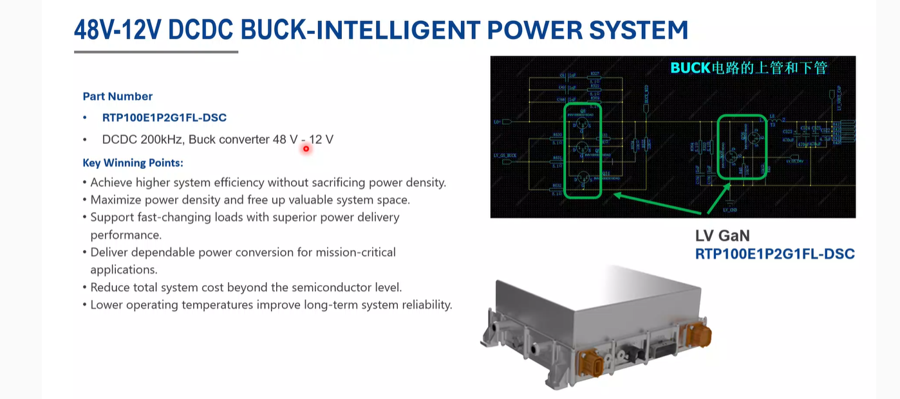

### 2. 车辆网络演进 — 集中化/区域架构

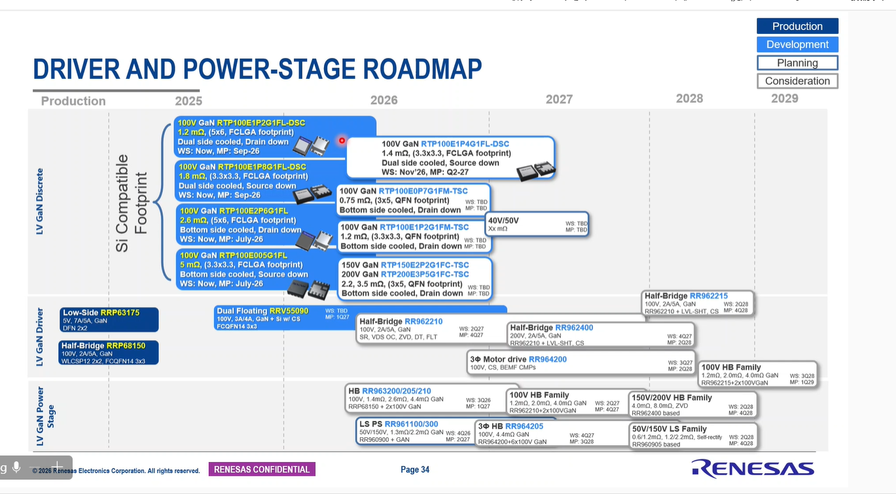

### 3. 制程与架构规划

| 制程 | 产品系列 | 说明 |
|------|---------|------|
| 现有 | U2C（28nm） | 基于 ARM Cortex-M33/M55 内核 |
| 未来 | 入围 M / U3B | 将采用 **22nm** 制程，性能、功耗、封装尺寸进一步提升 |

### 4. RH850/U2X 家族概念 — 从 2MB 到 26MB 的可扩展 ASIL-D 平台

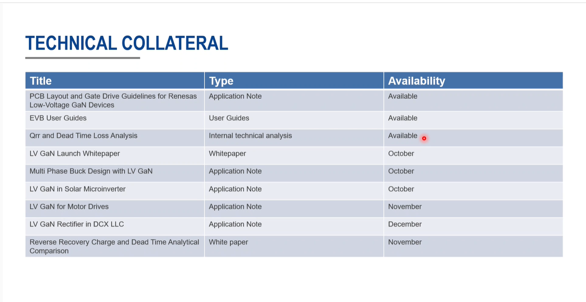

### 5. U2A 和 U2C 路线图

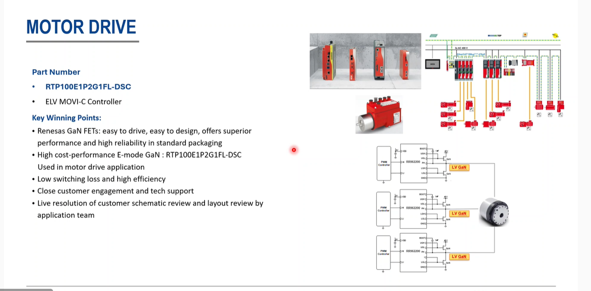

### 6. RH850 U2C 核心特性

### 7. U2C 系列详细特性

| 特性 | 说明 |
|------|------|
| 核心 | Cortex-M55，双核配置（1+1 / 2+2） |
| Flash | 320KB / 4MB / 8MB 多档可选 |
| 功能安全 | 满足 ISO 26262 ASIL-D 标准 |
| 信息安全 | 满足 ISO 21434，支持后量子密码（PQC）硬件加速 |
| 通信接口 | 新增 CAN-XL、10BASE-T1S / 100BASE-T1 / 1000BASE-T1 / TSN 支持 |
| 工作温度 | -40 C ~ 160 C（高可靠性） |
| OTA | 全系列支持 AB 分区、无感升级 |
| 封装 | TQFP 100/144/176 等多种封装 |

### 8. 中国本地软件合作伙伴

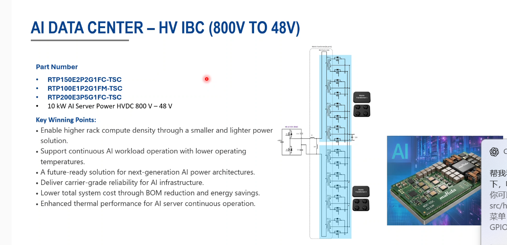

### 9. RH850 底盘域控系列

- 定位：底盘专有控制，P 系列迭代产品
- 配置：1+1 / 2+2 两种核心配置
- Flash：320KB ~ 8MB 宽泛选择
- 特点：高功能安全（ASIL-D）、丰富外设（ADC、GTM、CAN 等）
- 算力升级款可达 **400MHz**，采用 Cortex-M55 内核，性能优于 M33

#### RH850 底盘生态 — 自 2013 年累计出货 40 亿+

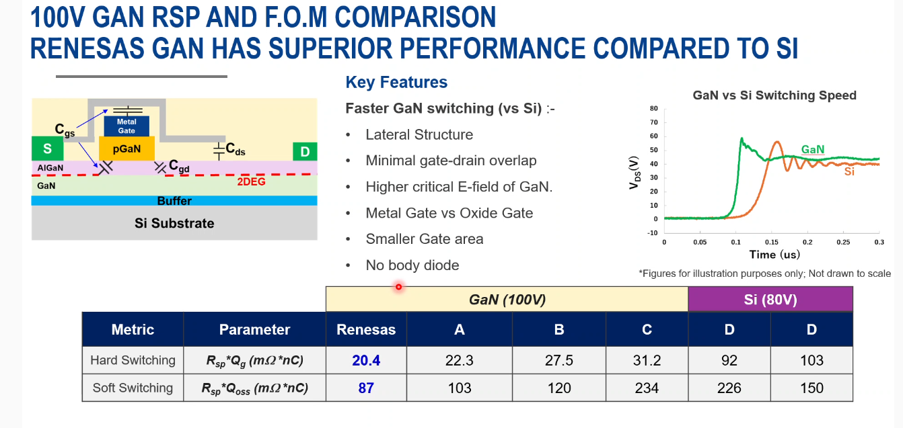

### 10. 典型应用场景

#### EPS 电子助力转向

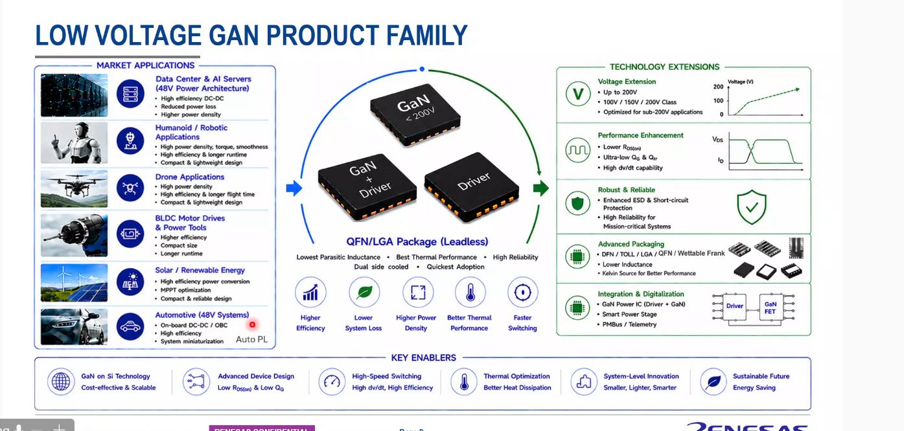

| 应用 | 说明 |
|------|------|
| **EPS 转向** | 从 CPS -> EPS -> HPS -> 线控转向，U2C 全系列覆盖 |
| **刹车系统** | 线控制动，需更高算力 |
| **底盘域控** | 整合多合一控制 |
| **主动降噪（ANC）** | 4 个传感器/单车，旗舰车型评估中 |
| **配套 PMIC** | 可提供 RH850 + PMIC 完整解决方案 |

---

## 二、GaN（氮化镓）功率器件介绍

### 1. 合作背景

- 与 **Navitas（纳微半导体）** 达成合作，获得其全部 GaN 产品授权（45V ~ 2000V）
- 可使用 Navitas 的 application、IP 及参考设计
- 不局限于高压应用，可覆盖低压到高压全场景

### 2. LV GaN 产品家族总览

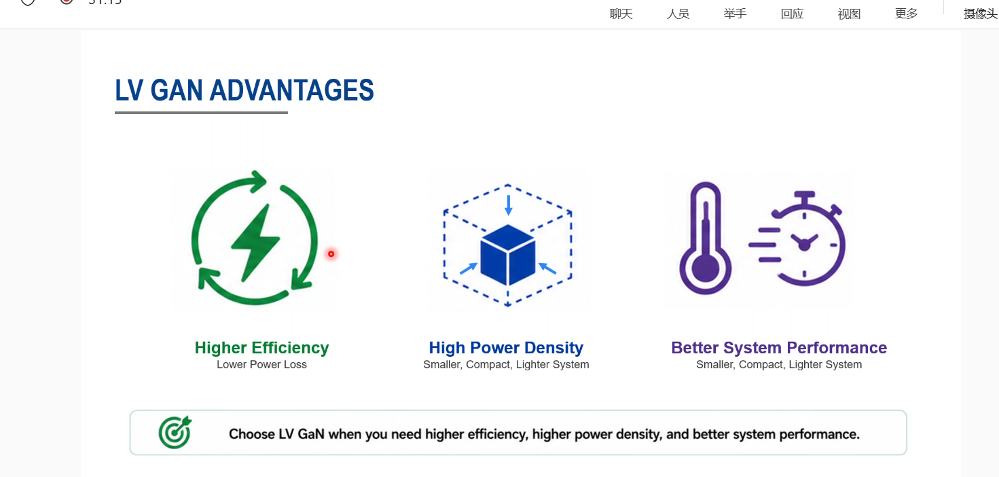

### 3. LV GaN 三大核心优势

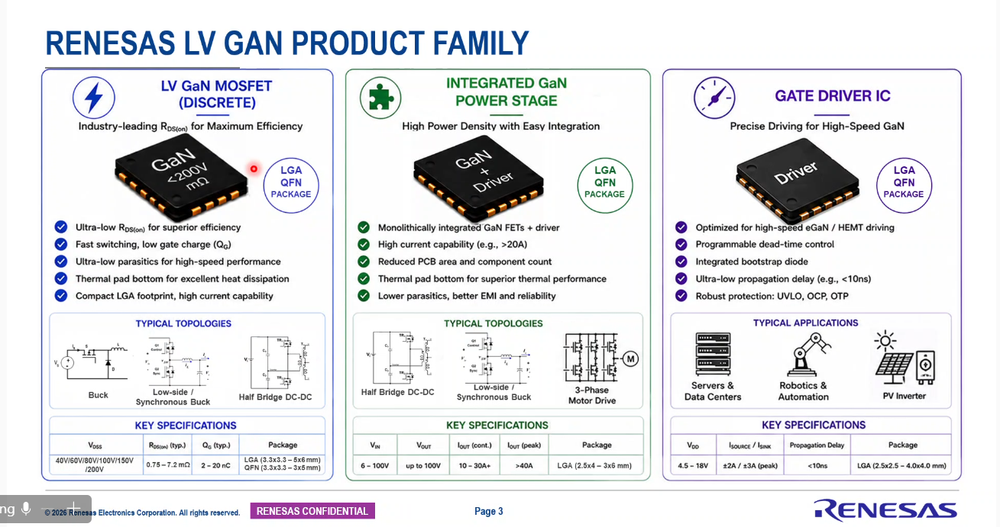

| 优势 | 说明 |
|------|------|
| **Higher Efficiency** | 更低的功率损耗 |
| **High Power Density** | 更小、更紧凑、更轻的系统 |
| **Better System Performance** | 更优的系统级性能 |

### 4. LV GaN 产品家族 — 市场应用与技术扩展

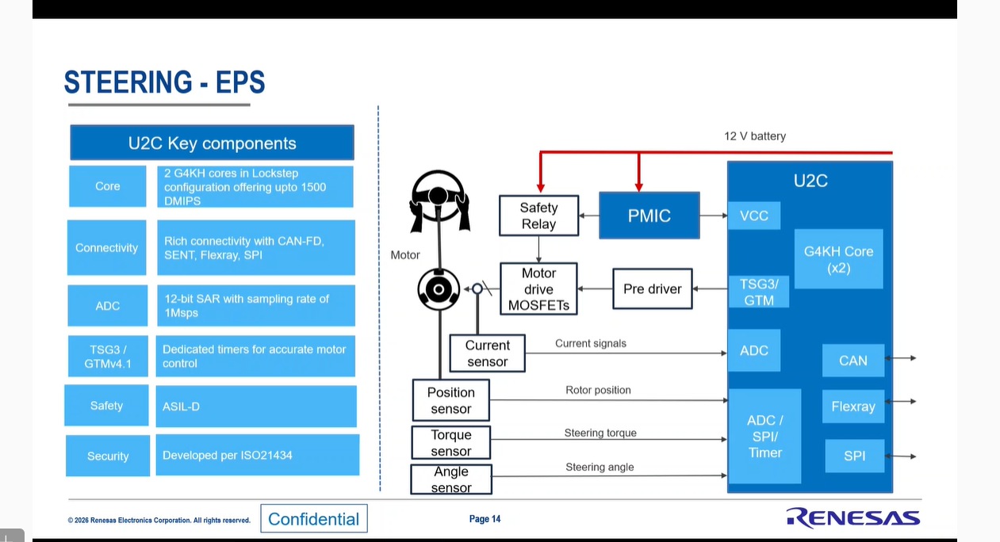

### 5. GaN vs Si 性能对比

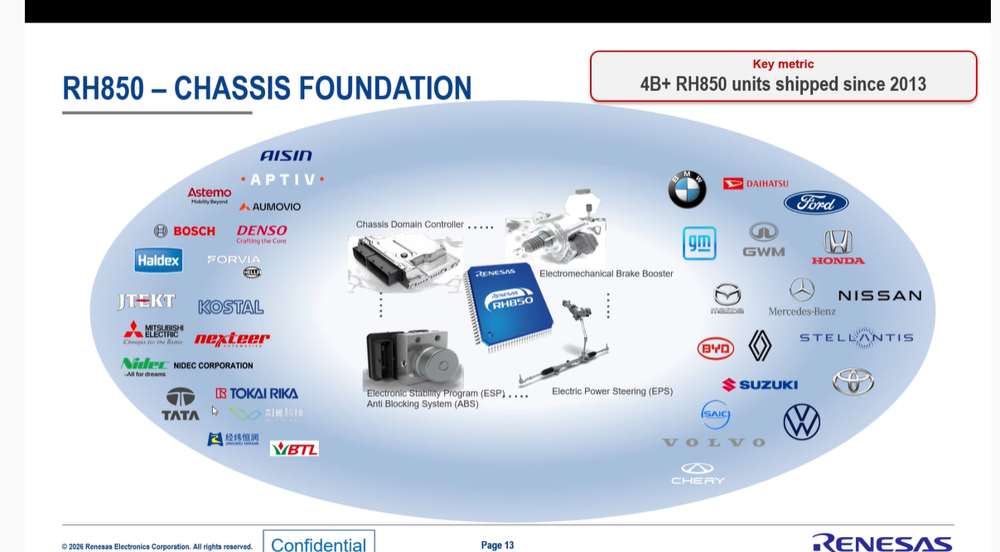

**关键数据：**
- GaN 硬开关 FOM（Rsp*Qg）：Renesas **20.4** vs Si 最高 103
- GaN 软开关 FOM（Rsp*Qoss）：Renesas **87** vs Si 最高 234
- GaN 开关速度远快于 Si（见右上波形图）

### 6. 六大目标应用场景

| 场景 | 说明 | 功率等级 |
|------|------|---------|
| **AI 数据中心** | PSUPPU / IBC / BBU，机架容量达十几 kW~MW 级，需极致小型化 | 数百 W ~ kW |
| **人形机器人 / 机械臂** | 需快速响应、小型化设计，GaN 高频优势突出 | 数十 W |
| **无人机** | 减轻重量、延长续航，每个马达约 60W | 数十 W |
| **马达驱动** | 工业马达、吊车、AGV 等大功率场景 | 数百 W ~ kW |
| **摄像头模块** | 户外环境严苛，GaN 耐高温优势 | 数十 W |
| **汽车应用** | 车窗马达、座椅控制等 | 数十 W |

> 注：消费电子（如手机充电器）因成本敏感，GaN 替代低压 MOSFET 暂不现实，非重点方向。

### 7. 成功案例

#### AI 数据中心 — HV IBC（800V to 48V）

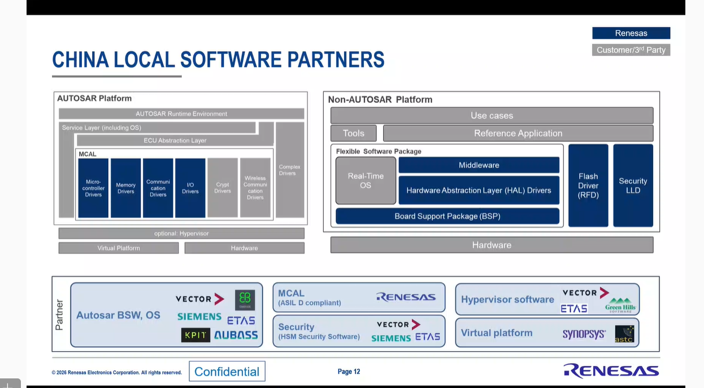

**关键料号：** RTP150E2P2G1FC-TSC、RTP100E1P2G1FM-TSC、RTP200E3P5G1FC-TSC
- 10 kW AI Server Power HVDC 800V - 48V
- 提升机架计算密度、降低工作温度、降低 BOM 成本

#### 48V-12V DCDC BUCK 智能电源系统

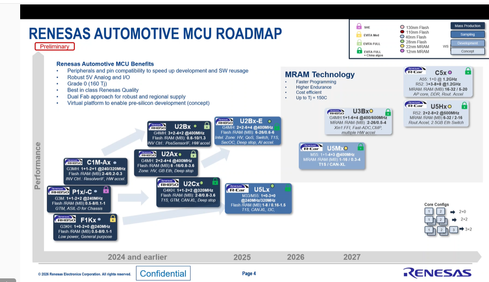

**关键料号：** RTP100E1P2G1FL-DSC
- DCDC 200kHz, Buck converter 48V - 12V
- 提升系统效率、最大化功率密度、降低工作温度

#### 马达驱动

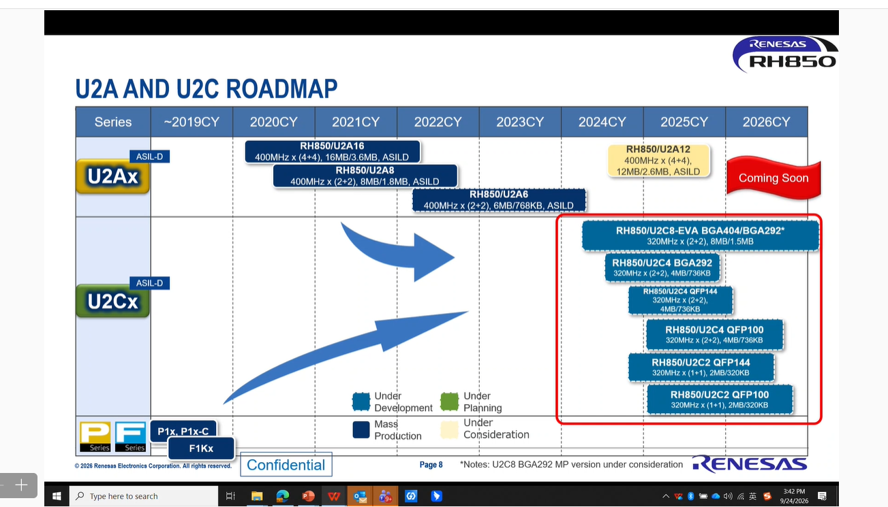

**关键料号：** RTP100E1P2G1FL-DSC + ELV MOVI-C Controller
- 低开关损耗、高效率
- 应用团队提供原理图和 Layout 实时审查支持

| 案例 | 使用器件 | 说明 |
|------|---------|------|
| **AI 数据中心 Hi-Power IPC** | 155V/2.2mOhm、100V/1.2mOhm、200V/3.5mOhm | 800V 架构，已量产 |
| **AI 数据中心 48V->12V IBC** | 100V/1.2mOhm | 路威斯 IPC 方案 |
| **BBU 电池备份** | 100V/1.5mOhm | 单机柜 10~20 个 BBU，每个 200W+，单柜贡献 2kW+ GaN 器件 |
| **485->425 摄像头模块** | 100V/1.2mOhm | 5~6 颗 GaN/台，替代 MOSFET |
| **三相马达驱动（国外大厂）** | 100V/1.2mOhm | 全系列马达产品已切换为 GaN 方案 |
| **汽车马达（车窗等）** | GaN 方案 | 替换 MOSFET，缩小体积、降低发热 |

---

## 三、GaN 产品路线图

### Driver and Power-Stage Roadmap（2025-2029）

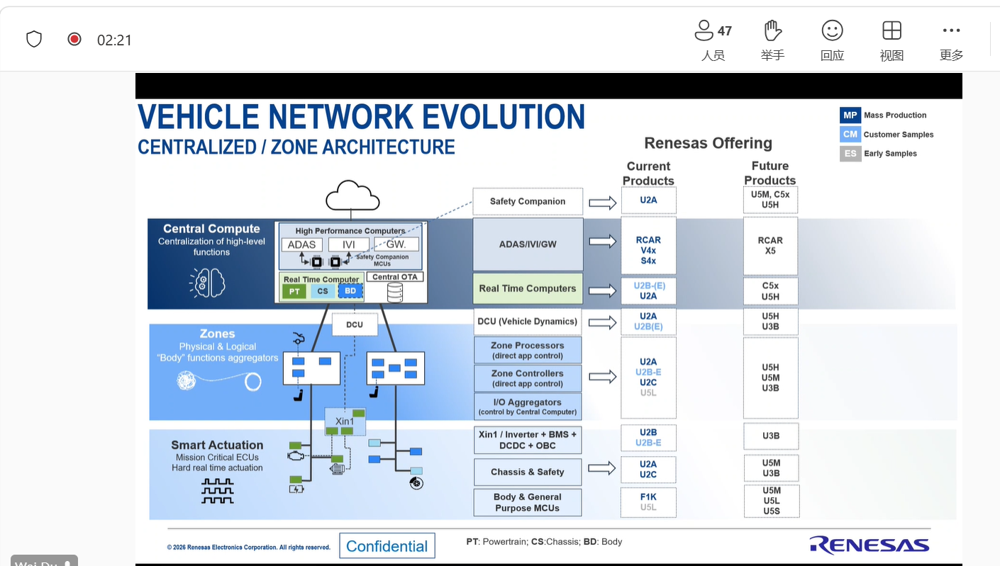

### 1. 100V GaN DISCRETE（分立器件）

**2025 年 9 月底** 首发 4 颗，Pin-to-Pin 兼容 MOSFET 封装：

| 规格 | 备注 |
|------|------|
| 100V / 14mOhm | MOSFET 兼容封装 |
| 100V / 18mOhm | MOSFET 兼容封装 |
| 100V / 26mOhm | MOSFET 兼容封装 |
| 100V / 50mOhm | MOSFET 兼容封装 |

**2025 年 Q4** 推出 4 颗 Navitas 专用封装料号：

| 料号 | 说明 |
|------|------|
| 150 / 075 | GaN 专用封装 |
| 152 / 250 | GaN 专用封装 |

后续规划：**45V / 80V** 更低压产品。

### 2. GaN 驱动 IC

| 产品 | 状态 | 说明 |
|------|------|------|
| RP63175（半桥驱动） | 已有 | 基础保护功能 |
| 板桥驱动（新一代） | 规划中 | 增加 Nt 模式保护等完善保护机制 |
| 100V 半桥驱动 IC | 预计 2025 年底 | 面向更多电源应用 |
| 三相半桥驱动 IC | 预计 2026 Q1 | 面向马达驱动应用 |

### 3. 整合型 GaN（GaN + 驱动 IC 集成）

**预计 2026 Q2** 推出 4 颗产品：

| 类型 | 规格 |
|------|------|
| 半桥 x3 | 100V / 14mOhm、26mOhm、44mOhm（内含 GaN + 驱动） |
| 单管 x1 | 150V / 13mOhm（Navitas GaN 集成） |

> 三相马达整合型 GaN 预计 **2026 Q3** 出货，已与特斯拉等人形机器人客户联合开发。

---

## 四、技术支持资料（Technical Collateral）

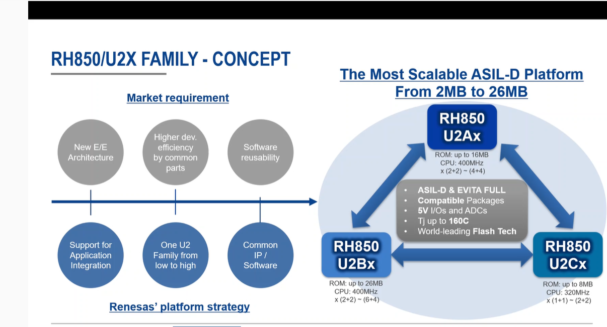

| 资料名称 | 类型 | 可用时间 |
|---------|------|---------|
| PCB Layout and Gate Drive Guidelines | Application Note | 已发布 |
| EVB User Guides | User Guides | 已发布 |
| Qrr and Dead Time Loss Analysis | Internal technical analysis | 已发布 |
| LV GaN Launch Whitepaper | Whitepaper | 10 月 |
| Multi Phase Buck Design with LV GaN | Application Note | 10 月 |
| LV GaN in Solar Microinverter | Application Note | 10 月 |
| LV GaN for Motor Drives | Application Note | 11 月 |
| LV GaN Rectifier in DCX LLC | Application Note | 12 月 |
| Reverse Recovery Charge and Dead Time Analytical Comparison | White paper | 11 月 |

---

## 五、重点推广建议

1. **AI 数据中心客户**：功率器件用量大（单柜 2kW+），优先推广
2. **底盘域控客户**：U2C/RH850 系列已有成熟方案，配合 PMIC 整体推广
3. **机器人/无人机客户**：GaN 高频小型化优势明显，关注人形机器人主动降噪等新应用
4. **已有 MOSFET 客户**：推动 GaN Pin-to-Pin 替换方案，降低客户切换成本
