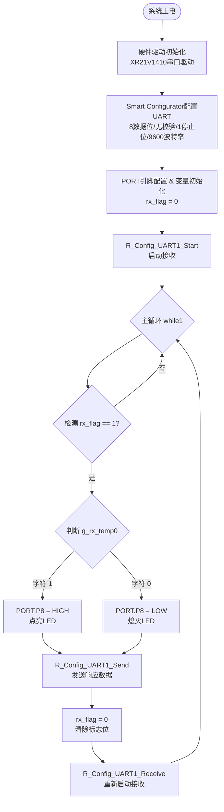

```flowchart TD
    Start([系统上电]) --> Init1[硬件驱动初始化\nXR21V1410 串口驱动]
    Init1 --> Init2[Smart Configurator 配置 UART\n8 数据位/无校验/1 停止位/9600 波特率/LSB 先行]
    Init2 --> Init3[PORT 引脚配置 & 变量初始化\nrx_flag = 0]
    Init3 --> StartRX[R_Config_UART1_Start 启动接收]
    StartRX --> MainLoop{主循环 while(1)}
    
    MainLoop --> CheckFlag{检测 rx_flag == 1?}
    CheckFlag -- 否 --> MainLoop
    CheckFlag -- 是 --> CheckData{判断 g_rx_temp[0]}
    
    CheckData -- 字符 '1' --> LED_ON[PORT.P8 = HIGH\n点亮 LED]
    CheckData -- 字符 '0' --> LED_OFF[PORT.P8 = LOW\n熄灭 LED]
    
    LED_ON --> SendResp[R_Config_UART1_Send 发送响应数据]
    LED_OFF --> SendResp
    
    SendResp --> ResetFlag[rx_flag = 0 清除标志位]
    ResetFlag --> NewRX[R_Config_UART1_Receive 重新启动接收]
    NewRX --> MainLoop
    
    subgraph 异步中断处理机制 ISR
        SerialTX[PC 串口助手发送数据] --> RX_ISR[触发接收中断 r_Config_UART1_interrupt_receive]
        RX_ISR --> ReadReg[读取硬件寄存器 RLN31.LURDR]
        ReadReg --> StoreBuf[存入缓冲区 gp_uart1_rx_address & 计数++]
        StoreBuf --> CheckLen{接收长度达到设定值？}
        CheckLen -- 否 --> ISR_End[中断返回，等待下一字节]
        CheckLen -- 是 --> Callback[调用回调函数 r_Config_UART1_callback_receiveend]
        Callback --> SetFlag[置位 rx_flag = 1]
        SetFlag --> ISR_End
    end
    
    SerialTX -. 异步事件触发 .-> RX_ISR
    
```


```flowchart TD
    Start([系统上电]) --> Init1[硬件驱动初始化\nXR21V1410串口驱动]
    Init1 --> Init2[Smart Configurator配置UART\n8数据位/无校验/1停止位/9600波特率/LSB先行]
    Init2 --> Init3[PORT引脚配置 & 变量初始化\nrx_flag = 0]
    Init3 --> StartRX[R_Config_UART1_Start 启动接收]
    StartRX --> MainLoop{主循环 while(1)}
    
    MainLoop --> CheckFlag{检测 rx_flag == 1?}
    CheckFlag -- 否 --> MainLoop
    CheckFlag -- 是 --> CheckData{判断 g_rx_temp[0]}
    
    CheckData -- 字符 '1' --> LED_ON[PORT.P8 = HIGH\n点亮LED]
    CheckData -- 字符 '0' --> LED_OFF[PORT.P8 = LOW\n熄灭LED]
    
    LED_ON --> SendResp[R_Config_UART1_Send 发送响应数据]
    LED_OFF --> SendResp
    
    SendResp --> ResetFlag[rx_flag = 0 清除标志位]
    ResetFlag --> NewRX[R_Config_UART1_Receive 重新启动接收]
    NewRX --> MainLoop
    
    subgraph 异步中断处理机制 ISR
        direction TB
        SerialTX[PC串口助手发送数据] -. 异步触发 .-> RX_ISR[触发接收中断\nr_Config_UART1_interrupt_receive]
        RX_ISR --> ReadReg[读取硬件寄存器\nRLN31.LURDR]
        ReadReg --> StoreBuf[存入缓冲区\ngp_uart1_rx_address & 计数++]
        StoreBuf --> CheckLen{接收长度达到设定值?}
        CheckLen -- 否 --> ISR_End[中断返回，等待下一字节]
        CheckLen -- 是 --> Callback[调用回调函数\nr_Config_UART1_callback_receiveend]
        Callback --> SetFlag[置位 rx_flag = 1]
        SetFlag --> ISR_End
    end
```





