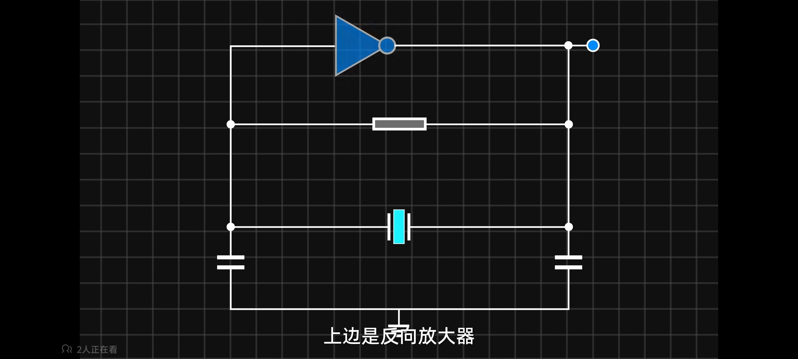
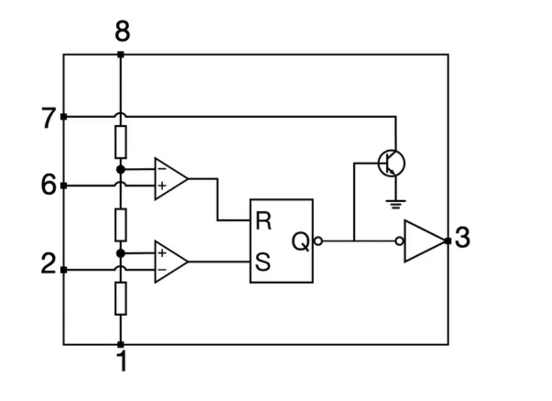
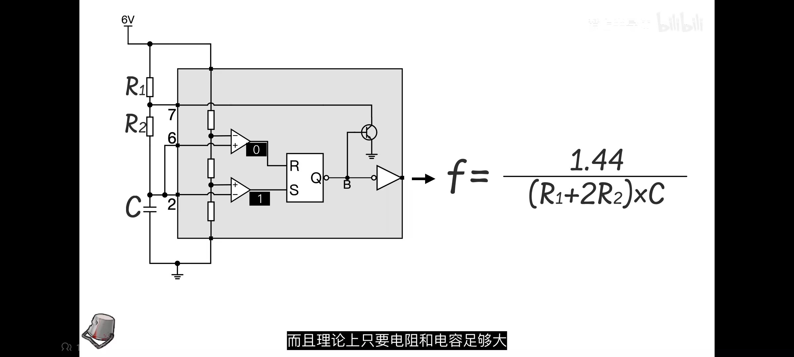
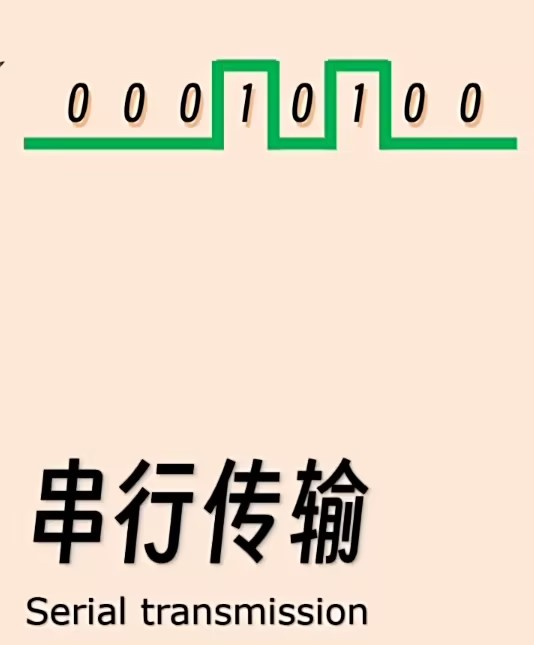
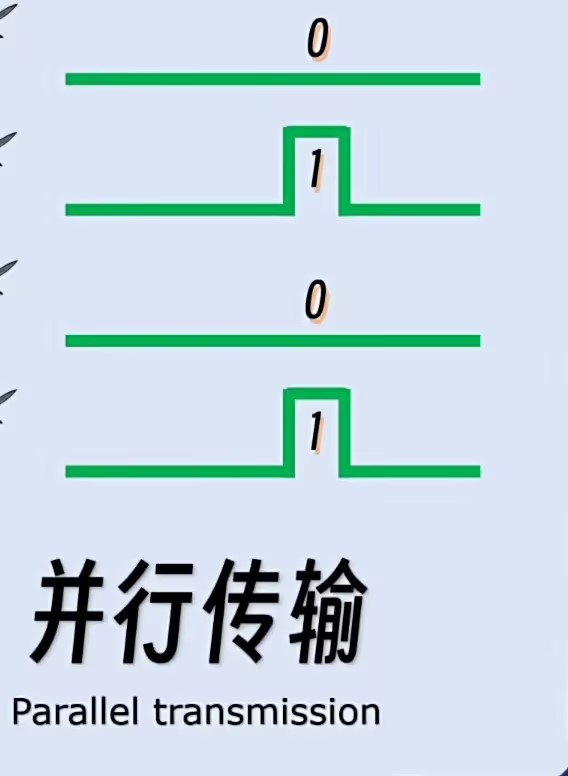
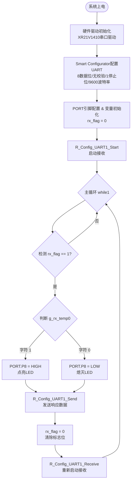

# 一、基础知识学习
## 晶振电路

这个电路利用石英晶体的物理特性，配合一个反向放大器，制造出一个极其精准的“心跳”，为芯片提供稳定的时钟信号。
### 工作流程
1. **起振：** 当电路通电时，电路中会有微小的电噪声。
2. **放大与反转：** 这些噪声经过反向放大器被放大并反转180度。
3. **筛选：** 信号经过石英晶体，晶体只让它的**固有频率**通过。
4. **循环：** 筛选后的信号经过电容移相（再产生180度相移），回到放大器输入端。
5. **共振：** 此时信号总共移相了360度（即回到原点），与原信号叠加，能量越来越强，最终形成稳定的正弦波振荡。
### 压电效应
- 正压电效应（机械能 → 电能）
当挤压或拉伸石英晶体时，它的表面会产生电荷（电压）。

- 逆压电效应（电能 → 机械能）
当你给石英晶体通电（施加电压）时，它会产生物理形变（微小的弯曲或伸缩）。
##  冯·诺依曼结构与哈佛结构
|特性|冯·诺依曼结构|哈佛结构|
|:--|:--|:--|
|存储方式|指令和数据混存|指令和数据分开存储|
|总线设计|只有一套总线（地址+数据）|两套独立的总线系统|
|执行效率|较低（取指和取数不能同时进行）|较高（可以同时进行）|
|硬件复杂度|简单|复杂|
|典型应用|PC、笔记本电脑 (x86架构)|单片机、嵌入式、DSP (ARM, AVR)|
## 改良哈佛结构
**在逻辑上保持指令与数据的分离，但在物理层面允许共享同一存储系统**。这种设计既保留了哈佛架构的并行优势，又克服了其硬件复杂度高和编程困难的问题。

| 特征    | 原始哈佛结构                    | 改良型哈佛结构                  |
| ----- | ------------------------- | ------------------------ |
| 物理存储器 | 两个完全独立的物理存储器（程序存储器和数据存储器） | 单一物理存储器，逻辑上分为程序和数据区域     |
| 总线设计  | 两套完全独立的总线系统（程序总线和数据总线）    | 分时复用的单套总线，但内部有独立的指令/数据路径 |
| 存储空间  | 程序和数据空间严格分离，无法共享          | 程序和数据空间可动态调整，提高存储利用率     |


## 555定时器

### 内部结构
- **分压网络**：三个5kΩ电阻串联构成，将Vcc精确分为1/3Vcc和2/3Vcc两个参考电压（这也是"555"名称的由来之一）。
- **电压比较器**：两个高增益、低失调的电压比较器，分别监测阈值端(TH)和触发端(TR)的电压：
  - 比较器C1：同相端接阈值输入TH（6脚），反相端固定为2/3Vcc
  - 比较器C2：反相端接触发输入TR（2脚），同相端固定为1/3Vcc
- **RS触发器**：由两个与非门构成，作为状态记忆与逻辑仲裁中枢，置位(S)端由C2输出驱动，复位(R)端由C1输出驱动。
### 定时器经典工作电路

1. **初始状态**：TRIG > 1/3Vcc，THRES < 2/3Vcc → 下比较器输出低，上比较器输出高 → RS锁存器保持复位 → OUT = 低，DISCH 导通 → 电容C已放空。

2. **触发瞬间**：TRIG 被拉低至 < 1/3Vcc → 下比较器翻转 → S=1 → RS锁存器置位 → OUT = 高，DISCH 截止。

3. **延时期间**：电容C开始通过电阻R向Vcc充电。

4. **自动复位**：当 VC≥2VCC/3VC​≥2VCC​/3 时，上比较器翻转 → R=1 → RS锁存器复位 → OUT = 低，DISCH 再次导通 → C迅速放电 → 回到初始状态。
## 串口通信原理
### 串行传输：仅需1根数据线逐位传输，速度慢但成本低、抗干扰强

### 并行传输：需要多根数据线同时传输（如8位数据需要8根线），速度快但成本高

### 波特率
每秒传输的符号（Symbol）个数，在串口通信中等于**每秒传输的比特数（bps）决定通信速度，双方必须设置相同才能正确解析数据。**
### 数据帧格式
1. **起始位（Start Bit）**：1位，**固定为逻辑0**，表示一帧数据开始
2. **数据位（Data Bits）**：5-9位，**通常为8位**，传输实际数据
3. **校验位（Parity Bit）**：0或1位，**可选**，用于错误检测
4. **停止位（Stop Bit）**：1/1.5/2位，**固定为逻辑高**，表示一帧数据结束
### 偶校验
数据位中的1为奇数个就把校验位设为1，1为偶数个就把校验位设为0.
# 二、ECHO程序实现过程




## 1、安装驱动
查看串口调试助手主控芯片为XR21V1410,注册迈凌官网账号，下载驱动，选择X64
## 2、安装串口调试软件


## 3、在Smart Configurator Components上面添加UART和PORT模块并进行选项设计

1. **Data length setting (数据位长度)**：每次传输的数据包含 8 个比特位（即 1 个字节）。
2. **Parity setting (校验位)**：不使用校验位。校验位用于检测数据传输中的错误（奇偶校验），但在现代短距离通信中通常不需要，因为它会降低效率。
3. **Stop bit length setting (停止位长度)**：数据传输结束时，用 1 个比特的高电平作为结束标志。
4. **Transfer rate setting -> Baudrate (波特率)**：数据传输的速度，每秒传输 9600 个比特。（**最关键**的参数。你的串口助手软件里的波特率**必须**也选 9600，否则全是乱码。）
5. **Transfer direction setting (传输方向)**：**最低有效位先行**。UART 协议的标准规定，发送数据时要先发二进制的最后一位。
6. **Receive data noise filter setting (接收数据噪声滤波)**：开启硬件滤波功能。如果信号线受到干扰（有毛刺），单片机会自动忽略极短的脉冲，防止误判为数据。
7. **Transmit/Receive data level setting (电平设置)**：
   - **Normal**：标准 TTL 电平（空闲时为高电平，发送数据时为低电平）。
   - **Inverted**：反相电平。
## 4、代码部分
1.r_cg_main.c
~~~ c    
#include "r_smc_entry.h"
/* Start user code for global. Do not edit comment generated here */
uint8_t g_rx_temp[8];
uint8_t g_tx_temp[8];
extern uint8_t rx_flag;
/* End user code. Do not edit comment generated here */
void r_main_userinit(void);
void main(void)
{
    r_main_userinit();
    /* Start user code for main. Do not edit comment generated here */
    R_Config_UART1_Create();
    R_Config_UART1_Create_UserInit();
    R_Config_UART1_Start();
    PORT.P8 = _PORT_Pn5_OUTPUT_LOW;

    
    R_Config_UART1_Send(g_tx_temp, 1);
    R_Config_UART1_Receive(g_rx_temp, 1);

    
    
    while (1)
    {
	    
	 if (rx_flag == 1)
	 {
	  if (g_rx_temp[0] == '1')
            {
                
                PORT.P8 = _PORT_Pn5_OUTPUT_HIGH;
            }
       else if (g_rx_temp[0] == '0') {
             PORT.P8 = _PORT_Pn5_OUTPUT_LOW; 
}
        
         R_Config_UART1_Send(g_rx_temp, 1);
           rx_flag = 0;
	 R_Config_UART1_Receive(g_rx_temp, 1);  
        }
        

    
	    
        
    }
       
    /* End user code. Do not edit comment generated here */
}
~~~

2.Config_UART1
~~~ c 
#include "r_cg_macrodriver.h"
#include "r_cg_userdefine.h"
#include "Config_UART1.h"
/* Start user code for include. Do not edit comment generated here */
/* End user code. Do not edit comment generated here */
extern volatile uint8_t  * gp_uart1_tx_address;       /* uart1 transmit data address */
extern volatile uint16_t   g_uart1_tx_count;          /* uart1 transmit data number */
extern volatile uint8_t  * gp_uart1_rx_address;       /* uart1 receive data address */
extern volatile uint16_t   g_uart1_rx_count;          /* uart1 receive data number */
extern volatile uint16_t   g_uart1_rx_length;         /* uart1 receive data length */
void r_Config_UART1_callback_receiveend(void);
void r_Config_UART1_callback_sendend(void);
void r_Config_UART1_callback_error(uint32_t err_type);
/* Start user code for global. Do not edit comment generated here */
 uint8_t rx_flag = 0;
extern uint8_t g_rx_temp[8];
extern uint8_t g_tx_temp[8];
/* End user code. Do not edit comment generated here */

void R_Config_UART1_Create_UserInit(void)
{
    /* Start user code for user init. Do not edit comment generated here */
    /* End user code. Do not edit comment generated here */
}
void r_Config_UART1_interrupt_receive(void)
{
    uint8_t  rx_data_8;
    uint16_t temp;
    rx_data_8 = RLN31.LURDR.UINT16;

    temp = g_uart1_rx_count;
    if (g_uart1_rx_length > temp)
    {
        *gp_uart1_rx_address = rx_data_8;
        gp_uart1_rx_address++;
        g_uart1_rx_count++;
        temp = g_uart1_rx_count;
        if (g_uart1_rx_length == temp)
        {
            r_Config_UART1_callback_receiveend();
        }
    }
}
void r_Config_UART1_interrupt_error(void)
{
    uint32_t err_type;
    *gp_uart1_rx_address = RLN31.LURDR.UINT16;
    err_type = (uint8_t)(RLN31.LEST);
    RLN31.LEST &= (uint8_t) ~_UART_CLEAR_ERROR_FLAG;
    r_Config_UART1_callback_error(err_type);
}

void r_Config_UART1_interrupt_send(void)
{
    if (g_uart1_tx_count > 0U)
    {
        RLN31.LUTDR.UINT16= *gp_uart1_tx_address;
        gp_uart1_tx_address++;
        g_uart1_tx_count--;
    }
    else
    {
        r_Config_UART1_callback_sendend();
    }
}


void r_Config_UART1_callback_sendend(void)
{
    /* Start user code for r_Config_UART1_callback_sendend. Do not edit comment generated here */
    /* End user code. Do not edit comment generated here */
}

void r_Config_UART1_callback_error(uint32_t err_type)
{
    /* Start user code for r_Config_UART1_callback_error. Do not edit comment generated here */
    /* End user code. Do not edit comment generated here */
}

void r_Config_UART1_callback_receiveend(void)
{
    /* Start user code for r_Config_UART1_callback_receiveend. Do not edit comment generated here */
    rx_flag = 1;
    
    /* End user code. Do not edit comment generated here */
}

/* Start user code for adding. Do not edit comment generated here */
/* End user code. Do not edit comment generated here */
~~~
### 运行逻辑

#### **数据接收流程**

**串口通信助手发送数据**：
- 在串口通信助手的发送区域输入数据
- 点击"发送"按钮，数据通过USB转串口芯片发送到单片机

**单片机接收数据**：
- **中断触发**：当数据到达UART1接收引脚时，触发`r_Config_UART1_interrupt_receive()`中断
- **数据处理**：
~~~c
 
        ```
        void r_Config_UART1_interrupt_receive(void) {
            uint8_t rx_data_8 = RLN31.LURDR.UINT16;  // 读取接收到的数据
            *gp_uart1_rx_address = rx_data_8;  // 存储到接收缓冲区
            g_uart1_rx_count++;
            if (g_uart1_rx_length == g_uart1_rx_count) {
                r_Config_UART1_callback_receiveend();  // 调用接收完成回调
            }
        }
~~~

 - **标志位设置**：在`r_Config_UART1_callback_receiveend()`中设置`rx_flag = 1`，表示接收完成
**主循环检测**：
~~~ c
    while (1) {
        if (rx_flag == 1) {
            // 处理接收到的数据
            R_Config_UART1_Send(g_tx_temp, 2);  // 发送响应
            rx_flag = 0;  // 重置标志位
            R_Config_UART1_Receive(g_rx_temp, 2);  // 重新开始接收
        }
    }
~~~
  
  - 主循环持续检测`rx_flag`，一旦为1，立即处理并准备下一次接收

#### ** 数据发送流程**

**单片机发送数据**：
 - 当`rx_flag`被置为1后，主循环调用`R_Config_UART1_Send(g_tx_temp, 2)`发送数据
- 发送过程由`r_Config_UART1_interrupt_send()`中断处理：
``` c
        void r_Config_UART1_interrupt_send(void) {
            if (g_uart1_tx_count > 0U) {
                RLN31.LUTDR.UINT16 = *gp_uart1_tx_address;  // 发送数据
                gp_uart1_tx_address++;
                g_uart1_tx_count--;
            } else {
                r_Config_UART1_callback_sendend();  // 发送完成回调
            }
        }
```
## 5、添加的代码部分
~~~ c
while (1) 
{ if (rx_flag == 1) 
    { /* 检查接收到的数据是否为ASCII字符'1' */ 
    if (g_rx_temp[0] == '1') { /* 点亮LED（根据硬件连接可能需要调整高低电平） */   P0RT.P8=_PORT_Pn5_OUTPUT_HIGH;
                             }
    else if 
    (g_rx_temp[0] == '0') {
     PORT.P8=_PORT_Pn5_OUTPUT_LOW; /* 熄灭 */ 
                          }
     rx_flag = 0; /* 重置标志位并重新开始接收 */ 
      R_Config_UART1_Receive(g_rx_temp, 1); 
     }
 }
~~~
检查接收到的数据是否为ASCII字符'1',如果是则点亮LED
**添加熄灭功能**：发送"0"可熄灭LED
## 6、错误整理

```c
while (1) { if (rx_flag == 0) {
            R_Config_UART1_Receive(g_rx_temp, 1);
             rx_flag = 1; }
```
**在最初代码中，变量定义为uint8_t rx_flag = 1;，导致在while中的if判断语句永远无法达成条件，程序无法进入，无法跳转到中断函数中，被“困死”在while循环中。
```c
#pragma interrupt r_Config_UART1_interrupt_receive(enable=false, channel=122, fpu=true, callt=false)
void r_Config_UART1_interrupt_receive(void)
{
    uint8_t  rx_data_8;
    uint16_t temp;
    rx_data_8 = RLN31.LURDR.UINT16;

    temp = g_uart1_rx_count;
    if (g_uart1_rx_length > temp)
    {
        *gp_uart1_rx_address = rx_data_8;
        gp_uart1_rx_address++;
        g_uart1_rx_count++;
        temp = g_uart1_rx_count;
        if (g_uart1_rx_length == temp)
        {
            r_Config_UART1_callback_receiveend();
        }
    }
}
```
**UART接收中断服务程序**。它的作用是：**每当单片机收到一个字节的数据，硬件就会自动运行这段代码**。

在user.UART.c文件开头定义` uint8_t rx_data = 0`,在main.c文件开头定义了 `extern uint8_t rx_data = 0`;
尽管加了 `extern`，但因为它赋了初值 `= 0`，编译器会强制把它当作**定义**处理,这意味着编译器在这里为 `rx_data` 分配了内存。于是，链接器发现了两份 `rx_flag` 的内存分配，所以报错 **Duplicate symbol（重复符号）**。
# 7、总结
**本周主要完成了串口通信的理论学习与 ECHO（回显）程序 的实战开发。通过理解晶振、UART协议等底层原理，搭建了瑞萨单片机与PC串口助手的通信桥梁，并成功实现了通过串口发送指令（'1'/'0'）控制LED亮灭的功能。过程中重点解决了变量重复定义和逻辑死循环等编译与运行时错误**