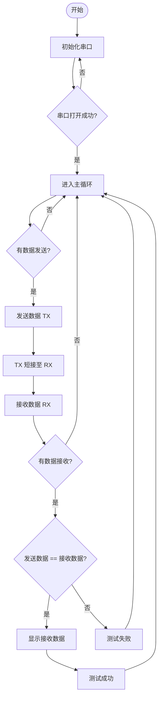

1. **CPU 主频 (System Clock)**：
    - 这是最直接的因素。如果主频从 80MHz 变为 40MHz，同样的代码延时时间会翻倍。
2. **编译器优化等级 (Optimization Level)**：
    - 如果开启 `-O2` 或 `-O3` 优化，编译器可能会把 `count--` 优化成寄存器操作，甚至直接删掉空循环，导致延时时间剧烈变化（甚至变为 0）。
3. **`volatile` 关键字**：
    - **这是导致本次 622ms 的关键原因**。代码中使用了 `volatile`，强制 CPU **每次都从栈内存 (RAM) 读取和写入 `count`**。
    - **内存访问 (LD/ST 指令)** 比 **寄存器运算 (ADD 指令)** 慢得多（通常慢 2-4 倍）。
    - 如果去掉 `volatile`，同样的 `5,000,000` 次循环，时间可能会缩短到 200ms 左右。
4. **Flash/RAM 的等待周期 (Wait State)**：
    - RH850 访问 Flash 或 RAM 时，如果配置了 Wait State，每条指令的执行时间都会增加。
CPU 主频 (System Clock)：
这是最直接的因素。如果主频从 80MHz 变为 40MHz，同样的代码延时时间会翻倍。
编译器优化等级 (Optimization Level)：
如果开启 -O2 或 -O3 优化，编译器可能会把 count-- 优化成寄存器操作，甚至直接删掉空循环，导致延时时间剧烈变化（甚至变为 0）。
volatile 关键字：
这是导致本次 622ms 的关键原因。代码中使用了 volatile，强制 CPU 每次都从栈内存 (RAM) 读取和写入 count。
内存访问 (LD/ST 指令) 比 寄存器运算 (ADD 指令) 慢得多（通常慢 2-4 倍）。
如果去掉 volatile，同样的 5,000,000 次循环，时间可能会缩短到 200ms 左右。
Flash/RAM 的等待周期 (Wait State)：
RH850 访问 Flash 或 RAM 时，如果配置了 Wait State，每条指令的执行时间都会增加。

件定时器的延时时间主要受以下关键参数影响：
1. 时钟源频率（Clock Source）
定时器的输入时钟频率
例如：系统时钟 80MHz、内部低速时钟、外部晶振等
影响：时钟频率越高，定时器计数越快
2. 预分频器（Prescaler / PSCR）
对输入时钟进行分频的系数
例如：Prescaler = 79，则定时器时钟 = 输入时钟 / (79+1)
影响：分频越大，定时器计数越慢，延时越长
3. 自动重装载值/周期值（Auto-Reload Value / Period / ARR）
计数器计数的目标值（溢出值）
例如：Period = 9999，计数器从 0 计到 9999 后溢出
影响：值越大，延时时间越长
4. 计数模式（Count Mode）
向上计数：从 0 计到 Period
向下计数：从 Period 计到 0
中央对齐：双向计数
影响：不同模式计算方式略有不同