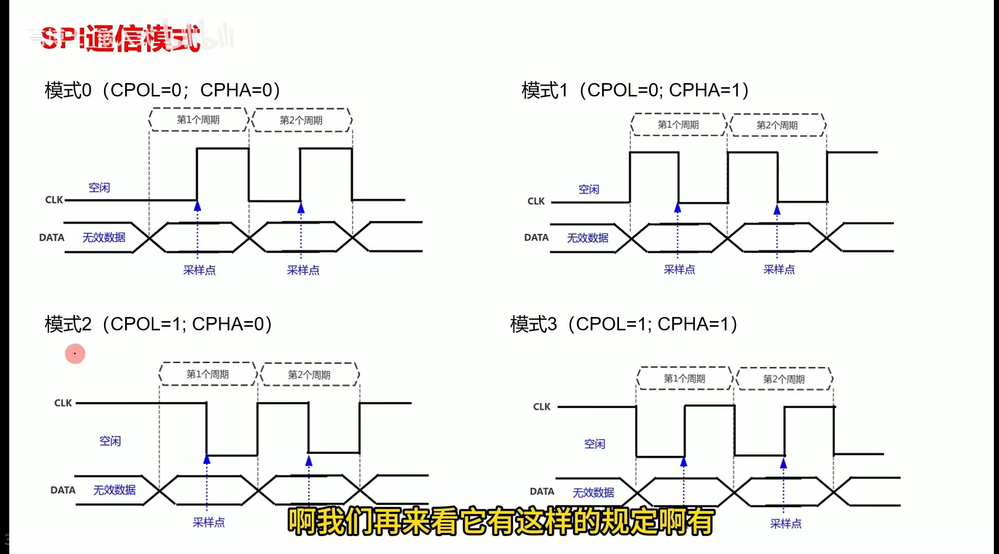
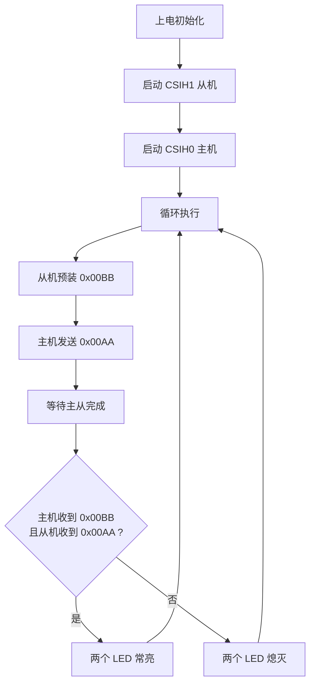

# 一、URAT自适应回环（接收<=1024字节)


main.c
 ```c
#include "r_smc_entry.h"
uint8_t g_rx_temp[DATA_BLOCK_SIZE];   // 接收缓冲区 (1KB)
uint8_t g_tx_temp[DATA_BLOCK_SIZE];   // 发送缓冲区 (1KB)
extern uint8_t rx_flag;
uint8_t tx_busy = 0;*/
 
 #define MAX_FRAME_LEN 1024
uint8_t g_rx_buffer[MAX_FRAME_LEN];
uint8_t g_tx_buffer[MAX_FRAME_LEN];
extern  uint8_t rx_flag;
extern  uint16_t rx_count;
volatile uint8_t tx_busy = 0;
 
/* End user code. Do not edit comment generated here */
void r_main_userinit(void);

void main(void)
{
    uint16_t i;
    r_main_userinit();
    /* Start user code for main. Do not edit comment generated here */
    // R_Config_UART0_Create();
    R_Config_UART1_Create();
    R_Config_UART1_Create_UserInit();
    R_Config_UART1_Start();
    PORT.P8 = _PORT_Pn5_OUTPUT_LOW;
     R_Config_UART1_Receive(g_rx_buffer, MAX_FRAME_LEN);
	while (1)
    {
        if (rx_flag == 1)
        {
            if (rx_count > 0)
            {
            
                if (g_rx_buffer[0] == '1')
                {
                    PORT.P8 = _PORT_Pn5_OUTPUT_HIGH;
                }
                else if (g_rx_buffer[0] == '0')
                {
                    PORT.P8 = _PORT_Pn5_OUTPUT_LOW;
                }

              
                for (i = 0; i < rx_count; i++)
                {
                    g_tx_buffer[i] = g_rx_buffer[i];
                }

                tx_busy = 1;
                R_Config_UART1_Send(g_tx_buffer, rx_count);

           
                while (tx_busy == 1);
            }

        
            rx_count = 0;
            rx_flag = 0;
            R_Config_UART1_Receive(g_rx_buffer, MAX_FRAME_LEN)  
    }
    
 ```      


```c

void r_Config_UART1_interrupt_receive(void)
{
    uint8_t  rx_data_8;
    //uint16_t temp;
    rx_data_8 = RLN31.LURDR.UINT16;
    if (rx_count < MAX_FRAME_LEN)
    {
        g_rx_buffer[rx_count] = rx_data_8;
        rx_count++;

        /* 检测到换行符或回车符，判定为一帧结束 */
        if (rx_data_8 == '\n' || rx_data_8 == '\r')
        {
            r_Config_UART1_callback_receiveend();
        }
    }

    
}


```
**注：在r_Config_UART1_interrupt_receive(void）中修改接收逻辑**

| **取消固定长度阻塞**               | 不再死等1024字节，改为**逐字节存入缓冲区**，实时判断帧结束               |
| -------------------------- | ----------------------------------------------- |
| **帧定界符 `\n` / `\r`**       | **串口助手通常以换行符表示“发送完毕”，单片机检测到此字符即触发 `rx_flag=1`** |
| **精确回传 `rx_count` 字节**     | **`R_Config_UART1_Send(..., rx_count)` 确保发几个收几个 |
| **溢出保护 `rx_count < 1024`** | **防止异常数据流导致缓冲区越界写崩程序**                          |


# 二、SPI通信
## 1.SPI通信基础概念
SPI（串行外设接口），是一种芯片和芯片之间的通信，采用一主多从模式。


**SPI四种通信模式**

CPOL极性 CPHA相位
CPLO=0，时钟信号空闲时为低电平；CPLO=1，时钟信号空闲时为高电平。
CPAH=0,第一个边沿为有效信号；CPAH=1，第二个边沿为有效信号。

四种模式就是：

- Mode 0：CPOL=0, CPHA=0
    - 空闲低
    - 第一个边沿采样，第二个边沿改变数据
- Mode 1：CPOL=0, CPHA=1
    - 空闲低
    - 第一个边沿改变数据，第二个边沿采样
- Mode 2：CPOL=1, CPHA=0
    - 空闲高
    - 第一个边沿采样，第二个边沿改变数据
- Mode 3：CPOL=1, CPHA=1
    - 空闲高
    - 第一个边沿改变数据，第二个边沿采样


## 2.CSIH与CSIG区别
CSIH 的特征：
- 有更多控制寄存器
- 有多组 CFG
- 有多路 BRS
- 有硬件片选选择
- 有 setup / hold / inter-data delay
- 有 slave select / handshake 这类功能
- 适合更复杂、规范的 SPI 主从通信

CSIG 的特征：
- 寄存器集合更简单
- CFG、收发寄存器和控制项明显少很多
- 更像“简单同步串行接口”
- 适合简单 SPI，不像 CSIH 那样强调多片选、多时序控制、排队式传输


## 3.Smart Configurator 设置


- **Transfer direction (传输方向): `MSB`**
    - **含义：** Most Significant Bit First（高位优先）。
    - **解释：** 发送数据时，先发送最高位（Bit 15/7），最后发送最低位（Bit 0）。这是SPI最常见的模式。如果是LSB，则反过来。

### 波特率有误差原因
CSIH 波特率生成公式：
波特率 = 基础时钟频率 / (分频系数 × 2)

由于分频系数必须是整数，所以：
- 如果计算结果不是整数 → 产生误差
- 如果计算结果是整数 → 无误差

**同样是9600波特率的情况下CSIG 误差更小**，通常是因为它在当前外设时钟下的**可选分频点更接近 9600**。
## 4.代码逻辑流程图


**为什么要先启动从机？**
因为 SPI 的本质是“主机给时钟，从机被动在时钟沿上同步移出/移入数据”。从机并不会像 UART 那样自己决定什么时候开始发，它只有在主机已经拉片选、并且开始出时钟之后，才能把“事先装进发送寄存器”的那一字移出去。所以这类主从回环里，必须先让 CSIH1 进入就绪状态，并先执行一次 Send_Receive 把从机要回的 0x00BB 预装进 TX0W/TX0H，然后再让 CSIH0 发起时钟。如果主机先启动，首帧时钟已经来了，但从机发送寄存器还没装好，那么主机读到的第一帧就很可能是旧值、空值或错位值。

## 5.代码部分
r_g_main.c
```c


void main(void)
{
    r_main_userinit();
    /* Start user code for main. Do not edit comment generated here */
    PORT.PM0 &= (uint16_t)~MASTER_LED_MASK;
    MASTER_LED_OFF();
    SLAVE_LED_OFF();

    R_Config_CSIH1_Start();
    R_Config_CSIH0_Start();

    while (1)
    {
        if (0U != spi_exchange_once())
        {
            MASTER_LED_ON();
            SLAVE_LED_ON();
        }
        else
        {
            MASTER_LED_OFF();
            SLAVE_LED_OFF();
        }
    }
    /* End user code. Do not edit comment generated here */
}

void r_main_userinit(void)
{
    DI();
    /* Start user code for r_main_userinit. Do not edit comment generated here */
    R_Systeminit();
    R_Pins_Create();
    EI();
    /* End user code. Do not edit comment generated here */
}

/* Start user code for adding. Do not edit comment generated here */
static void wait_cycles(uint32_t cycles)
{
    volatile uint32_t i;

    for (i = 0UL; i < cycles; i++)
    {
        __nop();
    }
}


```
Config_CSIH0_user.c
```c

Includes


void R_Config_CSIH0_Create_UserInit(void)
{
/* Start user code for user init. Do not edit comment generated here */

   
    g_csih0_tx_done = 0;
    g_csih0_rx_done = 0;
    g_csih0_test_cnt = 0;
    g_csih0_error_flag = 0U;
    g_csih0_last_error_type = 0U;
    
    
    {
        int i;
        for (i = 0; i < 16; i++)
        {
            g_csih0_rx_buffer[i] = 0x0000;
        }
    }
/* End user code. Do not edit comment generated here */
}

#pragma interrupt r_Config_CSIH0_interrupt_send(enable=false, channel=29, fpu=true, callt=false)
void r_Config_CSIH0_interrupt_send(void)
{
    uint8_t err_type;
    uint16_t sio_dummy;
    uint16_t temp;
    err_type = (CSIH0.STR0 & (_CSIH_CONSISTENCY_ERROR_DETECTED | _CSIH_PARITY_ERROR_DETECTED | 
               _CSIH_OVERRUN_ERROR_DETECTED));
    CSIH0.STCR0 |= (_CSIH_CONSISTENCY_ERROR_CLEAR | _CSIH_PARITY_ERROR_CLEAR | _CSIH_OVERRUN_ERROR_CLEAR);
    if (0U != err_type)
    {
        r_Config_CSIH0_callback_error(err_type);
    }
    else
    {
        if (0U != gp_csih0_rx_address)
        {
            *gp_csih0_rx_address = CSIH0.RX0W;
            gp_csih0_rx_address++;
        }
        else
        {
            sio_dummy = CSIH0.RX0W;
        }
        temp = g_csih0_total_num;
        if (temp > g_csih0_tx_num)
        {
            if (0U != gp_csih0_tx_address)
            {
                CSIH0.TX0H = *gp_csih0_tx_address;
                gp_csih0_tx_address++;
            }
            else
            {
                CSIH0.TX0H = _CSIH_DUMMY_DATA;
            }
            g_csih0_tx_num++;
        }
        if (temp == g_csih0_tx_num)
        {
            r_Config_CSIH0_callback_sendend();
            r_Config_CSIH0_callback_receiveend();
        }
    }
}

void r_Config_CSIH0_interrupt_error(void)
{
    uint32_t err_type;
    err_type = (CSIH0.STR0 & (_CSIH_CONSISTENCY_ERROR_DETECTED | _CSIH_PARITY_ERROR_DETECTED | 
               _CSIH_OVERRUN_ERROR_DETECTED));
    CSIH0.STCR0 |= (_CSIH_CONSISTENCY_ERROR_CLEAR | _CSIH_PARITY_ERROR_CLEAR | _CSIH_OVERRUN_ERROR_CLEAR);
    *gp_csih0_rx_address = CSIH0.RX0W;
    if (err_type != 0U)
    {
        r_Config_CSIH0_callback_error(err_type);
    }
}


void r_Config_CSIH0_callback_sendend(void)
{
/* Start user code for r_Config_CSIH0_callback_sendend. Do not edit comment generated here */
      g_csih0_tx_done = 1;
/* End user code. Do not edit comment generated here */
}


void r_Config_CSIH0_callback_receiveend(void)
{
/* Start user code for r_Config_CSIH0_callback_receiveend. Do not edit comment generated here */
     g_csih0_rx_done = 1;  
    
    if ((gp_csih0_rx_address != ((void *)0)) && (g_csih0_rx_num > 0))  
    {
        uint16_t i;
        uint16_t copy_num = (g_csih0_rx_num < 16) ? g_csih0_rx_num : 16;
        for (i = 0; i < copy_num; i++)
        {
            g_csih0_rx_buffer[i] = *(gp_csih0_rx_address - g_csih0_rx_num + i);
        }
    }
/* End user code. Do not edit comment generated here */
}

void r_Config_CSIH0_callback_error(uint32_t err_type)
{
/* Start user code for r_Config_CSIH0_callback_error. Do not edit comment generated here */
    g_csih0_error_flag = 1U;
    g_csih0_last_error_type = err_type;
/* End user code. Do not edit comment generated here */
}

/* Start user code for adding. Do not edit comment generated here */
/* End user code. Do not edit comment generated here */


```

r_Config_CSHI1_user.c
```c

void R_Config_CSIH1_Create_UserInit(void)
{
/* Start user code for user init. Do not edit comment generated here */
    uint16_t i;

    PORT.P8 |= _PORT_Pn5_OUTPUT_HIGH;
    g_csih1_rx_done = 0U;
    g_csih1_tx_reply = 0x00BBU;
    g_csih1_error_flag = 0U;
    g_csih1_last_error_type = 0U;
    g_csih1_rx_irq_count = 0U;

    for (i = 0U; i < 16U; i++)
    {
        g_csih1_rx_buffer[i] = 0U;
    }
/* End user code. Do not edit comment generated here */
}

)
void r_Config_CSIH1_interrupt_receive(void)
{
    uint8_t err_type;
    uint16_t sio_dummy;
    uint16_t temp;
    err_type = (CSIH1.STR0 & (_CSIH_CONSISTENCY_ERROR_DETECTED | _CSIH_PARITY_ERROR_DETECTED | 
               _CSIH_OVERRUN_ERROR_DETECTED));
    CSIH1.STCR0 |= (_CSIH_CONSISTENCY_ERROR_CLEAR | _CSIH_PARITY_ERROR_CLEAR | _CSIH_OVERRUN_ERROR_CLEAR);
    if (0U != err_type)
    {
        r_Config_CSIH1_callback_error(err_type);
    }
    else
    {
        g_csih1_rx_irq_count++;
        temp = g_csih1_total_num;
        if (0U != gp_csih1_rx_address)
        {
            *gp_csih1_rx_address = CSIH1.RX0W;
            gp_csih1_rx_address++;
        }
        else
        {
            sio_dummy = CSIH1.RX0W;
        }
        g_csih1_rx_num++;
        if (temp > g_csih1_rx_num)
        {
            if (0U != gp_csih1_tx_address)
            {
                CSIH1.TX0H = *gp_csih1_tx_address;
                gp_csih1_tx_address++;
            }
            else
            {
                CSIH1.TX0H = _CSIH_DUMMY_DATA;
            }
        }

        if (temp == g_csih1_rx_num)
        {
            r_Config_CSIH1_callback_receiveend();
            r_Config_CSIH1_callback_sendend();
        }
    }
}


void r_Config_CSIH1_callback_receiveend(void)
{
/* Start user code for r_Config_CSIH1_callback_receiveend. Do not edit comment generated here */
    uint16_t copy_num;
    uint16_t i;

    g_csih1_rx_done = 1U;

    if ((gp_csih1_rx_address != ((void *)0)) && (g_csih1_rx_num > 0U))
    {
        copy_num = (g_csih1_rx_num < 16U) ? g_csih1_rx_num : 16U;
        for (i = 0U; i < copy_num; i++)
        {
            g_csih1_rx_buffer[i] = *(gp_csih1_rx_address - g_csih1_rx_num + i);
        }
    }

/* End user code. Do not edit comment generated here */
}


void r_Config_CSIH1_callback_error(uint32_t err_type)
{
/* Start user code for r_Config_CSIH1_callback_error. Do not edit comment generated here */
    g_csih1_error_flag = 1U;
    g_csih1_last_error_type = err_type;
    g_csih1_rx_done = 1U;
/* End user code. Do not edit comment generated here */
}

/* Start user code for adding. Do not edit comment generated here */
/* End user code. Do not edit comment generated here */


```


## 6.错误整理
### 错误一
```c
uint16_t d;  //  16位无符号整数，最大值只有 65535！
for(d=0; d<100000; d++) __nop(); // d 永远到不了 100000，会无限循环！
```

程序卡死在第一个延时循环里，LED 保持第一次置高的状态，一直常亮。

### 错误二
```c
 R_Config_CSIH0_Send_Receive(tx_buf, 8, rx_buf, 0)//×
 R_Config_CSIH0_Send_Receive(tx_buf, 8, rx_buf, _CSIH0_SELECT_CHIP_SUM);//×
```

观察到下面`R_Config_CSIH0_Send_Receive`以及CSIH1.c中此处应该写`chip_0`

```c
MD_STATUS R_Config_CSIH0_Send_Receive(uint16_t* const tx_buf, uint16_t tx_num, uint16_t* const rx_buf, uint32_t chip_id)
{
    MD_STATUS status = MD_OK;
    uint32_t regValue = _CSIH0_SETTING_INIT;

    if ((tx_num < 1U) || (chip_id < _CSIH_SELECT_CHIP_0) || (chip_id > _CSIH_SELECT_CHIP_7))
    {
        status = MD_ARGERROR;
    }
    else
    {
        /* Set transmit setting */
        gp_csih0_tx_address = tx_buf;
        g_csih0_total_num = tx_num;
        g_csih0_tx_num = 0U;
        /* Set receive setting */
        gp_csih0_rx_address = rx_buf;
        /* Set select chip id */
        regValue &= (~chip_id);
        if (0U != gp_csih0_tx_address)
        {
            regValue |= (*gp_csih0_tx_address);
            gp_csih0_tx_address++;
        }
        else
        {
            regValue |= _CSIH_DUMMY_DATA;
        }
        /* Disable CSIH0 interrupt operation */
        INTC1.ICCSIH0IC.BIT.MKCSIH0IC = _INT_PROCESSING_DISABLED;
        /* Synchronization processing */
        g_cg_sync_read = INTC1.ICCSIH0IC.UINT16;
        __syncp();
        /* Set transmit data */
        CSIH0.TX0W = regValue;
        g_csih0_tx_num++;
        /* Enable CSIH0 interrupt operation */
        INTC1.ICCSIH0IC.BIT.MKCSIH0IC = _INT_PROCESSING_ENABLED;
        /* Synchronization processing */
        g_cg_sync_read = CSIH0.CTL1;
        __syncp();
    }

    return (status);
}
```

### 错误三 片选信号选错


主机输出片选时，有效状态为低电平。
Config_CSIH1.c 初始化代码中有一行：
```c
CSIH1.CTL1 = ... | _CSIH_SLAVE_SELECT_DISABLE | ...;
```

CSIH_SLAVE_SELECT_DISABLE 表示：禁用硬件片选同步功能。
在此模式下，CSIH1 从机不依赖 CSS 引脚的边沿来启动通信，而是直接通过 SCK 时钟边沿同步数据。
当你把错误的线拿掉后：
SSI 引脚恢复默认状态）→ 不再误触发禁止功能
CSS 引脚虽悬空，但代码已关闭硬件片选依赖 → 不影响通信
主从仅靠 SCK/MOSI/MISO 即可正常同步 → 通信成功类主从回环里，必须先让 CSIH1 进入就绪状态，并先执行一次 Send_Receive 把从机要回的 0x00BB 预装进 TX0W/TX0H，然后再让 CSIH0 发起时钟。如果主机先启动，首帧时钟已经来了，但从机发送寄存器还没装好，那么主机读到的第一帧就很可能是旧值、空值或错位值。

## 7.实验现象


### 片选信号发送低电平


主入从收

主收从入

片选
时钟

type2

type3

type4


# 三、IIC
## 时钟配置

时序结构


应答位
低代表正确应答，高代表错误
起始位，结束位


构成
数据线SDA；时钟线SCL
两条线并联了一个上拉电阻，在无信号的时候保持高电平
SCL的高电平为工作状态，低电平是为休息状态，因此时钟的变化频率就决定了通信的总速度

在第九个工作期间，主机SDA端口变成输入设备，SDA的控制权交给从设备，如果读此时的SDA为高电平，则此时为无应答或则数据错误，数据传输没有问题时从设备会将SDA改为低电平

第一数据最右边一位是读写标志位，逻辑1表示接收，逻辑0表示发送


指针功能
第二组8位数据用于指针值，确定读写哪一个寄存器
设置的指针会被保存，下次读写将从设置处开始

从机地址


# 四、总结
### UART自适应回环通信

-  实现≤1024字节可变长度接收，取消固定长度阻塞
- 添加`\n`/`\r`帧定界符检测，实时判定帧结束
- 精确回传`rx_count`字节，避免数据冗余
- 增加缓冲区溢出保护，提升系统稳定性

###  SPI主从通信调试

- 掌握SPI四种模式（CPOL/CPHA）及CSIH/CSIG模块区别
-  完成CSIH0（主机）↔ CSIH1（从机）双向数据交换
-  解决3类关键问题：
    - 延时循环变量溢出导致程序卡死
    - 片选参数配置错误（chip_id）
    - 硬件片选使能/禁用逻辑混淆
-  明确"先启从机、再启主机"的通信时序原则

###  I²C通信基础梳理

- 理解SDA/SCL时序、起始/停止位、应答机制
-  掌握从机地址+寄存器指针的读写流程