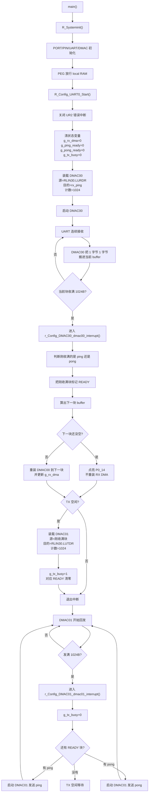

学习乒乓缓冲区的原理，让uart 能够echo至少1M数据不丢包（了解DMA）


DMA直接存储器访问
数据搬运，分担CPU的负担


数据流处理中的DMA
什么是数据流？音频，视频等源源不断需要处理的，不希望被打断的数据

CPU经常会被打断，让CPU搬运数据流会很不靠谱

DMA+双缓冲，可以很稳定地处理数据流

创一个比较大的数组，比如1024字节，完成一半之后产生半完成中断，把数据分为上半部分和下半部分，之后DMA搬运下半部分buffer，同时上半部分buffer交给CPU进行一些处理


完成了RIIC0作为主机，RIIC1作为从机的IIC通信，，学习了DMA的基本概念，了解了乒乓缓冲区的原理，DMA加上双缓冲去处理如音频视频等源源不断的数据流


把DMAC00作为RX，将软件触发修改为如图UART收到一字节触发一次DMA


传输完成向CPU发一次中断，通知CPU


DMAC01


UART 需要下一个发送字节时触发，让 DMA 顺着 UART 发送节奏喂数据


寻找 ping/pong缓冲区地址
先定义数组，再编译，之后再搜索


**外设寄存器那边选 Fixed**，**RAM buffer 那边选 Increment**


```c
PDMA0.DSA0 = (uint32_t)0xFFCE2026;

    PDMA0.DDA0 = (uint32_t)&rx_ping[0];

    PDMA0.DTC0 = UART_RLOCK_SIZE;

    PDMA0.DCSTC0 = _DMAC_TRANSFER_ERROR_FLAG_CLEAR | _DMAC_TRANSFER_COMPLETION_FLAG_CLEAR;
```
**让 DMAC00 从 UART 接收寄存器开始，把 1024 字节写进 ping，并清空旧状态后开始新一轮接收。”**
DCSTC0 =DMA Status Clear
DSA0 =45DMA Source Address 0


/* Start user code for global. Do not edit comment generated here */

uint8_t rx_ping[1024];

uint8_t rx_pong[1024];

#define UART_RLOCK_SIZE 1024

volatile uint8_t g_rx_buffer;//0表示当前为ping，1则表示pong

volatile uint8_t g_ping_ready;

volatile uint8_t g_pong_ready;

volatile uint8_t g_tx_busy;

volatile uint8_t g_tx_buffer;//同理

  

/* End user code. Do not edit comment generated here */

void r_main_userinit(void);

  

/***********************************************************************************************************************

* Function Name: main

* Description  : This function implements main function.

* Arguments    : None

* Return Value : None

***********************************************************************************************************************/

void main(void)

{

    r_main_userinit();

    /* Start user code for main. Do not edit comment generated here */

    R_Config_UART0_Start();

    INTC2.ICRLIN30UR0.BIT.MKRLIN30UR0 = _INT_PROCESSING_DISABLED;

    INTC2.ICRLIN30UR0.BIT.RFRLIN30UR0 = _INT_REQUEST_NOT_OCCUR;

  

    INTC2.ICRLIN30UR1.BIT.MKRLIN30UR1 = _INT_PROCESSING_DISABLED;

    INTC2.ICRLIN30UR1.BIT.RFRLIN30UR1 = _INT_REQUEST_NOT_OCCUR;

  

    //关闭CPU进入UART中断并清除标志

  

    g_rx_buffer=0;

    g_ping_ready=0;

    g_pong_ready=0;

    g_tx_busy=0;

    g_tx_buffer=0;

  

    //初始化

  
  

    R_Config_DMAC00_Stop();

    R_Config_DMAC01_Stop();

  

    PDMA0.DSA0 = (uint32_t)0xFFCE2026;

    PDMA0.DDA0 = (uint32_t)&rx_ping[0];

    PDMA0.DTC0 = UART_RLOCK_SIZE;

    PDMA0.DCSTC0 = _DMAC_TRANSFER_ERROR_FLAG_CLEAR | _DMAC_TRANSFER_COMPLETION_FLAG_CLEAR;

    //让DMAC00从UART接收寄存器开始，把1024字节写进ping这个缓存区，然后清空旧状态防止出错

  
  

    R_Config_DMAC00_Start();

  
  
  
  
  
  
  

    /* End user code. Do not edit comment generated here */

}


错误在切换缓冲区的时候，没有加一个判断，要切换的缓冲区是否已经将数据全部传输出去，会导致直接覆盖数据


ERROR2
PEG 权限 可以先理解成：

**DMA/外设有没有权限访问某些 RAM 区域的门禁。**





Local RAM和 GlobalRAM 以及

 Local RAM（本地 RAM）
物理位置：直接集成在 CPU 核心内部或紧邻核心 
community.renesas.com
访问特点：
速度最快，通常支持单周期访问
不会被其他核心干扰，确定性高
典型用途：
存放当前核心的堆栈（Stack）
实时性要求高的中断服务程序
核心私有的临时变量/算法数据
注意：其他核心无法直接访问你的 Local RAM

Global RAM（全局/共享 RAM）
物理位置：位于芯片内部，但通过系统总线连接各核心 
community.renesas.com
访问特点：
所有 CPU 核心、DMA、外设均可访问
访问速度略慢（可能需 2~4 个周期）
多核同时访问时需考虑仲裁和同步
典型用途：
核间通信（IPC）：CPU1 写，CPU2 读
共享的传感器数据缓冲区
DMA 传输的源/目标地址
注意：需使用信号量/锁机制避免数据竞争

Retention RAM（保持RAM/保留RAM）
核心特性
低功耗保持：在芯片进入睡眠/待机/深度睡眠模式时，主电源关闭，但 Retention RAM 由**备用电源（VBAT/LDO）**继续供电，数据不丢失
容量很小：由于需要额外的电源电路和保持电路，成本高，通常只有 4KB~64KB
唤醒后直接使用：芯片从低功耗模式唤醒后，Retention RAM 中的数据立即可用，无需重新加载
典型应用场景
保存系统状态：休眠前的关键变量、程序计数器、堆栈指针
RTC（实时时钟）数据：时间、日期、闹钟设置
快速唤醒：保存少量上下文，唤醒后快速恢复运行，无需从头初始化
低功耗数据采集：休眠期间持续记录传感器数据


USRT.h
```c
void R_UART1_DmaEcho_Start(void);
uint32_t R_UART1_DmaEcho_GetRxBytes(void);
uint32_t R_UART1_DmaEcho_GetTxBytes(void);
uint32_t R_UART1_DmaEcho_GetDropCount(void);
uint32_t R_UART1_DmaEcho_GetErrorFlags(void);
```
- 让 main 能直接启动 DMA echo
- 让你在调试器里直接看收发统计、丢包计数、错误标志，而不是只靠串口工具窗口判断


USRT.User.c
```c
#include "Config_DMAC00.h"
#include "Config_DMAC01.h"
```
- UART1 这边要直接控制 DMAC00/01
- 不引入 DMA 头文件，就没法安全使用 DMA 配置宏和接口


```c
extern volatile uint32_t g_cg_sync_read;

#define UART1_DMA_ECHO_BLOCK_SIZE             (1024U)
#define UART1_DMA_ECHO_BUFFER_COUNT           (2U)

#define UART1_LRAM_SELF_BASE                  (0xFEDD8000UL)
#define UART1_LRAM_ALIAS_OFFSET               (0x00200000UL)
#define UART1_LRAM_SIZE                       (0x00028000UL)

#define UART1_PEG_SPEN                        (0x00000001UL)
#define UART1_PEG_MK_32K                      (0x00007000UL)
#define UART1_PEG_MK_128K                     (0x0001F000UL)
#define UART1_PEG_BA_SPID1                    (0x00000020UL)
#define UART1_PEG_BA_WR                       (0x00000004UL)
#define UART1_PEG_BA_RD                       (0x00000002UL)
#define UART1_PEG_BA_EN                       (0x00000001UL)

#define UART1_DMA_RX_DTCT_SETTING             (_DMAC_CYCLES_EXECUTED | _DMAC_TRANSFER_HARDWARE | _DMAC_CHAIN_DISABLE | \
                                               _DMAC_TRANSFER_COMPLETION_INTERRUPT_ENABLE | _DMAC_CONTINUOUS_TRANSFER_DISABLE | \
                                               _DMAC_RELOAD2_DISABLE | _DMAC_RELOAD1_DISABLE | _DMAC_DESTINATION_INCREMENT | \
                                               _DMAC_SOURCE_FIXED | _DMAC_TRANSFER_DATA_8BITS | _DMAC_SINGLE_TRANSFER)
#define UART1_DMA_TX_DTCT_SETTING             (_DMAC_CYCLES_EXECUTED | _DMAC_TRANSFER_HARDWARE | _DMAC_CHAIN_DISABLE | \
                                               _DMAC_TRANSFER_COMPLETION_INTERRUPT_ENABLE | _DMAC_CONTINUOUS_TRANSFER_DISABLE | \
                                               _DMAC_RELOAD2_DISABLE | _DMAC_RELOAD1_DISABLE | _DMAC_DESTINATION_FIXED | \
                                               _DMAC_SOURCE_INCREMENT | _DMAC_TRANSFER_DATA_8BITS | _DMAC_SINGLE_TRANSFER)

static uint8_t g_uart1_dma_echo_buffers[UART1_DMA_ECHO_BUFFER_COUNT][UART1_DMA_ECHO_BLOCK_SIZE];
static volatile uint8_t g_uart1_dma_echo_queue[UART1_DMA_ECHO_BUFFER_COUNT];
static volatile uint8_t g_uart1_dma_echo_queue_head;
static volatile uint8_t g_uart1_dma_echo_queue_tail;
static volatile uint8_t g_uart1_dma_echo_queue_count;
static volatile uint8_t g_uart1_dma_echo_rx_buffer_index;
static volatile uint8_t g_uart1_dma_echo_tx_active;
static volatile uint8_t g_uart1_dma_echo_tx_wait_ready;
static volatile uint8_t g_uart1_dma_echo_enabled;
static volatile uint32_t g_uart1_dma_echo_rx_bytes;
static volatile uint32_t g_uart1_dma_echo_tx_bytes;
static volatile uint32_t g_uart1_dma_echo_drop_count;
static volatile uint32_t g_uart1_dma_echo_error_flags;
static volatile uint8_t g_uart1_dma_echo_error_sink;

static void r_uart1_dma_echo_write_protected_reg32(volatile uint32_t * reg, uint32_t value);
static void r_uart1_dma_echo_init_peg(void);
static uint32_t r_uart1_dma_echo_cpu_to_dma_address(const void * cpu_address);
static void r_uart1_dma_echo_queue_push(uint8_t buffer_index);
static uint8_t r_uart1_dma_echo_queue_pop(uint8_t * buffer_index);
static void r_uart1_dma_echo_arm_rx(uint8_t buffer_index);
static void r_uart1_dma_echo_arm_tx(uint8_t buffer_index, uint8_t kick_first_byte);
static void r_uart1_dma_echo_try_start_tx(void);
void r_uart1_dma_echo_on_rx_block_complete(void);
void r_uart1_dma_echo_on_tx_block_complete(void);
```


```c
void r_Config_UART1_callback_sendend(void)
{
    /* Start user code for r_Config_UART1_callback_sendend. Do not edit comment generated here */
    if (g_uart1_dma_echo_enabled != 0U)
    {
        INTC2.ICRLIN31UR0.BIT.MKRLIN31UR0 = _INT_PROCESSING_DISABLED;
        INTC2.ICRLIN31UR0.BIT.RFRLIN31UR0 = _INT_REQUEST_NOT_OCCUR;

        if (g_uart1_dma_echo_tx_wait_ready != 0U)
        {
            r_uart1_dma_echo_try_start_tx();
        }
    }
    /* End user code. Do not edit comment generated here */
}
```
- 当前做法是：UART 发送链路如果正忙，就先等 UR0 send-end 再接着起下一块 DMA
- 这样我不用改自动生成的 UART send ISR 本体，只把自定义逻辑放在 user 区域里，降低 Smart 重新生成覆盖的风险


```c
void r_Config_UART1_callback_error(uint32_t err_type)
{
    /* Start user code for r_Config_UART1_callback_error. Do not edit comment generated here */
    if (g_uart1_dma_echo_enabled != 0U)
    {
        g_uart1_dma_echo_error_flags |= err_type;
    }
    /* End user code. Do not edit comment generated here */
}
```
- UART 一旦出现 framing/overrun，要留痕，便于判断是串口链路问题还是 DMA 问题
- 这同样放在 callback 的 user 区域里，避免去改 ISR 主体


加了写保护寄存器的统一写入函数。

原因：

PEG 相关寄存器是受保护写的
直接写不符合 RH850 的保护写流程，必须走 写值 -> 写反码 -> 再写值

1. DMA 访问 local RAM 时，要经过 PEG
2. DMA 不能直接访问 local RAM 的 self area
3. 需要把访问地址改成对应的 CPU1 area
4. 还要允许对应 SPID 的读写权限


- self area：0xFEDD8000 ~ 0xFEDFFFFF
- CPU1 area：0xFEBD8000 ~ 0xFEBFFFFF


# Smart Configuration设置

- Chain tansfer不让DMA00自动串联到别的DMA通道,
- Trigger source INTRLIN31UR1    串口收到1个字节，就触发一次DAM，将字节搬到RAM
- Transfer mode Singer transfer      每次 UART 触发，本质上只搬 1 个字节
- Source address 0xFFCE2026    RLIN31.LURDR 的地址  数据接收寄存器的地址，Line-Uart receive Data Receive
- Destination address 0xFEDD8000  接收 buffer 放在 local RAM 里的起始地址，DMA要把接受的数据往这块RAM里写
- Tansfer count 1024   1024字节为一块，接收满1024字节就触发DMA中断，切换一块缓冲区（ping-pong）
- Reload function 1 enabled
- Reload function 2 enabled    当前不是用硬件reload实现双缓冲


- Count direction Fixed   因为源是LURDR，串口接收寄存器位置不变所以选Fixed
- Count direction Increment  因为目标是
- Data size 8bit