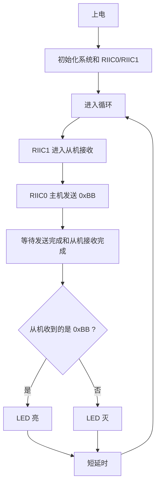

# 问题回答
1.SDA与SCL为什么要加上拉电阻？
加上拉电阻是因为IIC总线的 SDA 和 SCL 采用开漏输出结构设备只能主动拉低，必须靠上拉电阻把总线恢复到高电平。
2.上拉电阻范围
范围：标准模式（100 kHz）：2.2kΩ ~ 10kΩ；快速模式（400 kHz）：1kΩ ~ 4.7kΩ；​高速模式（1 MHz+）：1kΩ ~ 2.2kΩ


# 一、IIC

## 1.数据内容层面
**单片机发送（写）数据**
发送成功

发送失败无应答

**单片机接收（读）数据**


**因此要在第一组数据中加入读\写标识，IIC中第一组数据最低位（最右边）表示标志位，读R为逻辑一，写W为逻辑0。

**IIC中的指针功能**
**第二组数据作为指针，如要读\写第四寄存器，第二组数据为00000100，接下来的数据内容从第四个寄存器开始读\写
注：设置的指针将会被保存，下次读写将从设置处开始（但从设备如果断电或者复位，设置的指针值会丢失）


**IIC RH850作为Master总体流程**
1. 主机发 Start 表示一次 I2C 通信开始
2. 主机发送器件地址 0x50 + 写位  
3. 从机 ACK，
4. 主机发送内部字地址 0x00，告诉 EEPROM： “我接下来想访问存储单元 0x00。”
5. 从机再次 ACK，表示字地址接收成功。
6. 主机发 Repeated Start (Sr) ，不释放总线，直接重新开始一次通信。
7. 主机发送器件地址 0x50 + 读位
8. 从机 ACK，EEPROM 应答，准备送数据。
9. EEPROM 发送数据 0xAA
10. 主机读完后发 NACK  
11. 主机发 Stop，本次事务结束。

## 2.代码部分
### 2.1 r_Config_RIIC0_error_interrupt

当 RIIC0 发生这些事件时，这个函数会被调用：
- 仲裁丢失
- 超时
- 收到 NACK
- 检测到 Start/Stop 条件
- 发送/接收阶段结束

#### 2.1.1仲裁丢失
```c
if((RIIC0.IER.UINT32 & _RIIC_ARBITRATION_LOST_INT_ENABLE) &&
   (RIIC0.SR2.UINT32 & _RIIC_ARBITRATION_LOST))
{
    r_Config_RIIC0_callback_receiveerror(MD_ERROR1);
}
如果仲裁丢失中断开启了 且状态寄存器检测到仲裁丢失,就回调错误处理，报 MD_ERROR1
```
#### 2.1.2超时错误
```c
else if((RIIC0.IER.UINT32 & _RIIC_TIMEOUT_INT_ENABLE) &&
        (RIIC0.SR2.UINT32 & _RIIC_TIMEOUT_DETECTED))
{
    r_Config_RIIC0_callback_receiveerror(MD_ERROR2);
}
```
#### 2.1.3收到NACK
```c
else if((RIIC0.IER.UINT32 & _RIIC_NACK_RECEPTION_INT_ENABLE) &&
        (RIIC0.SR2.UINT32 & _RIIC_NACK_DETECTED))
```
主机接收模式下接到NACK
```c
RIIC0.SR2.UINT32 &= (uint32_t) ~_RIIC_STOP_CONDITION_DETECTED;
RIIC0.CR2.UINT32 |= _RIIC_STOP_CONDITION_REQUEST;
while (!(RIIC0.SR2.UINT32 & _RIIC_STOP_CONDITION_DETECTED))
{
    NOP();
}
RIIC0.SR2.UINT32 &= (uint32_t) ~_RIIC_NACK_DETECTED;
RIIC0.SR2.UINT32 &= (uint32_t) ~_RIIC_STOP_CONDITION_DETECTED;
```
主机发送模式下接到NACK
```c
else if (_RIIC_MASTER_RECEIVE == g_riic0_mode_flag)
这时执行：

RIIC0.SR2.UINT32 &= (uint32_t) ~_RIIC_STOP_CONDITION_DETECTED;
RIIC0.CR2.UINT32 |= _RIIC_STOP_CONDITION_REQUEST;
dummy = RIIC0.DRR.UINT32;
while ((RIIC0.SR2.UINT32 & _RIIC_STOP_CONDITION_DETECTED) != _RIIC_STOP_CONDITION_DETECTED)
{
    NOP();
}
RIIC0.SR2.UINT32 &= (uint32_t) ~_RIIC_NACK_DETECTED;
RIIC0.SR2.UINT32 &= (uint32_t) ~_RIIC_STOP_CONDITION_DETECTED;
```
dummy- 对接收寄存器 DRR 做一次“占位读取”,把硬件接收流程完整走完,防止 RIIC 接收状态机卡在半路。
（“占位读取”：发一个时钟，把数据读出来舍弃，让整个程序走完）。

NACK与ACK
NACK=Negative Acknowledge    ACK=Acknowledge

#### 2.1.4主机发送模式下正确推进
```c
else if (_RIIC_MASTER_TRANSMIT == g_riic0_mode_flag)
```
```c

if ((_RIIC_MASTER_SENDS_ADR_7_W == g_riic0_state) ||
    (_RIIC_MASTER_SENDS_ADR_10A_W == g_riic0_state))
```
- 清 START 检测标志
- 关闭 START 中断
- 打开 STOP 中断

调用
```c
_Config_RIIC0_callback_transmitend();

g_app_riic0_tx_done = 1;
```
#### 2.1.5主机接收模式下正确推进
其他步骤同理
Repeated
```c
else if (_RIIC_MASTER_RECEIVES_RESTART == g_riic0_state)

g_riic0_state = _RIIC_MASTER_SENDS_ADR_10A_R;
```
===**把 RIIC0 当前通信状态，切换成“主机接下来要发送读地址阶段”。**==
### 2.2 r_Config_RIIC0_transmit_interrupt
**每进来一次发送中断，就根据当前模式和状态，把“下一个该发的字节”写到发送寄存器 RIIC0.DRT 里，同时推进 IIC 状态机。**
#### 2.2.1主机发送模式
```c
if (_RIIC_MASTER_SENDS_ADR_7_W == g_riic0_state)
{
    RIIC0.DRT.UINT32 = (uint8_t)(g_riic0_slave_address << _RIIC_ADDRESS_7BIT_SHIFT);
    g_riic0_state = _RIIC_MASTER_SENDS_DATA;
}
```
当前状态是“准备发送 7 位从机地址（写方向）”,把 g_riic0_slave_address 左移 1 位后写到发送寄存器 DRT。因为 I2C 总线上地址格式是：7位地址 + 1位R/W，写方向时，最低位 R/W = 0

比如此时 EEPROM 地址是 0x50：左移 1 位后，会变成总线发送字节 0xA0

主机接收模式也是同理，要先发地址，说明要开始读数据，改变g_riic0_state状态。
### 2.3r_Config_RIIC0_receive_interrupt
**主机在“读数据”时，每收到一个字节，就在这里决定怎么取数、什么时候发 NACK、什么时候发 STOP**
#### 2.3.1如果接收长度是 1 或 2 字节，先打开 WAIT
```c
if ((2U == g_riic0_rx_length) || (1U == g_riic0_rx_length))
{
    RIIC0.MR3.UINT32 |= _RIIC_WAIT;
}
```
- 如果这次只收 1 或 2 个字节，就要更早开始准备结束流程
原因：如果不提前进入wait，发送NACK或许会出现字符丢失，甚至来不及发送stop。

#### 2.3.2判断字符长度
```c
if (1U == g_riic0_rx_length)
{
    g_riic0_state = _RIIC_MASTER_RECEIVES_STOPPING;
}
else
{
    g_riic0_state = _RIIC_MASTER_RECEIVES_DATA;
}
```
如果是多字节就继续发
#### 2.3.3读出最后一个字节
```c
*gp_riic0_rx_address = RIIC0.DRR.UINT32;
gp_riic0_rx_address++;
g_riic0_rx_count++;
```
为什么存到缓存区？
**RIIC 接收到的 EEPROM 数据需要先存到软件接收缓冲区里，后面的程序才能拿这个值去判断读回来的是否正确；你现在只读 1 个字节，所以就存到数组第 0 个元素。**（也可以直接定义变量去接收）
g_at24c08_read_buffer[0]
### 2.4初始化
```c
void r_main_userinit(void) { DI(); 
R_Systeminit(); 
leds_off(); 
R_Config_RIIC0_Start(); 
EI();
 }
```
### 2.5 EEPROM 写和读 1 个字节
```c
uint8_t eeprom_write_byte(uint16_t address, uint8_t data)
{
    MD_STATUS status;

    eeprom_write_buf[0] = (uint8_t)(address & 0xFF);
    eeprom_write_buf[1] = data;

    g_riic0_tx_done_flag = 0;//清发送完成标志

    status = R_Config_RIIC0_Master_Send(eeprom_device_address(address),
                                        &eeprom_write_buf[0],
                                        EEPROM_WRITE_BUFFER_LENGTH);
    if (status != MD_OK)
    {
        return 0;
    }

    return wait_tx_done();
}

uint8_t eeprom_read_byte(uint16_t address, uint8_t * const data)
{

    eeprom_addr_buf[0] = (uint8_t)(address & 0xFF);
    eeprom_read_buf[0] = 0;

    g_riic0_tx_done_flag = 0;
    g_riic0_rx_done_flag = 0;

    
    if (Config_RIIC0_Master_Send_Without_Stop(eeprom_device_address(address),
                                                     &eeprom_addr_buf[0],
                                                     EEPROM_ADDRESS_LENGTH)!= MD_OK)
    {
        return 0;
    }

    if (wait_tx_done() == 0)
    {
        return 0;
    }

    g_riic0_rx_done_flag = 0;

 
    if (R_Config_RIIC0_Master_Receive(eeprom_device_address(address),
                                           (uint8_t *)&eeprom_read_buf[0],
                                           EEPROM_READ_LENGTH); != MD_OK)
    {
        return 0;
    }

    if (wait_rx_done() == 0)
    {
        return 0;
    }

    *data = eeprom_read_buf[0];
    return 1;
```

- eeprom_write_buf[0] 放 EEPROM 的内部地址低 8 位
- eeprom_write_buf[1] 放要写入的数据
```c

 eeprom_write_buf[0] = (uint8_t)(address & 0xFF);
 eeprom_write_buf[1] = data;
```
- **AT24C08BN 的写协议本来就要求主机先发“内部地址”，再发“数据”**。**把 16 位地址里的低 8 位取出来，作为 EEPROM 写操作中的地址字节**-,再把结果强制转换成 uint8_t,原因是这次只发送AA只有一个字节。
### 2.6 GIIC0作为主机，GIIC1作为从机
#### 2.6.1代码流程图



#### 2.6.2从机接收
```c
if (R_Config_RIIC1_Slave_Receive((uint8_t *)&slave_rx_data[0], 1) != MD_OK)
{
    return 0;
    }
```
转到**R_Config_RIIC1_Slave_Receive() 真正设置从机接收状态（在R_Config_RIIC1_User.c中系统自动生成）
```c
void r_Config_RIIC1_callback_receiveend(void)
{
    g_riic1_rx_done_flag = 1;
}
```
接收结束后置完成标志为1**
#### 2.6.3主机发送BB
```c
uint8_t master_tx_data[1] = { 0xBB };
```
主机发起发送并判断
```c
if (R_Config_RIIC0_Master_Send(0x01, &master_tx_data[0], 1)!= MD_OK)
{
    return 0;
}
```
发送完成标志位置1
```c
void r_Config_RIIC0_callback_transmitend(void)
{
    g_riic0_tx_done_flag = 1;
}
```
## 3.Smart Configurator 设置
### 3.1从机设置


**启用从机地址寄存器 0**

**Address format = 7 bits,使用 7 位从机地址。**  

**General call address enable是否允许这个 I2C 从机响应“广播地址”。**
### 3.2从机设置

- Enable master arbitration-lost detection（使能主机仲裁丢失检测）
   功能：检测多主机环境下的总线仲裁丢失
   场景：当总线上有多个主机同时通信时，如果检测到总线冲突（其他主机占用），自动停止传输并报告错误

- Enable NACK transmission arbitration-lost detection（使能NACK传输仲裁丢失检测）
  功能：当主机发送NACK（非应答）时，检测是否发生仲裁丢失
  场景：主机不想继续接收数据时发送NACK，如果此时总线有其他主设备占用

- Enable transfer operation during NACK reception（使能NACK接收期间的传输操作）
  功能：即使接收到从机的NACK，也继续完成当前传输操作（生成STOP条件）
  场景：从机返回NACK（如地址不匹配、忙状态），主机仍能正常结束事务，释放总线
## 4.实验现象
### 4.1EEPROM

### 4.2RIIC0作为主机,RIIC1作为从机


# 二、DMA完成UART双缓冲通信
## 2.1基础概念
- **Local RAM（本地 RAM）**
**物理位置：直接集成在 CPU 核心内部或紧邻核心** 
**访问特点：速度最快，通常支持单周期访问，不会被其他核心干扰，确定性高**
**典型用途：**
**存放当前核心的堆栈（Stack）**
**实时性要求高的中断服务程序**
**注意：其他核心无法直接访问你的 Local RAM**

- **Global RAM（全局/共享 RAM）**
**物理位置：位于芯片内部，但通过系统总线连接各核心** 
**访问特点：所有 CPU 核心、DMA、外设均可访问，访问速度略慢（可能需 2~4 个周期），多核同时访问时需考虑仲裁和同步**
**典型用途：**
**核间通信（IPC）：CPU1 写，CPU2 读**
**共享的传感器数据缓冲区**
**DMA 传输的源/目标地址**


- **Retention RAM（保持RAM/保留RAM）**
**核心特性**
**低功耗保持：在芯片进入睡眠/待机/深度睡眠模式时，主电源关闭，但 Retention RAM 由备用电源（VBAT/LDO）继续供电，数据不丢失**
**容量很小：由于需要额外的电源电路和保持电路，成本高，通常只有 4KB~64KB**
## 2.2思路流程
**创两个比较大的数组，比如1024字节，完成一个之后产生完成中断，把数据分为RX和TX，之后DMA搬运TX部分buffer，同时RXbuffer交给CPU进行一些处理**。
## 2.3问题解决
PEG 相关寄存器是受保护写的
直接写不符合 RH850 的保护写流程，必须走 写值 -> 写反码 -> 再写值

1. DMA 访问 local RAM 时，要经过 PEG
2. DMA 不能直接访问 local RAM 的 self area
3. 需要把访问地址改成对应的 CPU1 area
4. 还要允许对应 SPID 的读写权限


- self area：0xFEDD8000 ~ 0xFEDFFFFF
- CPU1 area：0xFEBD8000 ~ 0xFEBFFFFF
所以在Smart Configuration设置相应正确地址范围。
