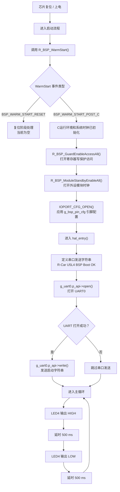
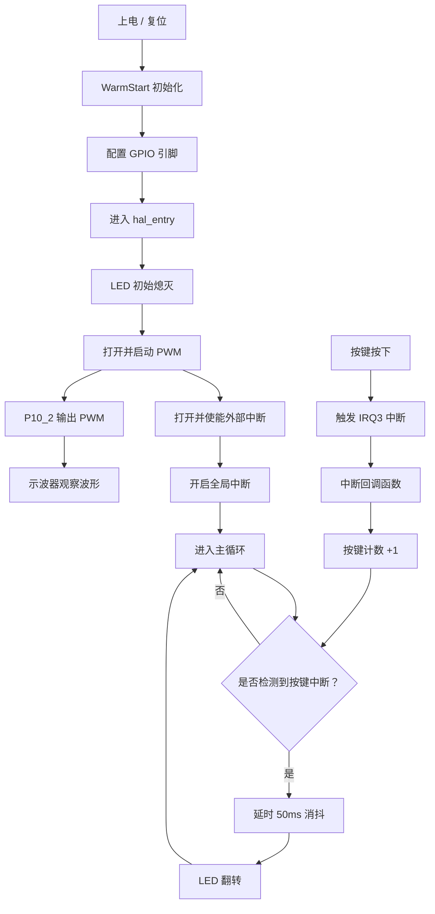
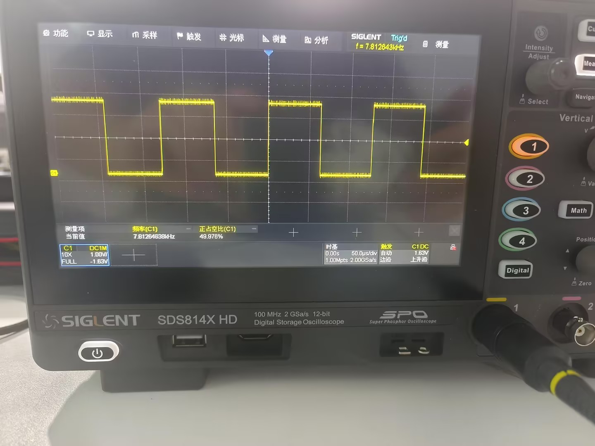

# 一、安装e2环境时遇到的问题以及解决方法


没有更换launch文件


FSP配置中找不到Rcar，需要在安装包安装rcarmcuu5l_FSP_Packs_v1.1.1
如下所示


缺少文件RFWCARM.dll文件，可能是安装文件缺失，可以重新下载或者修复


系统 PATH 里找不到 `java` / `javaw`，Renesas 期望的自带 `jre\\bin\\javaw.exe` 也不存在

解决办法：改为set(RASC_EXE_PATH "C:/Renesas/fsp_sc/eclipse/rasc.exe")
# 二、BSP最小系统启动

## 实现功能：
芯片从复位向量正常启动，配置系统时钟到240MHz，初始化必要系统寄存器，进入main()函数并通过LED闪烁验证

## 验证操作
开发板LED以1Hz频率闪烁
## 时钟树配置，系统时钟树达到240Mhz 

## 引脚设置

Pin脚配置

引脚模式选择输出模式，初始低电平
输出类型选择Push-Pull，推挽输出，主动输出高电平或低电平
输入缓冲和双向模式以及反向输出都选择Disable

## 引脚配置文件更改成正确型号

改好配置后需要在Manage configuration里面选择当前的修改后的配置文件，然后点击generate project content


g_bsp_pin_cfg 是生成给程序执行的“引脚配置表”。
没有这张表，程序不知道你在 RASC 里配了什么
## LED闪烁代码
```c
void hal_entry(void)

{

    /* TODO: add your own code here */

    while(1)

    {

        R_IOPORT_PinWrite(&g_ioport_ctrl,LED4,BSP_IO_LEVEL_HIGH);

        R_BSP_SoftwareDelay(500,BSP_DELAY_UNITS_MILLISECONDS);

        R_IOPORT_PinWrite(&g_ioport_ctrl,LED4,BSP_IO_LEVEL_LOW);

        R_BSP_SoftwareDelay(500,BSP_DELAY_UNITS_MILLISECONDS);

    }
```
`bsp_api.h` 会进一步包含 BSP 里的延时定义，所以能直接使用
## 串口打印代码
```c
static volatile uint8_t g_uart_tx_complete = 0;//标志位UART是否已经发送完成

void user_uart_callback(uart_callback_args_t * p_args)//UART回调函数在FSP配置里
{
    if (UART_EVENT_TX_COMPLETE == p_args->event)
    {
        g_uart_tx_complete = 1;
    }
}

void hal_entry(void)
{
    static uint8_t msg[] = "R-Car U5L4 BSP Boot OK\r\n";//要- 1因为 C 字符串结尾会自动带一个隐藏的 `\0`

    fsp_err_t err = g_uart0.p_api->open(g_uart0.p_ctrl, g_uart0.p_cfg);//```使用 g_uart0 的配置参数g_uart0.p_cfg，初始化 g_uart0 的运行状态 g_uart0.p_ctrl，调用 UART 驱动的 open 函数，并把结果保存到 err。
    if (FSP_SUCCESS == err)
    {
        g_uart_tx_complete = 0;

        err = g_uart0.p_api->write(g_uart0.p_ctrl, msg, sizeof(msg) - 1);

        while ((FSP_SUCCESS == err) && (0 == g_uart_tx_complete))
        {
            /* Wait for UART transmit complete. */
        }
    }

    while (1)
    {
        R_IOPORT_PinWrite(&g_ioport_ctrl, LED4, BSP_IO_LEVEL_HIGH);
        R_BSP_SoftwareDelay(500, BSP_DELAY_UNITS_MILLISECONDS);

        R_IOPORT_PinWrite(&g_ioport_ctrl, LED4, BSP_IO_LEVEL_LOW);
        R_BSP_SoftwareDelay(500, BSP_DELAY_UNITS_MILLISECONDS);
    }
}
```
## 串口模块配置

在Stacks下方配置串口
Channel: 0
Baud Rate: 115200
Data Bits: 8bits
Parity: None
Stop Bits: 1bit
Operation: Both TX RX
RLIN30TX: P00_2
RLIN30RX: P00_3
注意这几个设置，其他暂时保持默认
## 项目中产生的错误
### 错误一：串口助手打印乱码

原因：系统的实际时钟并不是24MHZ,查看丝印发现晶振是16MHZ

验证：将串口波特率换成76800，能正常显示，它与115200大约为2/3，恰好16MHZ与24MHZ关系也是2/3.

改正方法：将时钟树Mainosc改为16MHZ（重点：改完之后一定要在VS code中将文件重新编译生成，再下载启动）

### 正确现象：


## 代码流程图：


# 三、GPIO 多功能与中断控制
## 实现功能
全面验证IOPORT的多种工作模式、复用功能、中断输入能力
## 验证操作
按键触发外部中断→LED翻转；用示波器验证Direct模式下PWM直接输出（不经CPU）
## 配置AP0和P0_0引脚


在stacks中配置中断设置

## 配置PWM


## 主要代码
### LED控制函数
```c
void external_irq_callback(external_irq_callback_args_t * p_args)
{
    if (KEY_IRQ_CHANNEL == p_args->channel)
    {
        g_key_irq_count++;
    }
}
```
### 外部中断回调函数
```c
void hal_entry(void)
{
    fsp_err_t err = FSP_SUCCESS;
    uint32_t handled_irq_count = 0;

    led_write(BSP_IO_LEVEL_LOW);
```
### 初始化并启动PWM定时器
```c
    err = g_external_irq0.p_api->open(g_external_irq0.p_ctrl, g_external_irq0.p_cfg);
    if (FSP_SUCCESS != err)
    {
        while (1)
        {
        }
    }

    err = g_external_irq0.p_api->enable(g_external_irq0.p_ctrl);
    if (FSP_SUCCESS != err)
    {
        while (1)
        {
        }
    }

    __enable_irq();
```
### 打开并使能外部中断
```c
    while (1)
    {
        if (handled_irq_count != g_key_irq_count)
        {
            handled_irq_count = g_key_irq_count;
            R_BSP_SoftwareDelay(KEY_DEBOUNCE_MS, BSP_DELAY_UNITS_MILLISECONDS);
            led_toggle();
        }
    }
}
```
## 流程图

## 遇到的错误
### 错误一：将Input Buffer打开导致无法进入中断函数，输出中断信号

### 原因：
- **模式覆盖**：系统可能误判该引脚需要作为输入或双向引脚，从而关闭了推挽输出驱动器，导致引脚变成高阻态（High-Z），无法输出高/低电平。
- **逻辑竞争**：输出信号通过 Input Buffer 回读到内部，可能会干扰内部状态机或中断控制器的逻辑判断。
## 正确现象


# 四、总结
##     本周主要完成了 R-Car U5L4 开发环境搭建、BSP 最小系统启动、LED 闪烁、UART 串口输出以及 GPIO 多功能与外部中断控制实验。过程中解决了 FSP Pack 缺失、RASC 路径错误、JDK 环境异常、引脚配置文件未生效、串口乱码等问题。通过 LED 闪烁验证了系统启动和 GPIO 输出，通过串口成功打印启动信息，并定位到晶振频率配置错误导致波特率异常。随后完成了按键外部中断控制 LED 翻转，以及 PWM Direct 模式输出验证，进一步熟悉了 FSP 中 IOPORT、UART、IRQ、PWM 等外设的配置与代码调用流程。


