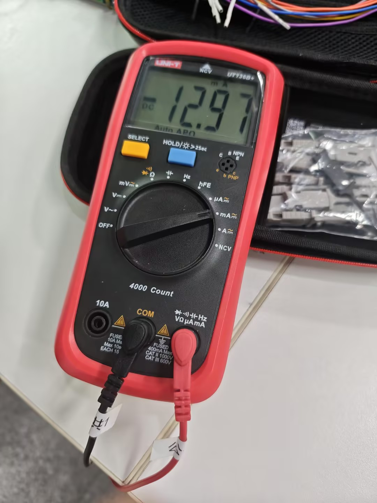
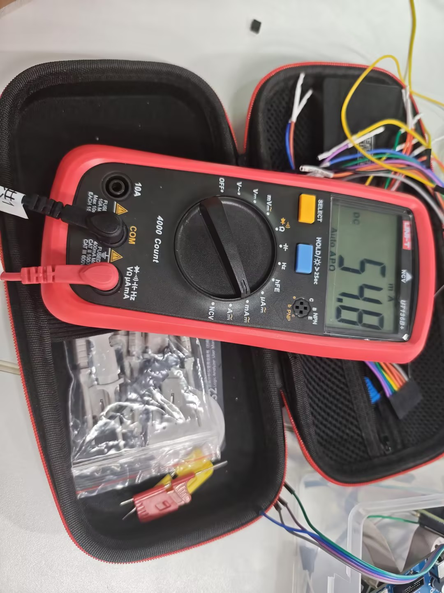
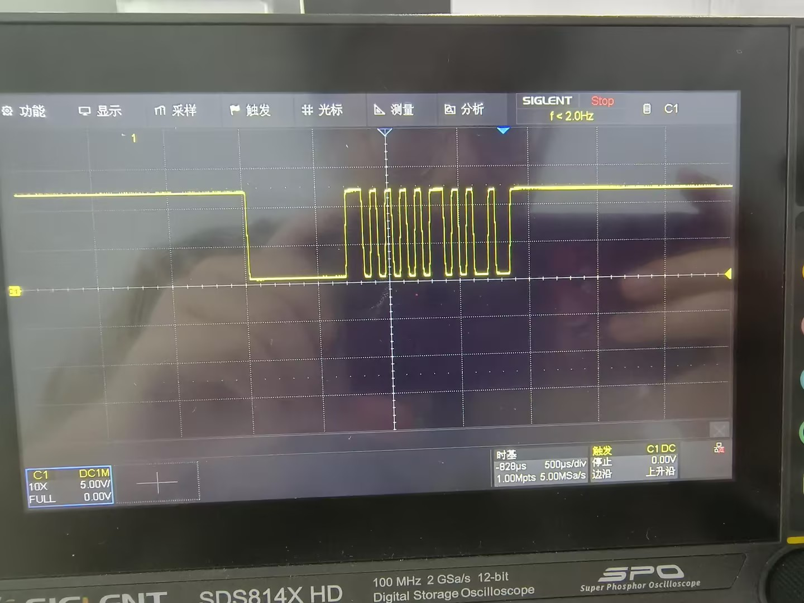

# 一、L3-03：TAUD 三相互补 PWM

## 功能设计

本实验实现以下功能：

1. 生成三相六路互补 PWM。
2. 为互补 PWM 插入死区时间。
3. 通过 TAPA 输出 U/V/W 三相 PWM。
4. 支持占空比动态变化。
5. 通过 TAPA0ESO 外部输入模拟故障，实现 Hi-Z 紧急关断。
6. 使用 ADCK 软件触发采样，验证 ADC 采样流程。

## 硬件连接

| 板子引脚 | 外设功能 | 说明 |
|---|---|---|
| P10_0 | TAPA0UP | U 相高边 PWM |
| P10_1 | TAPA0UN | U 相低边 PWM |
| P10_2 | TAPA0VP | V 相高边 PWM |
| P10_3 | TAPA0VN | V 相低边 PWM |
| P10_4 | TAPA0WP | W 相高边 PWM |
| P10_5 | TAPA0WN | W 相低边 PWM |
| P08_1 | TAPA0ESO | Hi-Z 外部触发输入 |
| AP0_0 | ADCK0I0 | ADC 输入采样引脚 |

验证时，逻辑分析仪连接 P10_0 到 P10_5，观察六路 PWM 输出。
Hi-Z 验证时，P08_1 接 GND 时 PWM 正常输出；当 P08_1 触发有效电平后，六路 PWM 被关闭。

## 软件设计

### 配置方法

#### 1. TAUD 三相 PWM 配置

在 FSP 中添加 Three-Phase PWM Driver on `r_taud_three_phase`，主要配置如下：


| 配置项                  | 设置值           | 说明            |
| -------------------- | ------------- | ------------- |
| TAUD Unit            | Unit 0        | 使用 TAUD0      |
| TAUD Operation Clock | CK0           | 使用 CK0 作为计数时钟 |
| TAUD Clock Prescaler | PCLK/0        | 不分频           |
| Output Level         | Positive      | 正逻辑输出         |
| Period               | 50 us         | PWM 周期        |
| Dead Time            | 10 Raw counts | 死区时间          |
| U/V/W Duty           | 50%           | 初始占空比         |

#### 2. TAPA 配置
TAPA 用于三相 PWM 输出和 Hi-Z 保护。
主要配置如下：


| 配置项 | 设置值 | 说明 |
|---|---|---|
| Asynchronous Hi-Z Control Function | Enable | 开启异步 Hi-Z 保护 |
| Hi-Z Input Edge Selection | Rising Edge | 上升沿触发 Hi-Z |
| Clear Condition Configuration | Stop Hi-Z output only when input is inactive | 输入无效后才允许解除 Hi-Z |
| TAPA0ESO | P08_1 | 外部 Hi-Z 输入引脚 |

#### 3. PIC 配置
PIC 用于连接 TAPA Hi-Z 输入控制。
主要配置：

| 配置项 | 设置值 |
|---|---|
| Enables Hi-Z Control By TAPA0ESO Pin Input | Enable |

#### 4. ADCK 配置

ADC 最终采用软件触发方式进行采样验证。
主要配置如

| 配置项 | 设置值 | 说明 |
|---|---|---|
| Data Format | 12-bit Unsigned Integer Right Justified | 12 位无符号右对齐 |
| Virtual Channel 0 | Physical Channel AN00 | 使用 AP0_0 |
| Scan Group 0 | Enable | 开启扫描组 0 |
| Trigger Method | Software | 软件触发 |
| Callback | adck_callback | ADC 转换完成回调 |

## 代码编写

### 1. 启动 TAUD、TAPA、PIC 和 ADCK

关键流程如下：

```c
g_pic_result = R_PIC_Open(&g_pic_ctrl, &g_pic_cfg);

g_adc_result = R_ADCK_Open(&g_adc0_ctrl, &g_adc0_cfg);
g_adc_result = R_ADCK_ScanCfg(&g_adc0_ctrl, &g_adc0_sg_cfg);
g_adc_result = R_ADCK_ScanGroupStart(&g_adc0_ctrl, ADC_GROUP_MASK_0);

g_taud_result = R_TAUD_THREE_PHASE_Open(&g_taud_three_phase0_ctrl,
                                        &g_taud_three_phase0_cfg);

g_tapa_result = R_TAPA_Start(&g_tapa0_ctrl);

g_taud_result = R_TAUD_THREE_PHASE_Start(&g_taud_three_phase0_ctrl);
```


占空比每秒变化
### 2. 动态修改三相占空比

程序中设置了 4 组占空比模式，并周期性切换：
```c
static const uint8_t duty_patterns[4][3] =
{
    {25U, 50U, 75U},
    {75U, 25U, 50U},
    {50U, 75U, 25U},
    {50U, 50U, 50U}
};
```

通过以下函数更新占空比：

```c
static void TaudThreePhaseSetDuty(uint8_t u_duty, uint8_t v_duty, uint8_t w_duty)
{
    three_phase_duty_cycle_t duty_cycle;

    duty_cycle.duty[THREE_PHASE_CHANNEL_U] = u_duty;
    duty_cycle.duty[THREE_PHASE_CHANNEL_V] = v_duty;
    duty_cycle.duty[THREE_PHASE_CHANNEL_W] = w_duty;

    g_taud_result =
        R_TAUD_THREE_PHASE_DutyCycleSet(&g_taud_three_phase0_ctrl, &duty_cycle);
}
```


### 3. TAPA Hi-Z 状态检测

程序通过读取 TAPA 标志位判断当前是否进入 Hi-Z 状态：

```c
uint32_t tapa_hiz_monitor =
    ((uint32_t) R_TAPA0->FLG >> TAPA_HIZ_MONITOR_SHIFT) & TAPA_HIZ_MONITOR_MASK;

g_tapa_hiz_active = (0U != tapa_hiz_monitor) ? 1U : 0U;
```

当外部输入触发 Hi-Z 后，`g_tapa_hiz_active` 会变为 1，PWM 输出关闭。

### 4. ADC 软件触发采样

程序周期性启动 ADC 扫描：

```c
g_adc_result = R_ADCK_ScanGroupStart(&g_adc0_ctrl, ADC_GROUP_MASK_0);

if (FSP_SUCCESS == g_adc_result)
{
    g_adc_software_trigger_count++;
}
else
{
    g_adc_software_trigger_fail_count++;
    g_adc_error_step = 6U;
}
```

ADC 转换完成后，在回调函数中读取结果：

```c
void adck_callback(adc_callback_args_t * p_args)
{
    uint16_t adc_value = 0U;

    g_adc_callback_count++;

    if (ADC_EVENT_SCAN_COMPLETE_GROUP_0 != p_args->event)
    {
        return;
    }

    g_adc_read_result = R_ADCK_Read(&g_adc0_ctrl, ADC_CHANNEL_0, &adc_value);

    if (FSP_SUCCESS == g_adc_read_result)
    {
        g_adc_last_value = adc_value;
        g_adc_read_count++;
    }
}
```

## 功能验证

### 1. 六路 PWM 输出验证

使用逻辑分析仪连接 P10_0 到 P10_5，可以观察到 6 路 PWM 波形。

验证现象：

- 6 路 PWM 持续输出。
- U/V/W 三相均有对应的高边和低边 PWM。
- PWM 周期符合配置比例。
- 高低边之间存在死区时间。

### 2. 死区时间验证

在逻辑分析仪中测量互补 PWM 的边沿间隔，可以看到高边关闭和低边打开之间存在延迟。

实测死区约为 `7.9 us`，说明死区插入功能有效。


### 3. Hi-Z 关断验证

P08_1 接 GND 时，PWM 正常输出。

当 P08_1 输入有效触发信号后，六路 PWM 被关闭。

关键观察变量：


```c
g_tapa_start_done = 1
g_tapa_error_step = 0
g_tapa_hiz_active = 1
g_tapa_hiz_trigger_count = 1
```

说明 TAPA Hi-Z 功能已经生效。

### 4. ADC 软件触发验证


#### 问题


FSP 要求 两个 ADC 触发输出都必须选择一个有效触发条件


观察 Watch 变量：

```c
g_adc_open_done = 1
g_adc_scan_cfg_done = 1
g_adc_scan_start_done = 1
g_adc_error_step = 0
g_adc_callback_count 持续增加
g_adc_read_count 持续增加
g_adc_software_trigger_count 持续增加
g_adc_software_trigger_fail_count = 0
```

说明 ADCK 软件触发采样正常。

`g_adc_last_value` 表示 AP0_0 当前输入电压对应的 ADC 采样值。若 AP0_0 接 GND，数值接近 0；若接 3.3V，数值会明显增大。

# 二、L3-07：FreeRTOS 集成与多任务调度
## 功能设计

本工程实现以下功能：

1. 在 R-Car U5L4 上启动 FreeRTOS 调度器。
2. 创建三个相同优先级的周期工作任务。
3. 使用 `vTaskDelayUntil()` 控制任务周期。
4. 使用 Queue 在工作任务与日志任务之间传递状态。
5. 使用 RLIN3 UART 输出任务执行状态。
6. 使用二值信号量等待 UART 发送完成。
7. 使用 UART TXI 中断回调通知日志任务。
8. 记录任务创建失败、Queue 丢包和 UART 超时等诊断信息。
9. 启用抢占式调度和同优先级时间片调度。


## 硬件连接

RLIN30 使用以下引脚：

|板子引脚|外设功能|连接目标|备注|
|---|---|---|---|
|P00_2|RLIN30TX|USB 转串口 RX|串口发送引脚|
|P00_3|RLIN30RX|USB 转串口 TX|当前程序未使用接收|
|GND|GND|USB 转串口 GND|必须共地|

## 软件设计

### FreeRTOS 配置

工程在 Smart Configurator 中添加以下组件：

- FreeRTOS
- FreeRTOS Port（`rm_freertos_port`）
- FreeRTOS Heap 4
- UART Driver on `r_rlin3_uart`
- I/O Port

FreeRTOS 主要配置如下：

|配置项|设置值|说明|
|---|---|---|
|Use Preemption|Enabled|启用抢占调度|
|Use Time Slicing|Enabled|启用同优先级时间片轮转|
|Tick Rate|1000 Hz|1 Tick 等于 1 ms|
|Max Priorities|5|有效优先级为 0～4|
|Use Tickless Idle|Disabled|当前多任务验证阶段关闭|
|Support Static Allocation|Enabled|支持静态创建任务|
|Support Dynamic Allocation|Enabled|支持动态创建任务和内核对象|
|Total Heap Size|16384 字节|为动态任务、Queue、Semaphore 提供空间|
|Use Mutexes|Enabled|支持互斥量|
|Use Task Notifications|Enabled|支持任务通知|
|Use Counting Semaphores|Enabled|支持计数信号量|

### 日志线程配置

Smart Configurator 生成的 `new_thread0` 作为 UART 日志任务：

|配置项|设置值|
|---|---|
|Symbol|`new_thread0`|
|Stack Size|4096 字节|
|Priority|3|
|Memory Allocation|Static|
|Allocate Secure Context|Disabled|

日志任务优先级高于三个工作任务。当工作任务向 Queue 写入状态后，日志任务被唤醒并立即处理消息；Queue 为空时，日志任务阻塞，不会持续占用 CPU。

### 工作任务配置

三个工作任务通过 `xTaskCreate()` 动态创建：

```
#define WORKER_STACK_DEPTH_WORDS    (512U)
#define WORKER_PRIORITY             (2U)
```

在 Cortex-M33 上，`StackType_t` 通常为 4 字节，因此每个工作任务的栈空间约为：

```
512 × 4 = 2048 字节
```

三个工作任务共使用约 6144 字节动态 Heap，剩余 Heap 用于任务控制块、Queue、Semaphore 和内存管理开销。

### UART 配置

RLIN3 UART 配置如下：

|配置项|设置值|
|---|---|
|实例名称|`g_uart0`|
|通道|RLIN30 / Channel 0|
|波特率|115200|
|数据位|8 bit|
|停止位|1 bit|
|校验|None|
|工作方向|TX/RX|
|Callback|`user_uart_callback`|
|RXI Priority|Disabled|
|TXI Priority|Priority 12|
|ERI Priority|Priority 12|

TXI 中断必须启用。RLIN3 驱动使用 TXI 中断发送后续字节，并在全部数据发送完成后产生 `UART_EVENT_TX_COMPLETE` 事件。

### Tick 来源说明

当前工程使用 FreeRTOS Cortex-M33 端口的默认实现，系统 Tick 实际由 Cortex-M SysTick 提供：

```
void vPortSetupTimerInterrupt(void);
void SysTick_Handler(void);
```

当前配置为：

```
#define configTICK_RATE_HZ    1000
```

因此系统每 1 ms 产生一次 Tick。

## 代码编写

### 任务状态结构

任务状态消息包含任务名称、运行状态和执行次数：

```c
typedef enum e_task_run_state
{
    TASK_RUN_STATE_STARTED = 0,
    TASK_RUN_STATE_RUNNING,
    TASK_RUN_STATE_CREATE_FAILED
} task_run_state_t;

typedef struct st_task_status_message
{
    char const      * p_task_name;
    task_run_state_t  state;
    uint32_t          run_count;
} task_status_message_t;
```

任务状态包括：

|状态|含义|
|---|---|
|`STARTED`|任务已经成功启动|
|`RUNNING`|任务完成一次周期运行|
|`CREATE_FAILED`|`xTaskCreate()` 创建任务失败|

### 任务周期配置

三个任务共用同一个入口函数，通过参数指定名称和周期：

```c
static const worker_configuration_t g_task_a_configuration =
{
    .p_task_name  = "TaskA",
    .period_ticks = pdMS_TO_TICKS(1000U)
};

static const worker_configuration_t g_task_b_configuration =
{
    .p_task_name  = "TaskB",
    .period_ticks = pdMS_TO_TICKS(1500U)
};

static const worker_configuration_t g_task_c_configuration =
{
    .p_task_name  = "TaskC",
    .period_ticks = pdMS_TO_TICKS(2000U)
};
```

使用统一入口可以减少重复代码。后续只需要修改配置结构即可增加不同周期的任务。

### Queue 状态上报

工作任务调用 `status_publish()` 上报状态：

```c
static void status_publish (char const * p_task_name,
                            task_run_state_t state,
                            uint32_t run_count)
{
    task_status_message_t message =
    {
        .p_task_name = p_task_name,
        .state       = state,
        .run_count   = run_count
    };

    if (pdTRUE != xQueueSend(g_status_queue,
                             &message,
                             pdMS_TO_TICKS(100U)))
    {
        g_status_drop_count++;
    }
}
```

如果 Queue 在指定时间内没有空位，消息发送失败，程序增加 `g_status_drop_count`，便于调试器观察。

### 周期工作任务

三个任务使用相同入口：

```c
static void worker_task_entry (void * pvParameters)
{
    worker_configuration_t const * p_configuration =
        (worker_configuration_t const *) pvParameters;

    TickType_t last_wake_time = xTaskGetTickCount();
    uint32_t run_count = 0U;

    status_publish(p_configuration->p_task_name,
                   TASK_RUN_STATE_STARTED,
                   run_count);

    while (1)
    {
        vTaskDelayUntil(&last_wake_time,
                        p_configuration->period_ticks);

        /* 在这里添加任务的实际业务代码。 */
        run_count++;

        status_publish(p_configuration->p_task_name,
                       TASK_RUN_STATE_RUNNING,
                       run_count);
    }
}
```

这里使用 `vTaskDelayUntil()`，而不是普通 `vTaskDelay()`。

`vTaskDelayUntil()` 根据上一次计划唤醒时间计算下一次唤醒时刻，可以减小任务执行时间造成的周期累积误差，更适合周期性任务。

### UART 发送完成回调

RLIN3 UART 发送完成后进入回调函数：

```c
void user_uart_callback (uart_callback_args_t * p_args)
{
    BaseType_t higher_priority_task_woken = pdFALSE;

    if (NULL == p_args)
    {
        return;
    }

    g_uart_last_event = (uint32_t) p_args->event;

    if ((UART_EVENT_TX_COMPLETE == p_args->event) &&
        (NULL != g_uart_tx_done_semaphore))
    {
        xSemaphoreGiveFromISR(g_uart_tx_done_semaphore,
                              &higher_priority_task_woken);

        portYIELD_FROM_ISR(higher_priority_task_woken);
    }
}
```

### UART 同步发送


遇到的问题：heap不足
把10240换成16384

UART 驱动的 `write()` 接口是异步发送。日志任务调用发送接口后，通过二值信号量等待发送完成：

```c
static BaseType_t uart_write_blocking (uint8_t const * p_data,
                                       uint32_t data_length)
{
    fsp_err_t err;

    xSemaphoreTake(g_uart_tx_done_semaphore, 0U);

    err = g_uart0.p_api->write(g_uart0.p_ctrl,
                               p_data,
                               data_length);

    g_uart_last_error = err;

    if (FSP_SUCCESS != err)
    {
        return pdFAIL;
    }

    if (pdTRUE != xSemaphoreTake(g_uart_tx_done_semaphore,
                                 pdMS_TO_TICKS(1000U)))
    {
        g_uart_last_error = FSP_ERR_TIMEOUT;
        g_uart_timeout_count++;

        return pdFAIL;
    }

    return pdPASS;
}
```

这种设计保证发送缓冲区在 UART 发送完成前保持有效，同时防止上一条消息尚未发送完成时启动下一次发送。


## 时间片调度说明

工程配置中已经启用：

```
#define configUSE_PREEMPTION      1
#define configUSE_TIME_SLICING    1
```

TaskA、TaskB 和 TaskC 的优先级均为 2，因此当多个任务同时处于 Ready 状态时，FreeRTOS 可以在系统 Tick 到来时对它们进行时间片轮转。
## 功能验证

### 串口设置

串口工具设置为：

```
端口：COM4
波特率：115200
数据位：8
停止位：1
校验：无
流控：无
```

### 实际输出


```
FreeRTOS concurrent task status demo started
[tick=3] TaskA STARTED       count=0
[tick=6] TaskB STARTED       count=0
[tick=9] TaskC STARTED       count=0
[tick=1003] TaskA RUNNING    count=1
[tick=1503] TaskB RUNNING    count=1
[tick=2003] TaskC RUNNING    count=1
[tick=2006] TaskA RUNNING    count=2
[tick=3003] TaskB RUNNING    count=2
[tick=3006] TaskA RUNNING    count=3
[tick=4003] TaskC RUNNING    count=2
[tick=4006] TaskA RUNNING    count=4
[tick=4503] TaskB RUNNING    count=3
```

从输出可以确认：

1. TaskA、TaskB、TaskC 均成功创建。
2. 三个任务首先输出 `STARTED` 状态。
3. TaskA 约每 1000 Tick 执行一次。
4. TaskB 约每 1500 Tick 执行一次。
5. TaskC 约每 2000 Tick 执行一次。
6. 各任务计数独立增长。
7. 串口输出没有交叉、乱码或丢失。
8. UART TXI 中断和发送完成信号量工作正常。

### Tick 偏差分析

输出中可能出现：

```
[tick=2003] TaskC RUNNING count=1
[tick=2006] TaskA RUNNING count=2
```

这不表示 TaskA 的周期发生错误。

TaskA 和 TaskC 可能在同一个 Tick 附近同时将消息写入 Queue，日志任务只能逐条输出。115200 波特率发送一行文本需要数毫秒，因此第二条日志显示的 Tick 会稍晚。

当前日志中的 Tick 是日志任务处理 Queue 消息时调用 `xTaskGetTickCount()` 得到的时间，并不是工作任务产生消息时的精确时间。
## 低功耗模式

打开 Tickless Idle低功耗模式

测量方式

注：测量时要拔掉调试器
正常模式下电流值


## 遇到的问题
这说明当前 FreeRTOS 没有更高优先级任务要运行，所以进入了 **Idle Task 空闲任务**

# 三、L4-04：PWM-Diag 高精度PWM与ADC触发
## 功能设计

本实验实现以下功能：

1. 使用PWMCLK0作为PWGC计数时钟。
2. 生成三路16kHz、50%占空比PWM。
3. 三路PWM相位依次偏移约0°、120°和240°。
4. PWGC0、PWGC1和PWGC2分别产生ADC触发。
5. PWSD将触发和通道信息发送给ADCK0。
6. ADCK0采集ANN00，对应AP0_0模拟输入。
7. PWSD将三路转换结果保存在对应的PWDDIR寄存器中。
8. 使用PWGC3在P10_3输出窄脉冲，标记PWGC0的ADC触发位置。
9. PWGC0～PWGC3通过同一次寄存器写入同步启动。

## 硬件连接

|MCU引脚|功能|外部连接|备注|
|---|---|---|---|
|P10_0|PWGC0O|示波器CH1、AP0_0|PWM0及ADC测试信号|
|P10_1|PWGC1O|示波器通道|PWM1|
|P10_2|PWGC2O|示波器通道|PWM2|
|P10_3|PWGC3O|示波器CH2|ADC触发位置标记|
|AP0_0|ANN00|P10_0|ADC模拟输入|
|A0VREFH|ADC参考高电压|3.3V|必须保持稳定|
|GND|公共地|示波器地夹|所有设备共地|


## 软件设计

### PWM-Diag公共配置


|配置项|设置值|
|---|---|
|PWMCLK0 Prescaler|0|
|PWGC Period 0|`0x07CF`|
|PWSD Queue Full Interrupt Priority|Priority 0|
|PWGC Interrupt Factor 0 Priority|Priority 0|
|PWGC Interrupt Factor 1/2 Priority|Disabled|

实际测得PWM频率约为16kHz，周期约为：

```
T = 1 ÷ 16kHz ≈ 62.5μs
```
PWM频率 = PWMCLK ÷ (Period + 1)
`PWMCLK0 Prescaler/BRS0 = 0`，所以 PWMCLK0 就等于 P040，也就是当前配置的40 MHz。


### PWGC0配置

|配置项|设置值|
|---|---|
|Name|`g_timer0`|
|Channel|Channel 0|
|Count Clock|PWMCLK0|
|Period|PWGC Period 0|
|Polarity|High|
|Offset|`0x0000`|
|Duty Cycle|`0x4000`，即50%|
|Trigger Delay|`0x6000`，即75%|
|ADCK Unit|ADCK0|
|Analog Input|ANN00|
|PWSD Queue Full Interrupt|Enabled|

### PWGC1配置

| 配置项           | 设置值        |
| ------------- | ---------- |
| Name          | `g_timer1` |
| Channel       | Channel 1  |
| Offset        | `0x029B`   |
| Duty Cycle    | `0x4000`   |
| Trigger Delay | `0x4000`   |
| ADCK Unit     | ADCK0      |
| Analog Input  | ANN00      |


`0x029B`约为整个周期的三分之一，对应约120°相位偏移。

### PWGC2配置

|配置项|设置值|
|---|---|
|Name|`g_timer2`|
|Channel|Channel 2|
|Offset|`0x0535`|
|Duty Cycle|`0x4000`|
|Trigger Delay|`0x4000`|
|ADCK Unit|ADCK0|
|Analog Input|ANN00|

`0x0535`约为整个周期的三分之二，对应约240°相位偏移。

### PWGC3触发标记配置

|配置项|设置值|
|---|---|
|Name|`g_timer3`|
|Channel|Channel 3|
|Count Clock|PWMCLK0|
|Period|PWGC Period 0|
|Polarity|High|
|Offset|`0x05DB`|
|Duty Cycle|`0x0400`|
|Interrupt Factor|Disabled|
|PWSD Queue Full Interrupt|Enabled|

PWGC0触发延迟为 `0x6000`，对应周期75%。PWGC3的Offset设置为：

```
CTDR = 0x07CF × 0x6000 ÷ 0x8000
     ≈ 0x05DB
```

因此，P10_3窄脉冲的上升沿与PWGC0的ADC触发比较位置一致。

PWGC3占空比为：

```
0x0400 ÷ 0x8000 = 3.125%
```

对应脉宽约为：

```
62.5μs × 3.125% ≈ 1.95μs
```

> PWGC3仅作为示波器标记。程序不调用`R_PWM_DIAG_ADTriggerEnable(g_timer3.p_ctrl)`，因此它不会触发ADC。

### ADCK配置

|配置项|设置值|
|---|---|
|ADC模块|ADCK0|
|PWM-Diag Setting|Enable|
|普通Scan Group 4|Disable|
|Data Format|12-bit Signed Fixed-point|
|Sampling Period|18 States|
|Callback|不用于PWM-Diag完成判断|

PWM-Diag使用专用转换路径。转换完成后，结果返回PWSD并存入：

```
PWSDnPWDDIRx
```

程序使用以下API读取结果：

```c
R_PWM_DIAG_ADConvResultRead(g_timer0.p_ctrl, &result);
R_PWM_DIAG_ADConvResultRead(g_timer1.p_ctrl, &result);
R_PWM_DIAG_ADConvResultRead(g_timer2.p_ctrl, &result);
```

### 程序初始化流程

核心初始化流程如下：

```c
R_ADCK_Open(&g_adc0_ctrl, &g_adc0_cfg);
R_ADCK_ScanCfg(&g_adc0_ctrl, &g_adc0_sg_cfg);
R_ADCK_ScanGroupStart(&g_adc0_ctrl, ADC_GROUP_MASK_PWM_DIAG);

g_timer0.p_api->open(g_timer0.p_ctrl, g_timer0.p_cfg);
g_timer1.p_api->open(g_timer1.p_ctrl, g_timer1.p_cfg);
g_timer2.p_api->open(g_timer2.p_ctrl, g_timer2.p_cfg);
g_timer3.p_api->open(g_timer3.p_ctrl, g_timer3.p_cfg);

R_PWM_DIAG_ADTriggerEnable(g_timer0.p_ctrl);
R_PWM_DIAG_ADTriggerEnable(g_timer1.p_ctrl);
R_PWM_DIAG_ADTriggerEnable(g_timer2.p_ctrl);
```

四个PWGC通道通过一次寄存器写入同步启动：

```c
R_SLPW00->SLPWGC[0].SLPWGC |=
    (1UL << 0) |
    (1UL << 1) |
    (1UL << 2) |
    (1UL << 3);
```

主循环持续读取三路ADC结果：

```c
while (1)
{
    pwm_diag_results_read(g_adc_result_live);
}
```

## ADC结果说明

调试器中观察：

```c
g_adc_result_live[0]
g_adc_result_live[1]
g_adc_result_live[2]
```

由于ADCK使用12位Signed Fixed-point格式，ADC码需要右移3位：

```c
adc_code = raw_result >> 3;
```

电压换算公式：

```c
Vin ≈ (adc_code ÷ 4095) × A0VREFH
```

### 多通道PWM相位差验证

可以逆推
   有效PWM时钟
= 16 kHz  × (0x07CF + 1)
= 16 kHz × 2000
= 32 MHz  所以P040实际上是32Mhz
三相120°相位差，计算：
```
一个周期 = 2000个计数
120°偏移 = 2000 × 120° ÷ 360°
          ≈ 667
          = 0x029B

三路PWM频率均约为16kHz，占空比约为50%。
```
PWM周期：

```
T ≈ 62.5μs
```

相邻两路PWM理论相位差为120°，对应时间差：

```
Δt = 62.5μs × 120° ÷ 360°
   ≈ 20.83μs
```

示波器测得相邻PWM时间差约20.6μs～20.8μs，与理论结果基本一致。

验证结果：

```
PWM0：约0°
PWM1：约120°
PWM2：约240°
```

多通道PWM同步和相位配置正确。


### 示波器观察PWM与ADC触发点关系

示波器连接：

```
CH1 → P10_0，PWM0
CH2 → P10_3，ADC触发位置标记
```

当前Trigger Delay为 `0x6000`，理论触发位置为PWM周期75%：

```
62.5μs × 75% = 46.9μs
```

示波器图中，粉色窄脉冲位于黄色PWM低电平区间中部，符合75%位置。
考虑光标位置误差，测量结果与理论75%一致。


# 四、L5-02：RLIN3 LIN 主从通信
## 功能设计

本项目按照以下阶段完成验证：

|阶段|MCU角色|图莫斯角色|验证内容|
|---|---|---|---|
|1|从机|主机|从节点ID接收与响应|
|2|主机|从机|主节点调度表及双向通信|
|3|主机|从机|诊断帧 `0x3C/0x3D`|
|4|主机|从机|睡眠命令及总线唤醒|
|5|从机|主机|19200/9600自动波特率|
|6|主机|从机|单从节点事件触发帧|


## 硬件连接

### LIN总线连接

|开发板P2接口|图莫斯接口|备注|
|---|---|---|
|12V|VBAT/12V|LIN收发器供电|
|LIN|LIN|LIN单线总线|
|GND|GND|必须共地|

### MCU与板载LIN收发器连接

|MCU引脚|外设功能|收发器信号|作用|
|---|---|---|---|
|P10_1|RLIN35TX|LIN_TXD|MCU发送数据到LIN收发器|
|P10_2|RLIN35RX|LIN_RXD|MCU接收LIN收发器输出|
|P10_0|GPIO输出|SLP_N|收发器睡眠控制，高电平正常工作|
|P11_7|GPIO输入|WAKE_N|可选外部唤醒检测|

P10_1和P10_2属于收发器逻辑侧信号。外部图莫斯只连接P2接口上的LIN单线，不应直接连接MCU的TX/RX引脚。

## 软件设计


选择LIN1


### 根据芯片上丝印可以看出FSP配置应该选择channel5，用跳线帽连接P10_2和LIN_RXD;P10_1和LIN_TXD


项目使用以下FSP模块：

- `rm_lin_stack`：LIN协议栈和调度表管理。
- `r_rlin3_lin`：RLIN3 LIN底层驱动。
- `r_ostm`：调度及传输层超时定时器。
- `r_ioport`：引脚与收发器控制。

### 时钟配置

RLIN3时钟源选择MOSC，外部晶振频率为16 MHz。

该配置必须与开发板实际晶振一致。

### RLIN3配置


```
LIN Stack：g_lin_stack0
RLIN3：g_lin0
Channel：5
Operation Mode：Master
Transfer Mode：Master schedule continuous
Baud Rate：19200 bit/s
Break Low Width：13 Tbits
Break High Width：0 Tbit
```

主机连续调度模式需要：

- Transport Layer Timer
- Schedule Timer

引脚配置为：

```
P10_1 → RLIN35TX
P10_2 → RLIN35RX
```

### RLIN3从机自动波特率配置

从机自动波特率实验使用：

```
Operation Mode：Slave
Slave Mode：Slave Auto
Transfer Mode：Slave auto mode
Reference Baud Rate：19200 bit/s
```

自动波特率模式下，RLIN3通过检测Break字段并测量Sync字段，自动设置从节点通信波特率。芯片手册第331页说明了该工作方式。

## 无条件帧设计

基本主从通信使用两个无条件帧：

|帧ID|主机操作|从机操作|数据|
|---|---|---|---|
|`0x24`|主机写|从机接收|`01 02 03 04 05 06 07 08`|
|`0x25`|主机读|从机发送|从机返回8字节数据|

普通数据帧采用增强校验。增强校验同时覆盖PID和Data，错误检测能力高于标准校验。

主节点调度表示意：

```c
static lin_stack_frame_info_t frames[] =
{
    {
        LIN_STACK_FRAME_TYPE_UNCD,
        LIN_STACK_FRAME_DIR_PUB,
        50U,
        {0x24U, {tx_data}, 8U, LIN_CHECKSUM_TYPE_ENHANCED}
    },
    {
        LIN_STACK_FRAME_TYPE_UNCD,
        LIN_STACK_FRAME_DIR_SUB,
        50U,
        {0x25U, {rx_data}, 8U, LIN_CHECKSUM_TYPE_ENHANCED}
    }
};
```

## 诊断帧设计

LIN诊断使用固定帧ID：

|帧ID|名称|方向|
|---|---|---|
|`0x3C`|Master Request Frame|主机发送诊断请求|
|`0x3D`|Slave Response Frame|从机发送诊断响应|

本实验使用的诊断请求为：

```
0F 06 B2 00 FF 7F FF FF
```

图莫斯从机返回：

```
0F 06 F2 34 12 21 43 FF
```

字段含义：

- `0F`：NAD，从节点地址。
- `06`：PCI，单帧中包含6字节诊断数据。
- `B2`：请求SID。
- `F2`：肯定响应SID。
- 其余字节：供应商ID、功能ID、变体等测试数据。

诊断帧 `0x3C/0x3D` 必须使用标准校验，这是LIN协议规定，不使用增强校验。

## 睡眠与唤醒设计

### 睡眠命令

主节点通过 `0x3C` 发送：

```
00 FF FF FF FF FF FF FF
```

其中首字节为 `0x00`，表示让总线节点进入睡眠状态。

发送睡眠命令后，程序通过P10_0将板载LIN收发器的SLP_N拉低，使收发器进入睡眠。

### 唤醒信号

程序重新拉高SLP_N，并通过RLIN3发送7 Tbits的显性低电平唤醒脉冲。

在19200 bit/s下：

```
1 Tbit = 1 / 19200 ≈ 52.08 μs
7 Tbits ≈ 364.6 μs
```

实际测得唤醒低电平约360.6 μs，与理论值接近。

唤醒后等待约100 ms，再发送验证帧，确认从节点恢复通信。

## 自动波特率设计

图莫斯作为主机，MCU作为从机。

验证步骤：

1. 图莫斯以19200 bit/s发送 `0x24` 和 `0x25`。
2. MCU正常接收和响应。
3. 保持MCU运行，不复位、不重新下载程序。
4. 停止图莫斯LIN通道。
5. 将图莫斯波特率修改为9600 bit/s。
6. 重新启动并发送相同帧。
7. MCU继续正常通信。

该现象证明RLIN3从节点能够根据新的Break和Sync字段重新测量并调整波特率。

## 事件触发帧设计

当前FSP LIN Stack只提供：

```
LIN_STACK_FRAME_TYPE_UNCD
LIN_STACK_FRAME_TYPE_DIAG
```

没有原生事件触发帧类型。因此本实验通过应用层方式模拟单从节点事件触发。

定义：

- 关联无条件帧ID：`0x26`
- `0x26`对应PID：`0xA6`
- 事件槽ID：`0x30`
- 事件响应：`A6 11 22 33 44 55 66 77`

工作过程：

```
无新事件：
MCU发送0x30帧头 → 图莫斯不响应

产生事件：
MCU发送0x30帧头 → 图莫斯单次响应
A6 11 22 33 44 55 66 77

事件响应完成：
后续0x30轮询 → 图莫斯重新保持静默
```

图莫斯配置为“单次响应”，因此第一次轮询成功，后续轮询显示 `SLAVE_NO_RESPONSE`。这属于无新事件时的预期现象。

## 功能验证

### 基本主从通信

MCU从机模式验证结果：

```
初始化状态：FSP_SUCCESS
接收计数：3
发送计数：3
错误计数：0
```

MCU主机连续调度验证结果：


## 选择从机响应


```
调度计数：206
发送计数：104
接收计数：103
错误计数：0
接收数据匹配：true
```

说明主机调度表和从机ID响应功能正常。

### Break、Sync和PID波形

Break是主节点拉低总线的一段长低电平，用来通知所有从节点“新帧开始”
Sync它形成交替变化的位序列，让从节点测量实际位宽、实现波特率同步
PID由6位ID和2位奇偶校验组成，不一定等于帧ID

在19200 bit/s下：

```
13 Tbits理论Break宽度 ≈ 677.1 μs
实测Break宽度 ≈ 672.72 μs
```

误差处于允许范围内，Break、Sync和PID结构正确。

### 诊断帧


地址为 `0x0F` 的从节点NAD，对“读取产品标识（SID 0xB2，Identifier 0）”作出肯定响应，并返回
NAD（Node Address for Diagnostics）就是 LIN 从节点的“诊断地址”


### 睡眠与唤醒
#### 配置SLP P10_0
应该初始为高电平，不然LIN会直接进入休眠


- `360.6 μs`的孤立低电平是唤醒脉冲。当前配置为7 Tbits，在19200 bit/s下理论值为：

```
7 × (1 / 19200) ≈ 364.6 μs
```


### 自动波特率


MCU未复位的情况下，图莫斯从19200 bit/s切换至9600 bit/s后，MCU接收和发送计数继续增加，数据匹配且错误计数保持为0，自动波特率验证成功。

### 事件触发帧
事件触发帧的目的，是“只有从节点的数据发生变化时才响应”，用来减少 LIN 总线占用。

它不是 MCU 的外部中断，而是一种 LIN 报文调度方式。


- MCU周期发送 ID `0x30` 帧头。
- 图莫斯只响应一次。
- MCU收到 `A6 11 22 33 44 55 66 77`。
单从节点事件触发响应验证成功。
# 五、总结
本周围绕R-Car U5L4完成了TAUD三相互补PWM、FreeRTOS多任务与数据调度、PWM-Diag触发ADC采样及RLIN3 LIN主从通信等功能开发。通过逻辑分析仪、示波器、万用表和图莫斯LIN分析仪完成硬件验证，确认PWM波形、ADC触发、任务通信以及LIN诊断、睡眠唤醒、自动波特率和事件触发等功能运行正常，并对开发过程中的时钟、引脚和外设配置问题进行了排查与解决。