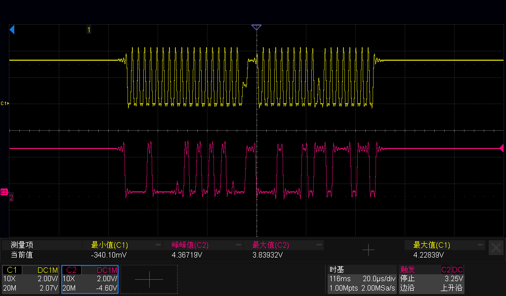
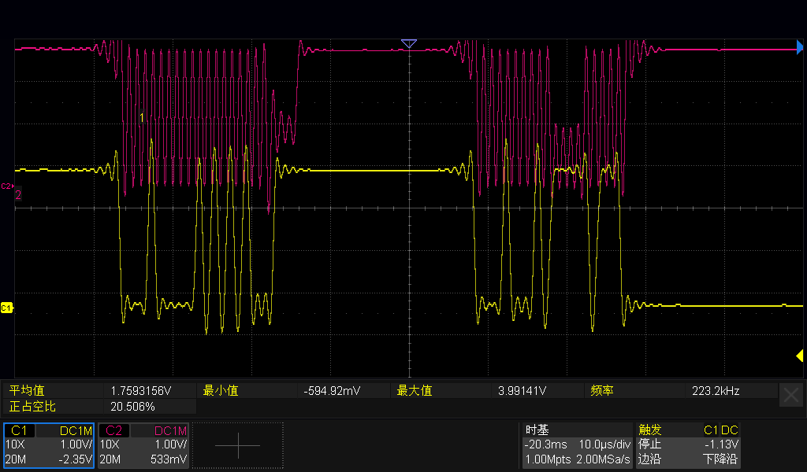
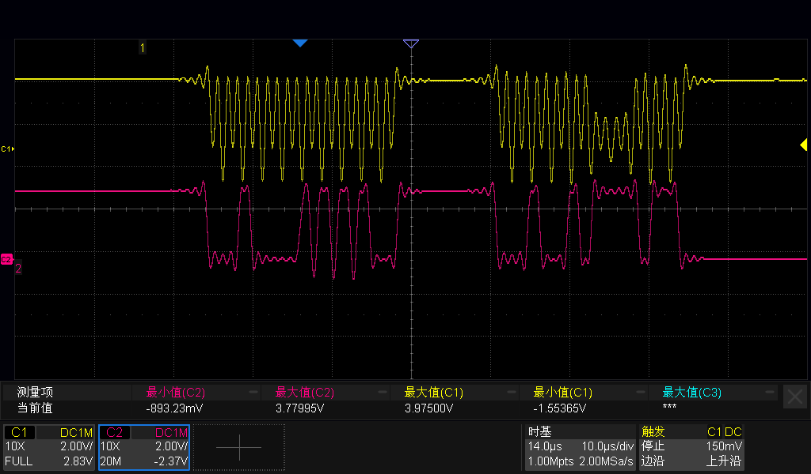
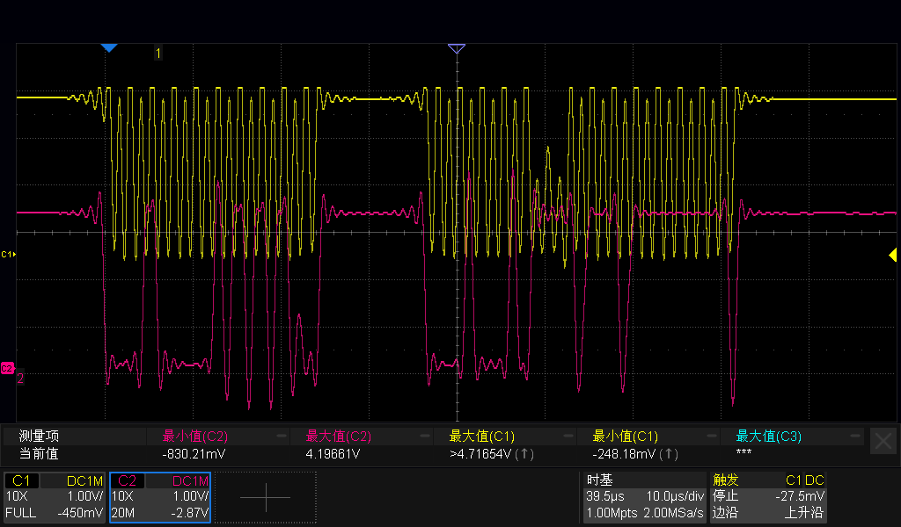

# L5-04：RI3C I3C 主从与带内中断（ri3c_i3c_intr_ep）

| 项目        | 描述                                                                                                             |
| --------- | -------------------------------------------------------------------------------------------------------------- |
| **功能目标**  | 实现I3C SDR通信和带内中断（IBI），支持现代车载传感器接口                                                                              |
| **涉及外设**  | RI3C（I3C模式 + I2C兼容模式）                                                                                          |
| **关键技术点** | ① I3C主/从模式 ② SDR单数据率通信 ③ 带内中断（IBI）- 从设备主动请求 ④ 动态地址分配（DAAS） ⑤ Master Ship Request ⑥ I2C遗留设备兼容（1Mbps） ⑦ FIFO缓冲传输 |
| **验证方法**  | 主从模式互测；从设备发起IBI验证中断响应；混合I2C/I3C设备通信                                                                            |
| **参考现有**  | i3c_master_ep, i3c_slave_ep                                                                                    |
## 一、I3C通信协议特点
I3C采用SCL、SDA两线通信，兼容传统I2C设备，并在此基础上支持更高的传输速率、动态地址分配（ENTDAA）、带内中断（IBI）、公共命令（CCC）及主机角色切换。I3C在数据传输阶段可采用推挽方式，传输效率和总线管理能力优于I2C，适合车载传感器等高速、低功耗应用。

| 对比项  | I2C                   | I3C            |
| ---- | --------------------- | -------------- |
| 速率   | 100 kHz、400 kHz、1 MHz | SDR最高约12.5 MHz |
| 地址   | 固定7位/10位地址            | 支持静态及动态地址      |
| 输出方式 | 开漏                    | 开漏与推挽结合        |
| 中断方式 | 需要额外GPIO              | 支持IBI带内中断      |
| 总线管理 | 功能较简单                 | 支持CCC和主机角色切换   |
| 兼容性  | 仅I2C设备                | 兼容Legacy I2C设备 |
**SDR:single date rate 单数据模式，就是I3C最基础、最常用的模式。**
## 二、FSP配置以及遇到的问题
因为原始例程与本机环境、实际芯片型号不一致，完成了以下适配：
```c
Extracting support files...
[ERROR] Toolchain configured for project is not currently available. Please add/enable toolchain through Renesas Toolchain Management or select a different toolchain for this project.
11:07:13 **** 项目r_i3c_master_u5l4_ep配置Debug的仅清理的构建 ****
make -r -j8 clean
make: *** No rule to make target 'clean'. Stop.
"make -r -j8 clean"以退出代码2结尾。构建可能不完整。
11:07:13 Build Failed. 1 errors, 0 warnings. (took 304ms)
```

1. 将工程工具链由`14.3.1.arm-14-174`改为本机已有的`13.2.1.arm-13-7`。
2. .
    - `configuration.xml`
    - `.secure_xml`
    - `.settings/com.renesas.cdt.managedbuild.gnuarm.prefs`
- 将目标芯片修改为实际使用的100-pin器件`R7F711001EBFC`。
- 重新生成引脚和FSP代码，解决原先因封装不一致造成的`pin_data.c`编译错误。

```
R7F711001EBBB
257-pin
```
因为用的是和100pin不一样的外设引脚
GDB Server for Renesas targets.


```c
GDB Server for Renesas targets.
Version For R-Car U5L [Alpha7] (Dec 17 2025 15:00:49)
Starting server with the following options:
Raw options : C:\Users\TPSZ-1300194\.eclipse\com.renesas.platform_1223251604\DebugComp\\rcarmcu\e2-server-gdb -g E2LITE -t R7F711001 -uConnectionTimeout= 30 -uClockSrc= 0 -uAllowClockSourceInternal= 1 -uInteface= SWD -uIfSpeed= auto -w 0 -z 33 -uResetBeginConnection= 0 -uNoReset= 1 -uLowPower= 0 -uDisconnectionMode= 1 -uWakeupAllCores= 0 -uEnableSciBoot= 1 -uneedAuthentication= 0 -uocdID= FFFFFFFFFFFFFFFFFFFFFFFFFFFFFFFFFFFFFFFFFFFFFFFFFFFFFFFFFFFFFFFF -uresetOnReload= 1 -n 0 -uMapMode= 0 -uInitialiseRAM= 1 -uFlashBp= 0 -uMultiDeviceSync= 0 -usupplyVoltageASP= 0 -uhookWorkRamSize= 0x400 -ueraseRomOnDownload= 0 -ueraseDataRomOnDownload= 0 -uExternalFlashEnable= 0 -uTraceMTB= 0 -uTraceSizeMTB= 1024 -uProgReWriteIRom= 0 -uProgReWriteDFlash= 0 -uOSRestriction= 0 -uTimeMeasurementEnable= 1 -uDWTEnable= 0 -uSWOSelectCore= CPU0 -uMemRegion= 0x40000000:0x40000:DATA_FLASH:e -l -uCore= CPU0|enabled|256|main -uSyncMode= async -uTraceCore= CPU0 -uFirstGDB= main --gdbVersion= 13.2
Connecting to E2LITE, ARM target
GDBServer endian : little
Target power from emulator : Off
Starting target connection
GDB action 'connect to target', has failed with error report, Error 0x00000100: The specified parameter is incorrect.
force_kill_gdb()
Disconnected from the Target Debugger.
```


调试配置里是调试器提供电源修改成外部供电

## 二. 完成3C SDR主从通信

基于原始`i3c_master_ep`和`i3c_slave_ep`例程，完成了两块板之间的I3C通信。

主要流程：

1. Master打开RI3C模块。
2. 配置主机静态地址和动态地址。
3. 建立I3C设备表。
4. 启动ENTDAA动态地址分配。
5. 选择I3C SDR速率模式。
6. Master向Slave写入`{1,2,3,4,5}`。
7. Master从Slave读取5字节。
8. 对发送和接收数据进行比较。

验证结果：

- 动态地址分配完成；
- Master写入完成；
- Master读取完成；
- 读写数据一致；
### master配置
1.U5L硬件不支持 Hot-Join，所以把 `ACK Hot-Join Requests` 关闭。数据手册第346页对此有明确说明。


`Transfer Mode = Normal` 表示使用普通FIFO，
### slave配置


1.这里要将对应管道号的SDA和SCL引脚改为N型开漏输出

|PODCEn|PODCn|输出方式|
|---|---|---|
|0|0|Push-pull|
|0|1|Emulated N-channel Open Drain|
|1|0|Push-pull|
|1|1|Emulated P-channel Open Drain|


I3C/I2C总线的开漏阶段要求设备能够主动拉低线路，释放后由上拉电阻恢复高电平，因此需要 N沟道开漏,如说明书上图所示。

- 

## 三、Mastership Request（主控权请求）
### Mastership Request：主机请求。因为I3C支持总线上存在多个具有控制器能力的设备，但同一时刻只能有一个Active Contoroller真正控制总线。
#### slave FSP配置

**Secondary Master = Enabled**  
表示该I3C节点具有“次级主机”能力，也就是它除了能作为从设备通信外，还允许在特定条件下接管总线，成为当前主机。
### 逻辑图
Secondary Master
      │
      │ ① 发起主机权请求
      ▼
Current Master
      │
      │ ② 接受请求
      │ ③ 向Secondary Master发送GETACCMST
      ▼
Secondary Master
      │
      │ ④ 返回自己的动态地址
      ▼
Current Master
      │
      │ ⑤ 发送STOP并释放总线
      ▼
Secondary Master成为新的Current Master

### 调试结果


**Mastership Request 实际交接成功**：
```
g_getaccmst_received = true
g_secondary_master_active = true
g_i3c_error = false
```


#### Master


## 四、I2C遗留设备兼容（1Mbps）
### ==第一次使用两块板子，焊接12v和GND==
#### I2C slave配置


说明书规定：
```
Standard-mode       = 100 kHz
Fast-mode           = 400 kHz
Fast-mode Plus      = 1 MHz
```
所以选择 Fast-mode Plus = 1Mhz
### master中配置

**要将Legacy inclusive打开，并且把Secondary Master关闭

#### 问题一：
线路正被芯片/短路主动拉低


尝试将 Master的160 ns高电平需要调整到300 ns

#### 发现板子本身没有上拉电阻，芯片的内部上来无法在输出的情况使用
加入上拉电阻后
‘
#### 问题三：
#### slave是不是没选10bit

但实际与此项配置无关- 当前Slave地址是`0x08`，位于7-bit地址范围内，不需要10-bit。U5L的RI3C Legacy I2C模式使用7-bit地址。
#### 问题四：
Clock Stretching (时钟延时)没有打开。


它的作用是：当从机暂时没有准备好接收或发送下一个字节时，从机主动把 SCL 拉低，通知主机“先等一下”

#### 观察寄存器，锁定问题出错原因
   - `DVSTAD`：目标设备的静态地址。期望为 `0x08`。
- `DVTYP`：目标设备类型。期望为 `1`，表示 Legacy I²C；`0` 表示 I3C
排除：
- Master设备地址设置错误
- 7位/10位地址错误
- Master把Slave当成I3C设备


### 降速：测试100khz和400khz情况下通信


#### 实验不同情况下的逻辑分析仪波形
##### 只测试一块板子上的SDA和SCL

==地址传输错误==
##### 没接上拉电阻

##### 重新焊接上拉电阻


- 第二个数据应该是 `0x22`，波形却再次出现 `0x11`；
- 没有完成10字节传输，也没有产生正常结束回调。
-


### 先不使用DMA换成更简单的程序，传输AA回传BB


#### 问题五：重新换回1Mhz还是错误


##### 寻找问题原因


程序发送数据无误，但slave接收发送BB到总线上错误

#### 观察寄存器

`NTST = 0x00000009` 表示：

```
CMDQEF = 1：命令队列已经空
TDBEF0 = 1：0xAA 已从发送缓冲区取走
RSPQFF = 0：没有生成传输完成响应
TEF = 0：没有传输错误
TABTF = 0：没有传输中止
```

也就是说，Master确实发送了 `0xAA`，但当前代码把：

```
R_I3C_Write(..., true);
```

设置成了保留总线、不产生STOP。随后程序又等待：

```
while ((!g_write_complete) && (!g_i3c_error))
```

由于写事务尚未正式结束，`g_write_complete` 不会产生，程序也就永远不会执行后面的 `R_I3C_Read()`。因此只看到一个 `AA`。

对于目前这种“等待写完成后再调用读”的程序，Master第301行必须改回：

```
g_legacy_i2c_status = R_I3C_Write(&g_i3c_ctrl,
                                  g_legacy_i2c_write_data,
                                  sizeof(g_legacy_i2c_write_data),
                                  false);
```

读取仍保持：

```
R_I3C_Read(..., false);
```

这样实际时序是：
START → 08 Write → AA → STOP
START → 08 Read → BB → STOP
寄存器判断是slave端的问题还是master


### 实际波形图

读数据`10111011``0xBB`最后一位`1`Master NACK，表示只读取一个字节

#### 问题六：添加20微秒延时

同时逻辑分析仪读到的是`0xFD`而不是`0xBB`，说明Slave在1 MHz下没有及时准备好发送数据。驱动来不及完成：

```
RX_COMPLETE
→ 判断收到AA
→ 准备BB
→ TX_REQUEST
→ 装载DRT
```

Master就已经开始读了。未准备好时硬件倾向于送出连续的`1`，所以出现接近`0xFF`的`0xFD`；随后Slave发送状态没有正常结束，SDA未释放。

尝试解决方法是在Master写完`0xAA`后，开始读取前增加约`20 μs`等待时间。位置是在Master的写完成等待循环之后、`R_I3C_Read()`之前：

```c
while ((!g_write_complete) && (!g_i3c_error))
{
    __WFI();
}

if (g_i3c_error)
{
    goto legacy_i2c_end;
}

R_BSP_SoftwareDelay(20U, BSP_DELAY_UNITS_MICROSECONDS);

g_read_complete = false;
```

这样Slave有足够时间处理`RX_COMPLETE`并预装`0xBB`。当前挂死的总线需要先复位或重新上电Slave，使SDA恢复高电平，再测试。


默认空闲数据`0xFF`，说明Slave在1 MHz下没有按照预期把`0xBB`送入移位发送过程。最后SDA持续为低，说明Slave RIIC仍停留在发送状态，没有正常处理Master的NACK和STOP。


### 尝试单个板子做I3C与12C的回显，测量更容易，程序集中，干扰因素更小
#### 尝试使用不同的I2C通道引脚


#### 换1kΩ上拉电阻

#### 问题七：是否与BSP_FEATURE_IIC_HAS_FMPE的值有关


#### 换成1之后无变化


观察现象
释放后的SCL上升不完整，部分高电平可能没有达到有效逻辑高门限




#### 调整示波器之后图像


但依旧存在过冲现象，目前能锁定在slave回传时SCL有一段异常的电平
#### 总结出现这种现象的可能原因
1.开启 FMPE 特性宏没有作用，硬件可能不支持1Mhz的传输
2.芯片的时钟导致
## 总结
本周已完成L5-04项目中原生I3C SDR、动态地址分配、IBI及Mastership Request等核心功能，并完成RI3C兼容I2C Slave的程序框架和100 kHz通信验证。
当前主要问题集中1 MHz下的信号完整性及Slave发送响应时序。通过调试变量、寄存器、逻辑分析仪和示波器，已经将问题范围缩小到Fm+电气特性、FMPE斜率控制。