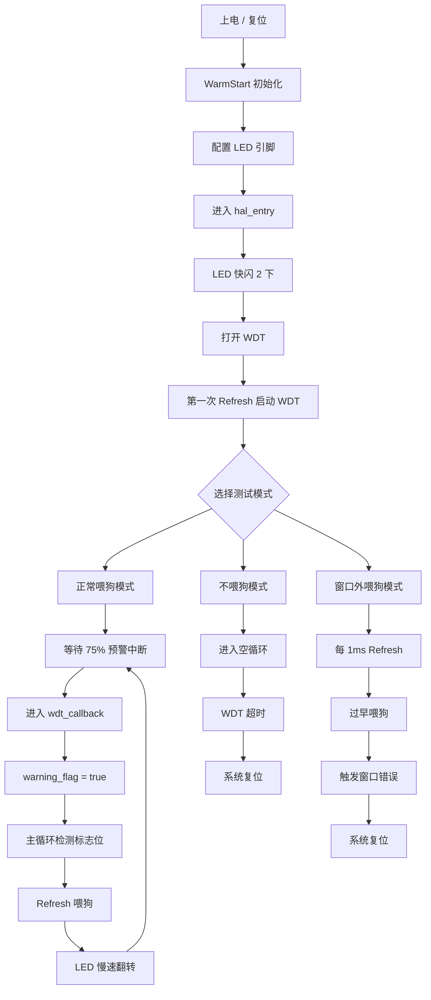
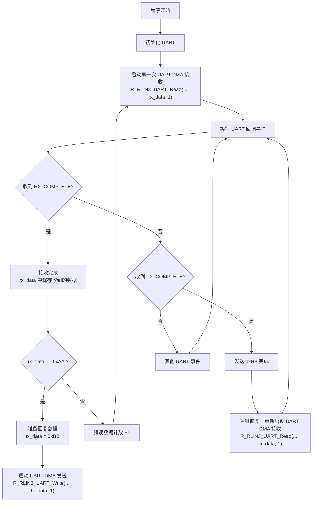
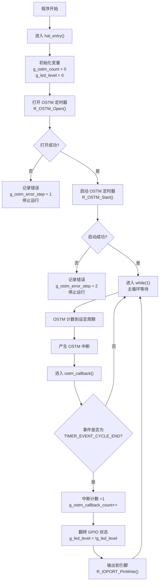

# 一、窗口看门狗与系统监控说明

| 项目        | 描述                                                                                           |     |
| --------- | -------------------------------------------------------------------------------------------- | --- |
| **功能目标**  | 配置WDTB实现系统监控，验证窗口看门狗的中断和复位功能                                                                 |     |
| **涉及外设**  | WDTB、ECM                                                                                     |     |
| **关键技术点** | ① 窗口看门狗周期配置 ② 75%溢出中断（预警喂狗） ③ 窗口打开周期设置 ④ 任意计数器值中断 ⑤ WDTB溢出到ECM的错误通知链路 ⑥ 喂狗窗口内刷新 vs 窗口外刷新对比测试 |     |
| **验证方法**  | 正常喂狗时系统稳定运行；故意不喂狗验证复位发生；窗口外喂狗验证错误检测                                                          |     |
| **参考现有**  | wdt_u5l4_ep                                                                                  |     |

## **ECM = Error Control Module（错误控制模块）**
主要功能：
1. **错误信号收集**
    - 接收来自各种外设模块的错误通知（如WDTB溢出、时钟异常、RAM/ROM错误等）
2. **错误响应处理**
    - 根据配置，ECM可以采取多种操作
        - 设置错误管脚输出（Error Pin）
        - 生成中断信号
        - 触发系统复位
3. **延时定时器功能**
    - ECM内置延时定时器，可以配置在错误发生后延迟一定时间再生成复位或输出信号
当看门狗定时器（WDTB）溢出时 → 发送错误信号给ECM → ECM根据配置产生中断或复位
## **窗口看门狗**（Window Watchdog）的重要特性：在不允许的时间点喂看门狗会导致系统复位。
## FSP配置说明

### **正常喂狗模式**：
下载运行后应该看到：
1. LED 快闪 2 下  
    这表示系统刚启动，程序进入了 `hal_entry()`。
2. 然后 LED 持续慢速翻转  
    大概每次 WDT 75% 预警中断来一次，LED 状态翻转一次。
3. 系统不会反复重启  
    也就是说不会一直重复“快闪 2 下、快闪 2 下、快闪 2 下”。
### 切换成不喂狗模式
`#define WDT_TEST_MODE WDT_TEST_NO_FEED`
现象应该是：
1. LED 快闪 2 下
2. 然后不再正常翻转
3. 过一会系统复位
4. 再次看到 LED 快闪 2 下
### 切换成窗口外喂狗模式
`#define WDT_TEST_MODE WDT_TEST_WINDOW_ERROR`
现象应该是：
1. LED 快闪 2 下
2. 很快复位
3. 又重新快闪 2 下
它会比“不喂狗模式”复位得更快，因为太早喂狗，触发窗口错误。
## 遇到的问题：闪烁间隔太大不好判断到底是不喂狗模式还是窗口外喂狗
WDT 每次 75% 预警都正常喂狗，但 LED 每 4 次预警才翻转一次。这样不会影响看门狗刷新，只是让 LED 闪烁变慢。

## 流程图


# 二、pDMA 多通道数据传输

| 项目        | 描述                                                                                                               |
| --------- | ---------------------------------------------------------------------------------------------------------------- |
| **功能目标**  | 实现pDMAC的内存到内存、内存到外设、外设到内存传输，覆盖全部3种传输模式                                                                           |
| **涉及外设**  | pDMAC（16通道）                                                                                                      |
| **关键技术点** | ① 通道优先级与仲裁 ② Single transfer（单次） ③ Block transfer 1（按传输次数） ④ Block transfer 2（按地址计数） ⑤ 传输完成中断 ⑥ 多通道并发传输 ⑦ 链式传输配置 |
| **验证方法**  | 内存填充测试（验证速度和正确性）；外设到内存（如UART RX DMA）验证；传输时间测量                                                                    |
| **参考现有**  | dmac_ep                                                                                                          |
## Memory to Memory + Block transfer 1 + Software trigger + Completion interrupt
### FSP配置


可靠性/访问保护相关功能不用修改


内存到内存：源和目的都要递增`Source Address Mode`和`Destination Address Mode`都要选择Incremented
### 在Watch面板里添加变量

数组传输成功
## Single transfer + Software trigger + Completion interrupt
### FSP配置
把DMA Mode换成Single transfer
### 三种模式区别

| 模式               | 一次请求搬多少  | 适合场景                    |
| ---------------- | -------- | ----------------------- |
| Single transfer  | 1 个数据    | UART、ADC 这种一个个来的数据      |
| Block transfer 1 | 一整块数据    | 内存复制、一次性搬运 buffer       |
| Block transfer 2 | 按组搬，多组数据 | 分段 buffer、多行数据、二维数组、帧数据 |
## 链式传输配置 Chain Function
Always chain 每次传输请求都触发链式动作,Chain at the last transfer最后一次传输完成后才触发下一通道

## 遇到的问题：发送两个AA之后就没有反应
### 原因

发送 `0xBB` 后，程序没有确认发送流程已经结束，RX DMA 没有重新启动|接收完一次 `0xAA` 后，需要重新调用接收逻辑，否则 DMA 只接收一次就停了
### 解决办法：
```c
void user_uart_callback(uart_callback_args_t * p_args)
{
    if (UART_EVENT_RX_COMPLETE == p_args->event)
    {
        g_uart_dma_echo.rx_complete = 1U;

        if (0xAA == g_uart_dma_echo.rx_data)
        {
            g_uart_dma_echo.tx_data = 0xBB;
            g_uart_dma_echo.ok_count++;

            R_RLIN3_UART_Write(&g_uart0_ctrl,
                               &g_uart_dma_echo.tx_data,
                               1);
        }
        else
        {
            g_uart_dma_echo.wrong_data_count++;
        }
    }
    else if (UART_EVENT_TX_COMPLETE == p_args->event)
    {
        
        //关键修复：发送完成后重新启动 UART DMA 接收，否则只能接收前几次数据，后面 AA 不会再触发接收。
        R_RLIN3_UART_Read(&g_uart0_ctrl,
                          &g_uart_dma_echo.rx_data,
                          1);
    }
}
```
### 改正之后


## 代码流程图



# 三、OSTM 操作系统定时器

|目        | 描述                                                              |
| --------- | --------------------------------------------------------------- |
| **功能目标**  | 配置OSTM作为系统时基，实现us/ms级精确延时和周期性中断                                 |
| **涉及外设**  | OSTM（多单元）                                                       |
| **关键技术点** | ① 间隔定时器模式（周期中断） ② 自由运行定时器模式 ③ 多单元同步启动 ④ us级精确延时函数 ⑤ 作为RTOS系统节拍源 |
| **验证方法**  | GPIO翻转测量中断周期精度（示波器）；延时函数用示波器验证us/ms级精度                          |
| **参考现有**  | ostm_u5l_ep                                                     |
## FSP配置


## 把period改为1ms
GPIO 高低电平翻转周期

OSTM 作为 1ms 系统时基，实现 ms 级延时函数
代码完成了三件事：
1. **OSTM0 周期中断**
    - FSP 配置为 `Period = 1 ms`（从这里也侧面证明了实际时钟频率是64Mhz，按照80Mhz算的是1s，但实际是1.25秒）
    - 所以理论上每 1ms 进入一次 `ostm_callback()`
2. **1ms 系统 tick**
    - 每次进入中断，执行：g_ostm_irq_count++;
    - 这个变量就相当于系统运行了多少个 ms
3. **基于 tick 的毫秒延时**
    - 主循环里调用：
    DelayMs(500U);
    Led4Toggle();
    - 意思是每等待 500 个 tick 后翻转一次 LED
##  us级精度
### FSP配置

Counter Reload Disable 做自由运行计时：Disable
前面的OSTM0用的是Interval timer mode
现在给 OSTM1 配的是free-running comparison mode

| 对比项    | Interval timer mode              | Free-running comparison mode |
| ------ | -------------------------------- | ---------------------------- |
| 通俗理解   | 周期闹钟                             | 连续秒表                         |
| 计数方式   | 按设定周期计数，到点后重新开始                  | 计数器持续运行，不停地走                 |
| 典型用途   | 周期中断、系统 tick、定时任务                | us 延时、时间测量、代码运行时间统计          |
| 当前项目用途 | OSTM0 做 1ms tick                 | OSTM1 做 DelayUs              |
| 代码思路   | 每 1ms 进一次中断，`g_ostm_irq_count++` | 读取当前计数值，等待计数差达到目标            |
| 优点     | 周期稳定，适合系统节拍                      | 精度高，适合短时间测量                  |
| 缺点     | 短 us 延时会受中断开销影响                  | 需要代码自己计算计数差                  |
| 类比     | 定好时间自动响的闹钟                       | 一直运行的秒表                      |


## 核心代码
```c
void ostm_callback(timer_callback_args_t * p_args)
{
    if (TIMER_EVENT_CYCLE_END == p_args->event)
    {
        g_ostm_callback_count++;

        g_led_level = !g_led_level;

        R_IOPORT_PinWrite(&g_ioport_ctrl,
                          LED4,
                          g_led_level);
    }
}
```
## 代码流程图

# 四、总结
本周主要完成了 WDTB 窗口看门狗、pDMA 多通道数据传输和 OSTM 操作系统定时器三个模块的配置与验证。WDTB 部分验证了正常喂狗、不喂狗复位和窗口外喂狗复位，理解了 WDTB 与 ECM 错误响应的关系；pDMA 部分完成了内存到内存、UART DMA 收发、多通道并发和链式传输验证，并解决了 UART 连续发送 `0xAA` 只返回两次 `0xBB` 的问题，原因是发送完成后没有重新启动 DMA 接收，最终通过在 `TX_COMPLETE` 回调中重新调用接收函数解决；OSTM 部分实现了周期中断和 GPIO 翻转验证，掌握了定时器中断周期、GPIO 完整周期以及实际时钟偏差对测量结果的影响。


```c
void uart_callback(uart_callback_args_t * p_args)
{
    if (UART_EVENT_RX_COMPLETE == p_args->event)
    {
        g_uart_rx_done = 1;
        g_uart_rx_done_count++;

        /* 这里可以处理接收到的 1 byte，比如判断 AA 或启动发送 */
    }
    else if (UART_EVENT_TX_COMPLETE == p_args->event)
    {
        /* 重新启动接收前清标志 */
        g_uart_rx_done = 0;

        R_RLIN3_UART_Read(&g_uart0_ctrl,
                          &g_uart_dma_echo.rx_data,
                          1);
    }
}
```
void uart_callback(uart_callback_args_t * p_args)
{
    if (UART_EVENT_RX_COMPLETE == p_args->event)
    {
        g_uart_rx_done = true;
        g_uart_rx_done_count++;

        /* 这里可以处理接收到的 1 byte，比如判断 AA 或启动发送 */
    }
    else if (UART_EVENT_TX_COMPLETE == p_args->event)
    {
        /* 重新启动接收前清标志 */
        g_uart_rx_done = false;

        R_RLIN3_UART_Read(&g_uart0_ctrl,
                          &g_uart_dma_echo.rx_data,
                          1);
    }
}