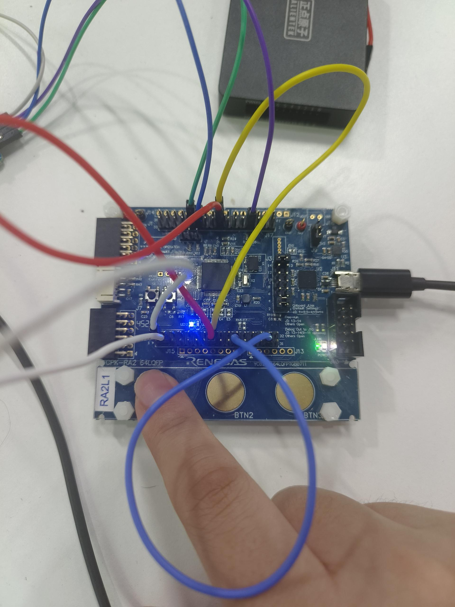
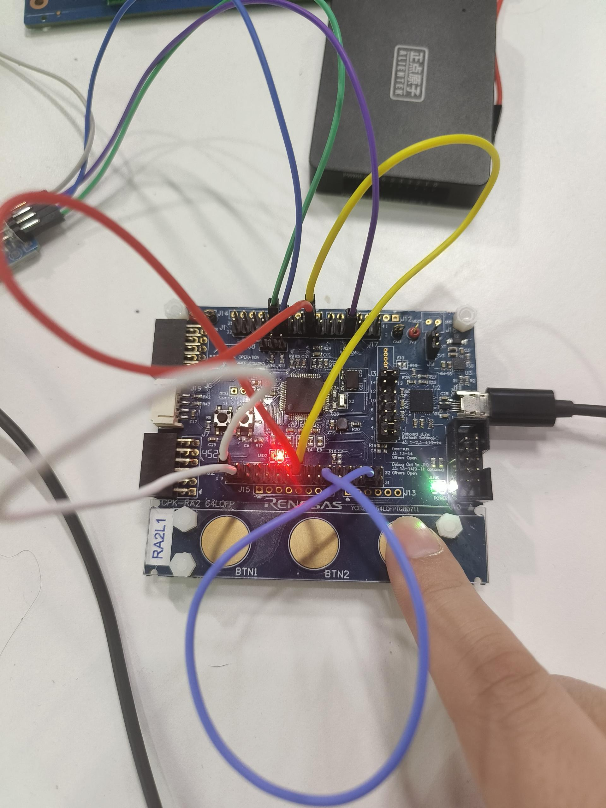
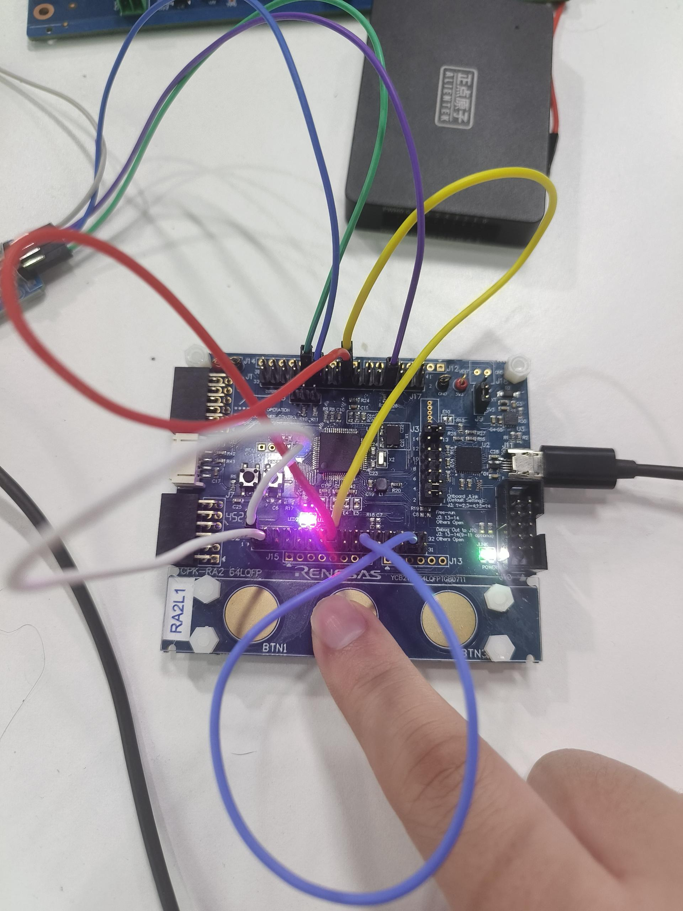
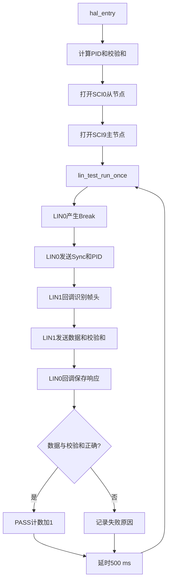

# RA2L1 案例工程验证

## 1. Blinky 示例工程验证

### 1.1 清理并构建工程


导入示例工程后，先执行“清理项目”，再重新构建项目。

### 1.2 构建错误：缺少 FSP 3.5.0 软件包


原始 Blinky 示例工程基于 FSP 3.5.0 创建。当前 e² studio 中没有安装对应的软件包，因此无法提取 CMSIS/FSP 组件并直接构建该工程。

### 1.3 处理方案：使用当前 FSP 重新创建工程

不继续使用依赖 FSP 3.5.0 的旧工程，改为在当前已安装的 FSP 环境中重新创建 RA2L1 工程，并按照示例功能配置触摸模块和 LED。

## 2. 三个电容触摸按键控制 LED

### 2.1 验证目标

使用 RA2L1 的 CTSU 电容触摸功能检测三个触摸按键，并实现以下 LED 控制效果：

| 触摸操作 | `button_status` | LED现象 |
|---|---:|---|
| 未触摸 | 0 | LED1、LED2熄灭 |
| 按住 Button00 | 1 | LED1点亮 |
| 按住 Button01 | 2 | LED2点亮 |
| 按住 Button02 | 4 | LED1、LED2同时点亮 |

### 2.2 创建 RA2L1 CTSU 测试工程


创建与实际MCU型号匹配的 RA2L1 工程，使用当前已经安装的 FSP，并选择无RTOS的裸机工程模板。

## 3. FSP 硬件配置

### 3.1 配置 CTSU 触摸引脚


本工程使用三个自电容触摸通道：

| QE按键 | CTSU通道 | MCU引脚 |
|---|---|---|
| Button00 | TS32 | P012 |
| Button01 | TS33 | P013 |
| Button02 | TS28 | P015 |

这三个通道与实际触摸板上的三个电极连接关系一致，因此在QE中分别分配给三个Button。

### 3.2 配置 LED GPIO引脚


将两个板载LED引脚配置成GPIO输出模式，初始输出低电平：

| LED | MCU引脚 | 初始配置 |
|---|---|---|
| LED1 | P502 | Output, Initial Low |
| LED2 | P501 | Output, Initial Low |

### 3.3 添加 Touch 中间件


在 `Stacks` 页面选择：

`New Stack → CapTouch → Touch (rm_touch)`

添加后，FSP会同时添加 `Touch (rm_touch)` 中间件和底层 `CTSU (r_ctsu)` 驱动。

### 3.4 添加 CTSU 收发 DTC 驱动


启用 `Support for using DTC`，然后分别添加：

- DTC Driver for Transmission
- DTC Driver for Reception

DTC负责在CTSU寄存器和内存之间传输测量数据，减少CPU参与数据搬运的开销。

### 3.5 配置 CTSU 驱动属性


主要配置如下：

- 扫描启动方式：Software
- DTC支持：Enabled
- 自动判断模式：Disabled
- 中断优先级：Priority 2
- TSCAP及三个TS通道分配正确

## 4. 安装并打开 QE for Capacitive Touch

### 4.1 安装 QE for Capacitive Touch 扩展


在Renesas Software Installer中选择 `QE for Capacitive Touch`，完成安装并重启 e² studio。

### 4.2 信任瑞萨更新站点

勾选瑞萨官方更新站点，然后继续安装。


### 4.3 在 QE 中选择目标工程


在 `CapTouch Workflow (QE)` 的 `Select a Project` 中选择 `RA2L1_CTSU_Test`。

### 4.4 创建触摸接口配置


选择自电容检测方式并创建新的Touch I/F配置。

### 4.5 添加三个触摸按钮


在Touch I/F画布中添加三个Button。

### 4.6 分配触摸通道并配置串联电阻


通道分配如下：

- Button00 → TS32
- Button01 → TS33
- Button02 → TS28
- 各通道串联电阻值：560 Ω

配置正确后，三个Button由红色变为绿色。

### 4.7 生成触摸接口配置


点击 `Create` 保存Touch I/F配置，然后生成工程内容并构建工程，为自动调谐做好准备。

## 5. QE 自动调谐

### 5.1 连接开发板并启动调谐

保持J-Link与开发板连接，在 `Start Tuning (Emulator)` 中点击 `Start Tuning`。

### 5.2 问题：自动调谐窗口没有出现

CPU停在地址 `0x0000008C` 的启动代码，尚未运行到QE设置的调谐断点 `0x00000514`，因此不会进入触摸测量窗口。


检查调试配置、主函数断点、时钟和看门狗设置后，重新启动调谐。


### 5.3 测量触摸灵敏度

操作顺序必须是：

**按住触摸按钮 → 保持触摸并按电脑空格键 → 松开手指**


QE依次测量三个按钮，全部测量完成且没有Overflow或Warning/Error后，继续完成调谐。


### 5.4 输出调谐参数文件


点击 `Output Parameter Files`，生成以下文件：

- `qe_gen/qe_touch_define.h`
- `qe_gen/qe_touch_config.h`
- `qe_gen/qe_touch_config.c`

这些文件保存CTSU测量参数、触摸阈值和Touch中间件配置。

### 5.5 输出触摸示例代码


进入 `Coding → Implement Program`，点击 `Show Sample → Output to a File`，生成：

`qe_gen/qe_touch_sample.c`

## 6. 触摸程序接入与状态验证

### 6.1 在 `hal_entry()` 中启动触摸程序

在 `src/hal_entry.c` 顶部声明QE示例函数：

```c
void qe_touch_main(void);
```

在 `hal_entry()` 中调用：

```c
void hal_entry(void)
{
    qe_touch_main();
}
```

`qe_touch_main()` 会打开Touch中间件，并在循环中持续启动扫描、等待扫描完成和读取按键状态。

### 6.2 添加 `button_status` 观察表达式

在调试器的Expressions窗口中添加：

```c
button_status
```


### 6.3 问题：触摸后数值没有变化


原因包括：

- CPU处于 `Suspended` 状态，触摸扫描没有继续执行。
- `button_status` 没有启用实时刷新。
- 松开按钮后才查看数值，此时状态已恢复为0。

### 6.4 启用实时刷新并验证按键状态

右键 `button_status`，选择 `Enable Real-time Refresh`，将刷新间隔设置为100 ms或200 ms，然后让CPU保持 `Running`。


| 操作 | `button_status`数值 |
|---|---:|
| 未触摸 | 0 |
| 按住 Button00 | 1 |
| 按住 Button01 | 2 |
| 按住 Button02 | 4 |

`button_status` 是位掩码：bit0、bit1和bit2分别表示Button00、Button01和Button02。

## 7. QE 图形化监控验证

### 7.1 启用 CapTouch 监控

保持程序运行，在 `Monitoring → Start Monitoring (Emulator)` 中打开监控视图，然后点击 `Enable Monitoring`。

### 7.2 触摸状态与曲线现象


三个按钮在 `CapTouch Board Monitor` 中均能正确响应；在 `CapTouch Status Chart` 中，触摸计数越过阈值时判定为按下。

## 8. 触摸按键控制 LED

### 8.1 LED 控制逻辑

触摸状态读取成功后，根据 `button_status` 的位状态控制两个板载LED：

```c
err = RM_TOUCH_DataGet(g_qe_touch_instance_config01.p_ctrl, &button_status, NULL, NULL);
if (FSP_SUCCESS == err)
{
    bsp_io_level_t led1_level =
        (0U != (button_status & ((1ULL << 0) | (1ULL << 2)))) ?
        BSP_IO_LEVEL_HIGH : BSP_IO_LEVEL_LOW;

    bsp_io_level_t led2_level =
        (0U != (button_status & ((1ULL << 1) | (1ULL << 2)))) ?
        BSP_IO_LEVEL_HIGH : BSP_IO_LEVEL_LOW;

    R_IOPORT_PinWrite(&g_ioport_ctrl,
                      BSP_IO_PORT_05_PIN_02,
                      led1_level);

    R_IOPORT_PinWrite(&g_ioport_ctrl,
                      BSP_IO_PORT_05_PIN_01,
                      led2_level);
}
```

### 8.2 代码说明

- `RM_TOUCH_DataGet()`：读取本轮触摸扫描的识别结果，并写入 `button_status`。
- `button_status & (1ULL << 0)`：判断Button00是否按下。
- `button_status & (1ULL << 1)`：判断Button01是否按下。
- `button_status & (1ULL << 2)`：判断Button02是否按下。
- LED1连接P502，由 `BSP_IO_PORT_05_PIN_02` 控制。
- LED2连接P501，由 `BSP_IO_PORT_05_PIN_01` 控制。
- Button02参与两个LED的判断条件，因此按住Button02时两个LED同时点亮。
- 所有按钮松开后，两个判断条件均为假，输出低电平，LED熄灭。

这段代码位于 `qe_gen/qe_touch_sample.c` 的 `RM_TOUCH_DataGet()` 成功分支中，每次触摸扫描完成后都会更新LED状态。

> [!NOTE]
> `qe_touch_sample.c` 是QE生成的示例文件。再次执行 `Show Sample → Output to a File` 时，自定义LED代码可能被覆盖，正式项目中建议将应用逻辑移到用户维护的源文件中。

### 8.3 LED 实际现象







三个触摸按键能够按照设计逻辑控制两个LED，说明CTSU触摸检测、QE调谐参数、Touch中间件和GPIO输出功能均正常。
# RA2L1 LIN 与 CAN 通信验证

本文记录 RA2L1 通过扩展板上的两路 LIN 收发器完成 LIN 主从节点自回环验证的过程。当前已经完成 LIN 验证；CAN 部分待具备合适的 CAN 收发器和测试条件后再补充。

## 1. LIN 验证目标与总体方案

### 1.1 验证目标

本次验证使用扩展板上的两路 LIN 收发器：

- LIN0 作为主节点，由 RA2L1 的 SCI9 控制。
- LIN1 作为从节点，由 RA2L1 的 SCI0 控制。
- LIN0 与 LIN1 接入同一根 LIN 总线。
- LIN0 发起通信，LIN1识别帧头后返回数据，最后由 LIN0 校验响应。

同时验证：

1. RA2L1 的两个 SCI/UART 通道能否正常工作。
2. LIN0、LIN1两路收发器的发送和接收方向是否正常。
3. LIN Break、Sync、PID、响应数据和校验和是否正确。
4. LIN 总线接线、供电和终端配置是否有效。

### 1.2 本次测试帧

| 项目 | 内容 | 发送方 |
| --- | --- | --- |
| Break | 约 700 μs dominant low | LIN0主节点 |
| Sync | `0x55` | LIN0主节点 |
| Frame ID | `0x12` | 程序设定 |
| PID | `0x92` | LIN0主节点 |
| 响应数据 | `0x11 0x22 0x33 0x44` | LIN1从节点 |
| 增强型校验和 | `0xC2` | LIN1从节点 |

完整通信方向如下：

```text
LIN0主节点：Break + 55 + 92  ──────>  LIN1从节点
LIN0主节点：11 22 33 44 C2  <──────  LIN1从节点
```

LIN0并不是先把 `11 22 33 44` 发给LIN1。LIN0只负责发送帧头；PID决定该帧由哪个节点发布响应，本程序中由LIN1返回数据。

## 2. RA2L1与扩展板硬件连接

### 2.1 LIN0接口连接


| RA2L1引脚 | 扩展板U8引脚 | LIN0信号 | 方向 |
| --- | --- | --- | --- |
| P109 / TXD9_B | U8-6 | LIN0_TXD | RA2L1 → LIN0收发器 |
| P110 / RXD9_B | U8-5 | LIN0_RXD | LIN0收发器 → RA2L1 |
| GND | U8-2 | GND | 共地 |

### 2.2 LIN1接口连接

| RA2L1外设 | RA2L1引脚 | 扩展板U17引脚 | LIN1信号 | 方向 |
| --- | --- | --- | --- | --- |
| SCI0 TXD | P205 / TXD0_D | U17-6 | LIN1_TXD | RA2L1 → LIN1收发器 |
| SCI0 RXD | P206 / RXD0_D | U17-5 | LIN1_RXD | LIN1收发器 → RA2L1 |
| GND | 任意可用GND | U17-2 | GND | 共地 |

### 2.3 LIN0与LIN1总线连接

| 连接点1 | 连接点2 | 作用 |
| --- | --- | --- |
| CN5-2 / LIN0_BUS | CN6-2 / LIN1_BUS | 将两路收发器连接到同一根LIN总线 |

CN5-3和CN6-3在扩展板原理图中都连接到同一个GND网络，因此两者在扩展板内部已经共地，不需要再用一根线把CN5-3和CN6-3互连。但是RA2L1开发板与扩展板之间必须至少连接一根GND线。

### 2.4 供电与跳线

- 扩展板使用12 V供电，确认LIN收发器所需电源正常。
- RA2L1与扩展板必须共地。
- LIN0：H19接1-2，H21短接，H20和H22保持断开。
- LIN1：H24接1-2，H26、H39和H36保持断开。
- 上电前用万用表检查电源与地之间不存在明显短路。
- 不要将RA2L1的TXD/RXD引脚直接连接到LIN_BUS。MCU逻辑信号必须经过LIN收发器转换后才能连接LIN总线。

## 3. FSP外设配置

### 3.1 添加LIN0主节点UART


为LIN0添加一个 `UART (r_sci_uart)` 实例，并设置：

| 配置项 | 设置值 |
| --- | --- |
| 实例名 | `g_lin_master_uart` |
| SCI通道 | SCI9 |
| 波特率 | 19200 bit/s |
| 数据位 | 8 bit |
| 校验位 | None |
| 停止位 | 1 bit |
| 回调函数 | `lin_master_uart_callback` |
| 中断优先级 | 2 |
| DTC | Disabled |

19200 bit/s是LIN常用速率，并且不超过LIN规范的20 kbit/s上限。一个位的时间约为：

```text
1 / 19200 ≈ 52.08 μs
```

程序将Break低电平保持约700 μs，相当于约13.44个位时间，满足LIN Break至少13个位时间的要求。

### 3.2 LIN0引脚设置


| SCI9功能 | RA2L1引脚 |
| --- | --- |
| TXD9_B | P109 |
| RXD9_B | P110 |

### 3.3 添加LIN1从节点UART

为LIN1再添加一个 `UART (r_sci_uart)` 实例，并设置：

| 配置项 | 设置值 |
| --- | --- |
| 实例名 | `g_lin_slave_uart` |
| SCI通道 | SCI0 |
| 波特率 | 19200 bit/s |
| 数据位 | 8 bit |
| 校验位 | None |
| 停止位 | 1 bit |
| 回调函数 | `lin_slave_uart_callback` |
| 中断优先级 | 2 |
| DTC | Disabled |

| SCI0功能 | RA2L1引脚 |
| --- | --- |
| TXD0_D | P205 |
| RXD0_D | P206 |

两个UART必须使用相同的波特率和帧格式，否则从节点无法正确识别Sync、PID和响应数据。

## 4. LIN帧结构与程序设计

### 4.1 LIN帧的组成

一次LIN通信由主节点发送的Header和某个发布节点发送的Response组成：

```text
Header   = Break + Break Delimiter + Sync + PID
Response = Data  + Checksum
```

- **Break**：主节点将总线拉低足够长的时间，表示新的一帧开始。
- **Break Delimiter**：Break结束后的高电平间隔。
- **Sync**：固定为 `0x55`，帮助节点同步波特率。
- **PID**：6位Frame ID加2位奇偶校验位。
- **Data**：本次测试为4字节。
- **Checksum**：本次使用增强型校验和，计算时包含PID和数据。

### 4.2 PID计算

LIN的Frame ID只有低6位有效。奇偶校验位计算方式为：

```text
P0 = ID0 XOR ID1 XOR ID2 XOR ID4
P1 = NOT(ID1 XOR ID3 XOR ID4 XOR ID5)
PID = ID + (P0 << 6) + (P1 << 7)
```

本程序选择ID `0x12`，计算后PID为 `0x92`。

对应代码：

```c
static uint8_t lin_protected_id_calculate(uint8_t frame_id)
{
    uint8_t id = (uint8_t) (frame_id & 0x3FU);
    uint8_t p0 = (uint8_t) (((id >> 0U) ^ (id >> 1U) ^
                            (id >> 2U) ^ (id >> 4U)) & 0x01U);
    uint8_t p1 = (uint8_t) (~((id >> 1U) ^ (id >> 3U) ^
                             (id >> 4U) ^ (id >> 5U)) & 0x01U);

    return (uint8_t) (id | (uint8_t) (p0 << 6U) |
                           (uint8_t) (p1 << 7U));
}
```

### 4.3 增强型校验和

增强型校验和将PID和全部数据字节进行带进位加法，最后逐位取反：

```c
static uint8_t lin_enhanced_checksum_calculate(uint8_t pid,
                                                uint8_t const * p_data,
                                                uint32_t length)
{
    uint16_t sum = pid;

    for (uint32_t i = 0U; i < length; i++)
    {
        sum = (uint16_t) (sum + p_data[i]);
        if (sum > 0xFFU)
        {
            sum = (uint16_t) ((sum & 0xFFU) + 1U);
        }
    }

    return (uint8_t) (~sum);
}
```

对PID `0x92`和数据 `11 22 33 44`计算后得到校验和 `0xC2`。

## 5. LIN代码的整体结构

### 5.1 程序需要的模块

LIN测试程序可以按以下结构拆分：

1. **协议常量**：波特率相关时间、Sync、ID、数据长度和超时时间。
2. **接收状态机**：记录当前等待Break、Sync、PID还是响应数据。
3. **测试状态变量**：记录成功、失败、计数和错误原因。
4. **PID与校验和函数**：生成符合LIN协议的字段。
5. **Break发生函数**：用SCI寄存器产生足够长的低电平。
6. **主节点测试流程**：发送Header、等待从节点、接收并校验Response。
7. **主节点UART回调**：识别自身Header并接收LIN1响应。
8. **从节点UART回调**：识别Break、Sync和PID，提出响应请求。
9. **超时与错误处理**：避免接线错误时程序永久卡死。
10. **调试观察变量**：不依赖串口助手即可确认测试结果。

程序调用关系如下：



### 5.2 协议常量与测试数据

```c
#define LIN_BREAK_TIME_US             (700U)
#define LIN_BREAK_DELIMITER_US        (60U)
#define LIN_RESPONSE_SPACE_US         (60U)
#define LIN_WAIT_STEP_US              (10U)
#define LIN_HEADER_TIMEOUT_US         (10000U)
#define LIN_RESPONSE_TIMEOUT_US       (15000U)
#define LIN_TEST_PERIOD_MS            (500U)
#define LIN_SYNC_BYTE                 (0x55U)
#define LIN_FRAME_ID                  (0x12U)
#define LIN_RESPONSE_DATA_LENGTH      (4U)
#define LIN_RESPONSE_LENGTH           (LIN_RESPONSE_DATA_LENGTH + 1U)

static uint8_t g_master_header[2] = {LIN_SYNC_BYTE, 0U};
static uint8_t g_slave_response[LIN_RESPONSE_LENGTH] =
{
    0x11U, 0x22U, 0x33U, 0x44U, 0U
};
```

`g_master_header[1]`在初始化时写入计算得到的PID，`g_slave_response[4]`写入计算得到的校验和。

### 5.3 接收状态机

```c
typedef enum e_lin_rx_state
{
    LIN_RX_WAIT_BREAK = 0,
    LIN_RX_WAIT_SYNC,
    LIN_RX_WAIT_PID,
    LIN_RX_WAIT_RESPONSE
} lin_rx_state_t;
```

使用状态机的原因是LIN总线上的所有节点都能看到总线数据。程序不能把每个接收到的字节都当成响应，而必须按照帧顺序判断：

```text
等待Break → 等待0x55 → 等待正确PID → 接收响应数据
```

主节点和从节点分别维护自己的状态：

- `g_master_rx_state`：LIN0接收状态。
- `g_slave_rx_state`：LIN1接收状态。

### 5.4 测试状态与错误记录

```c
volatile bool     g_lin_test_done          = false;
volatile bool     g_lin_test_pass          = false;
volatile uint32_t g_lin_pass_count         = 0U;
volatile uint32_t g_lin_fail_count         = 0U;
volatile uint32_t g_lin_master_break_count = 0U;
volatile uint32_t g_lin_slave_break_count  = 0U;
volatile fsp_err_t g_lin_last_fsp_error    = FSP_SUCCESS;
volatile uint8_t  g_lin_master_rx[5]       = {0U};
```

这些变量使用 `volatile`，因为其中一部分会在UART中断回调和主循环之间共享，同时也需要在调试器中实时观察。

### 5.5 UART初始化与主循环

`hal_entry()`负责一次性初始化和周期测试：

```c
void hal_entry(void)
{
    fsp_err_t err;

    g_master_header[1] = lin_protected_id_calculate(LIN_FRAME_ID);
    g_slave_response[LIN_RESPONSE_DATA_LENGTH] =
        lin_enhanced_checksum_calculate(g_master_header[1],
                                        g_slave_response,
                                        LIN_RESPONSE_DATA_LENGTH);

    err = R_SCI_UART_Open(&g_lin_slave_uart_ctrl,
                          &g_lin_slave_uart_cfg);
    if (FSP_SUCCESS != err)
    {
        /* 记录从节点打开失败 */
    }

    err = R_SCI_UART_Open(&g_lin_master_uart_ctrl,
                          &g_lin_master_uart_cfg);
    if (FSP_SUCCESS != err)
    {
        /* 记录主节点打开失败 */
    }

    while (1)
    {
        lin_test_run_once();
        R_BSP_SoftwareDelay(500U, BSP_DELAY_UNITS_MILLISECONDS);
    }
}
```

先打开从节点，再打开主节点，可以确保主节点开始发帧时从节点已经具备接收能力。

### 5.6 产生LIN Break

普通 `R_SCI_UART_Write()`只能发送标准UART字符，无法直接产生至少13个位时间的持续低电平，因此代码暂时关闭SCI发送器，并通过SCI的串行端口寄存器控制TXD输出：

```c
static void lin_master_break_send(void)
{
    g_lin_master_uart_ctrl.p_reg->SCR_b.TE = 0U;
    g_lin_master_uart_ctrl.p_reg->SPTR_b.SPB2IO = 1U;
    g_lin_master_uart_ctrl.p_reg->SPTR_b.SPB2DT = 0U;

    R_BSP_SoftwareDelay(LIN_BREAK_TIME_US,
                        BSP_DELAY_UNITS_MICROSECONDS);

    g_lin_master_uart_ctrl.p_reg->SPTR_b.SPB2DT = 1U;
    R_BSP_SoftwareDelay(LIN_BREAK_DELIMITER_US,
                        BSP_DELAY_UNITS_MICROSECONDS);

    g_lin_master_uart_ctrl.p_reg->SCR_b.TE = 1U;
}
```

执行顺序为：

1. `TE = 0`：暂时关闭SCI发送。
2. `SPB2IO = 1`：允许软件控制TXD输出。
3. `SPB2DT = 0`：将TXD拉低，产生Break。
4. 延时700 μs。
5. `SPB2DT = 1`：释放总线，产生Break Delimiter。
6. 重新使能SCI发送器。

### 5.7 单次测试主流程

`lin_test_run_once()`按照LIN帧顺序组织通信：

```text
清除上次状态
  ↓
LIN0产生Break
  ↓
LIN0发送 0x55 + PID
  ↓
等待LIN0发送完成
  ↓
等待LIN1识别Header
  ↓
LIN1发送 11 22 33 44 C2
  ↓
等待LIN0接收完整响应
  ↓
比较数据并重新计算校验和
  ↓
记录PASS或失败原因
```

发送Header：

```c
lin_master_break_send();

err = R_SCI_UART_Write(&g_lin_master_uart_ctrl,
                       g_master_header,
                       sizeof(g_master_header));
```

从节点识别Header后，主流程发送Response：

```c
R_BSP_SoftwareDelay(LIN_RESPONSE_SPACE_US,
                    BSP_DELAY_UNITS_MICROSECONDS);

err = R_SCI_UART_Write(&g_lin_slave_uart_ctrl,
                       g_slave_response,
                       sizeof(g_slave_response));
```

最后比较4字节数据并校验最后一个字节。如果全部正确：

```c
g_lin_test_pass      = true;
g_lin_test_done      = true;
g_lin_failure_reason = LIN_FAILURE_NONE;
g_lin_pass_count++;
```

### 5.8 LIN0主节点回调

LIN0回调主要处理三类事件：

1. `UART_EVENT_BREAK_DETECT`：检测到总线Break，接收状态切换到等待Sync。
2. `UART_EVENT_TX_COMPLETE`：主节点Header发送完成。
3. `UART_EVENT_RX_CHAR`：依次识别Sync、PID并保存LIN1返回的5个字节。

核心状态转换：

```c
if (UART_EVENT_BREAK_DETECT & p_args->event)
{
    g_lin_master_break_count++;
    g_master_rx_count = 0U;
    g_master_rx_state = LIN_RX_WAIT_SYNC;
    return;
}

if (UART_EVENT_RX_CHAR & p_args->event)
{
    uint8_t data = (uint8_t) p_args->data;

    if (LIN_RX_WAIT_SYNC == g_master_rx_state)
    {
        g_master_rx_state = (0x55U == data) ?
                            LIN_RX_WAIT_PID : LIN_RX_WAIT_BREAK;
    }
    else if (LIN_RX_WAIT_PID == g_master_rx_state)
    {
        if (g_master_header[1] == data)
        {
            g_master_rx_state = LIN_RX_WAIT_RESPONSE;
        }
    }
    else if (LIN_RX_WAIT_RESPONSE == g_master_rx_state)
    {
        g_lin_master_rx[g_master_rx_count++] = data;
    }
}
```

LIN0通过自己的RXD也能看到总线上的Header，因此必须先跳过自己发送的Sync和PID，之后才把字节保存为LIN1的响应。

### 5.9 LIN1从节点回调

LIN1回调不主动发起通信，只监听总线：

```c
if (UART_EVENT_BREAK_DETECT & p_args->event)
{
    g_lin_slave_break_count++;
    g_slave_rx_state = LIN_RX_WAIT_SYNC;
    return;
}

if (UART_EVENT_RX_CHAR & p_args->event)
{
    uint8_t data = (uint8_t) p_args->data;

    if (LIN_RX_WAIT_SYNC == g_slave_rx_state)
    {
        g_slave_rx_state = (0x55U == data) ?
                           LIN_RX_WAIT_PID : LIN_RX_WAIT_BREAK;
    }
    else if (LIN_RX_WAIT_PID == g_slave_rx_state)
    {
        if (g_master_header[1] == data)
        {
            g_slave_response_pending = true;
        }

        g_slave_rx_state = LIN_RX_WAIT_BREAK;
    }
}
```

回调中只设置 `g_slave_response_pending` 标志，不在中断内部完成整套测试流程。实际调用 `R_SCI_UART_Write()`发送响应由主流程处理，这样可以缩短中断执行时间，也便于进行超时和错误处理。

### 5.10 超时机制

每个等待过程都必须设置超时。例如接线断开时，如果只使用无限循环等待回调标志，程序会永远卡住，无法判断失败位置。

```c
static bool lin_wait_flag(volatile bool const * p_flag,
                          uint32_t timeout_us)
{
    uint32_t elapsed_us = 0U;

    while ((!(*p_flag)) && (elapsed_us < timeout_us))
    {
        R_BSP_SoftwareDelay(10U, BSP_DELAY_UNITS_MICROSECONDS);
        elapsed_us += 10U;
    }

    return *p_flag;
}
```

## 6. 失败原因设计

程序使用 `g_lin_failure_reason`记录测试失败位置：

| 数值 | 枚举 | 含义 |
| ---: | --- | --- |
| 0 | `LIN_FAILURE_NONE` | 没有错误 |
| 1 | `LIN_FAILURE_SLAVE_OPEN` | SCI0从节点打开失败 |
| 2 | `LIN_FAILURE_MASTER_OPEN` | SCI9主节点打开失败 |
| 3 | `LIN_FAILURE_MASTER_WRITE` | LIN0帧头发送失败 |
| 4 | `LIN_FAILURE_MASTER_TX_TIMEOUT` | LIN0发送完成超时 |
| 5 | `LIN_FAILURE_SLAVE_HEADER_TIMEOUT` | LIN1没有识别到有效Header |
| 6 | `LIN_FAILURE_SLAVE_WRITE` | LIN1响应发送失败 |
| 7 | `LIN_FAILURE_SLAVE_TX_TIMEOUT` | LIN1发送完成超时 |
| 8 | `LIN_FAILURE_MASTER_RESPONSE_TIMEOUT` | LIN0等待响应超时 |
| 9 | `LIN_FAILURE_RESPONSE_DATA` | 响应数据不一致 |
| 10 | `LIN_FAILURE_RESPONSE_CHECKSUM` | 响应校验和错误 |

## 7. 下载、运行与结果确认

### 7.1 调试表达式

程序没有使用串口助手打印测试结果，需要在e² studio的“表达式”窗口中添加：

```text
g_lin_test_done
g_lin_test_pass
g_lin_pass_count
g_lin_fail_count
g_lin_master_break_count
g_lin_slave_break_count
g_lin_master_rx
(int) g_lin_failure_reason
(int) g_lin_last_fsp_error
```

正常结果：

| 表达式 | 预期值 |
| --- | --- |
| `g_lin_test_done` | `true` |
| `g_lin_test_pass` | `true` |
| `g_lin_pass_count` | 持续增加 |
| `g_lin_fail_count` | `0` |
| `g_lin_master_break_count` | 持续增加 |
| `g_lin_slave_break_count` | 持续增加，并与主节点基本一致 |
| `g_lin_master_rx` | `11 22 33 44 C2` |
| `(int) g_lin_failure_reason` | `0` |
| `(int) g_lin_last_fsp_error` | `0` |

调试器可能以十进制显示接收数组：

```text
17 34 51 68 194
```

它们换算为十六进制正好是：

```text
11 22 33 44 C2
```

### 7.2 验证结果


本次测试中，主、从节点的Break计数都能持续增加，LIN0收到的数据为 `11 22 33 44 C2`，并且 `(int) g_lin_failure_reason = 0`，因此可以确认：

- LIN0主节点能够正确发送Break、Sync和PID。
- LIN1从节点能够识别Header并返回响应。
- LIN0能够正确接收LIN1的4字节数据和增强型校验和。
- 两路LIN收发器以及LIN总线连接工作正常。

程序暂停时如果停在 `R_BSP_SoftwareDelay()` 或 `bsp_delay.c`中属于正常现象，因为程序每完成一次测试都会延时约500 ms。

## 8. CAN0 外部自回环测试

### 8.1 验证目标

本次验证使用扩展板上的 CAN 收发器，通过外部自回环（External Loopback）模式测试 RA2L1 的 CAN0 模块：

- RA2L1 的 CAN0 通过 P401（CTX0_B）和 P402（CRX0_B）连接扩展板上的 CAN 收发器。
- CAN 控制器发出消息后，经收发器驱动总线，再通过总线回传到接收端。
- 验证 CAN 波特率配置、邮箱过滤、发送/接收中断回调以及数据完整性。

同时验证：

1. CAN0 模块能否正常打开并切换到正常工作模式。
2. 外部环回模式下发送的消息能否被自身接收。
3. 接收消息的 ID、DLC 和数据内容是否与发送一致。
4. 扩展板 CAN 收发器、终端电阻和跳线配置是否正确。

### 8.2 硬件连接

| RA2L1 引脚 | 扩展板信号 | 方向 |
| --- | --- | --- |
| P401 / CTX0_B | CAN0_TXD | RA2L1 → CAN 收发器 |
| P402 / CRX0_B | CAN0_RXD | CAN 收发器 → RA2L1 |


### 8.3 跳线配置

| 跳帽 | 设置 | 含义 |
| --- | --- | --- |
| H7 | 短接 1-2 | 将 CAN0_STB（Standby）拉低，让收发器进入正常工作模式 |
| H9 | 短接 1-2 | CAN0_VIO 使用 3.3V，与 RA2L1 电平匹配 |
| H8 | 短接 1-2 和 3-4 | 接入 CAN0 的分裂终端电阻（两个 60Ω 串联，中点电容接地） |

> **注意**：H7 必须短接 1-2，将 STB 引脚拉低。如果 H7 未短接，收发器处于 Standby 模式，无法发送和接收 CAN 消息，同时也会导致 J-Link 无法通过扩展板下载程序。

### 8.4 FSP 配置

#### 8.4.1 时钟配置

CANMCLK 来自 PCLKB（ICLK/2）。系统时钟使用 HOCO 48MHz，PCLKB = 24MHz。


#### 8.4.2 引脚配置

| CAN0 功能 | RA2L1 引脚 |
| --- | --- |
| CTX0_B | P401 |
| CRX0_B | P402 |


#### 8.4.3 CAN Stack 配置


| 配置项 | 设置值 |
| --- | --- |
| 实例名 | `g_can0` |
| 通道 | 0 |
| 时钟源 | CANMCLK |
| 波特率 | 500000 bit/s |
| 采样点 | 75% |
| 邮箱数量 | 32 |
| 消息模式 | Overwrite |
| 全局 ID 模式 | Standard |
| 回调函数 | `can_callback` |
| 中断优先级 | 2 |

邮箱分配：

| 邮箱编号 | 类型 | 说明 |
| --- | --- | --- |
| 0 | 发送（TX） | 默认发送邮箱 |
| 1~30 | 接收（RX） | 接收邮箱，ID 掩码 0x1FFFFFFF |
| 31 | 发送（TX） | 程序使用的发送邮箱 |

#### 8.4.4 添加 CGC 模块

程序需要主动启动主振荡器（20MHz 晶振），因此添加 CGC 模块：


> 虽然 CAN 模块实际使用 CANMCLK（来自 HOCO/PCLKB），但代码中启动 Main OSC 是为了确保晶振电路正常工作。如果 Main OSC 启动失败，可能说明晶振或引脚存在硬件问题。

### 8.5 CAN 代码说明

#### 8.5.1 协议常量与测试数据

```c
#define CAN_TX_MAILBOX            (31U)
#define CAN_TEST_ID               (4U)
#define CAN_TEST_DATA_LENGTH      (8U)
#define MAIN_OSC_TIMEOUT_MS       (100U)
#define CAN_TRANSFER_TIMEOUT_MS   (1000U)
```

| 常量 | 含义 |
| --- | --- |
| `CAN_TX_MAILBOX = 31` | 使用邮箱 31 作为发送邮箱 |
| `CAN_TEST_ID = 4` | 测试消息的 CAN ID（标准帧） |
| `CAN_TEST_DATA_LENGTH = 8` | 数据长度 8 字节（CAN 最大） |
| `CAN_TRANSFER_TIMEOUT_MS = 1000` | 发送/接收超时 1 秒 |

发送帧内容：

```c
can_frame_t g_can_tx_frame =
{
    .id = CAN_TEST_ID,                          // ID = 4
    .id_mode = CAN_ID_MODE_STANDARD,            // 标准帧（11 位 ID）
    .type = CAN_FRAME_TYPE_DATA,                // 数据帧
    .data_length_code = CAN_TEST_DATA_LENGTH,   // 8 字节
    .options = 0U,
    .data = {0x00U, 0x55U, 0xAAU, 0x12U,
             0x34U, 0xA5U, 0x5AU, 0xFFU}        // 测试数据
};
```

#### 8.5.2 测试状态与错误记录

```c
volatile bool     g_can_test_done;          // 测试是否完成
volatile bool     g_can_test_pass;          // 测试是否通过
volatile bool     g_can_tx_complete;        // 发送是否完成（回调设置）
volatile bool     g_can_rx_complete;        // 接收是否完成（回调设置）
volatile uint32_t g_can_test_state;         // 当前测试步骤（1~7）
volatile uint32_t g_can_failure_reason;     // 失败原因编码
volatile uint32_t g_can_last_event;         // 最后一次回调事件
volatile uint32_t g_can_last_error;         // 最后一次错误码
volatile uint32_t g_can_last_mailbox;       // 最后一次涉及的邮箱编号
volatile fsp_err_t g_can_last_fsp_error;    // 最后一次 FSP 错误
```

失败原因枚举：

| 数值 | 枚举 | 含义 |
| ---: | --- | --- |
| 0 | `CAN_FAILURE_NONE` | 没有错误 |
| 1 | `CAN_FAILURE_CGC_OPEN` | CGC 模块打开失败 |
| 2 | `CAN_FAILURE_MAIN_OSC_START` | 主振荡器启动失败 |
| 3 | `CAN_FAILURE_MAIN_OSC_TIMEOUT` | 主振荡器稳定超时 |
| 4 | `CAN_FAILURE_CAN_OPEN` | CAN 模块打开失败 |
| 5 | `CAN_FAILURE_MODE_TRANSITION` | 模式切换失败 |
| 6 | `CAN_FAILURE_WRITE` | 消息写入邮箱失败 |
| 7 | `CAN_FAILURE_TRANSFER_TIMEOUT` | 发送/接收超时 |
| 8 | `CAN_FAILURE_CAN_EVENT` | 回调报告错误事件 |
| 9 | `CAN_FAILURE_ID_MISMATCH` | 接收 ID 与发送不一致 |
| 10 | `CAN_FAILURE_DLC_MISMATCH` | 接收 DLC 与发送不一致 |
| 11 | `CAN_FAILURE_DATA_MISMATCH` | 接收数据与发送不一致 |

#### 8.5.3 主流程 `hal_entry()`

测试按以下步骤顺序执行，每步设置 `g_can_test_state` 便于调试定位：

```text
state=1: 打开 CGC 模块
  ↓
state=2: 启动主振荡器（20MHz 晶振）
  ↓
         等待晶振稳定（最多 100ms）
  ↓
state=3: 打开 CAN0 模块
  ↓
state=4: 切换到正常模式 + 外部环回
  ↓
state=5: 向邮箱 31 写入发送帧
  ↓
         等待发送完成 + 接收完成（最多 1000ms）
  ↓
state=6: 比较接收帧与发送帧（ID、DLC、数据）
  ↓
         全部匹配 → PASS
         不匹配   → 记录失败原因
  ↓
state=7: 进入死循环（调试器观察结果）
```

关键代码段：

```c
// 步骤 1~2：启动时钟
g_can_test_state = 1U;
error = R_CGC_Open(&g_cgc0_ctrl, &g_cgc0_cfg);
// ...
g_can_test_state = 2U;
error = R_CGC_ClockStart(&g_cgc0_ctrl, CGC_CLOCK_MAIN_OSC, NULL);

// 等待晶振稳定
for (timeout = 0U; timeout < MAIN_OSC_TIMEOUT_MS; timeout++)
{
    error = R_CGC_ClockCheck(&g_cgc0_ctrl, CGC_CLOCK_MAIN_OSC);
    if (FSP_SUCCESS == error) { break; }
    R_BSP_SoftwareDelay(1U, BSP_DELAY_UNITS_MILLISECONDS);
}

// 步骤 3：打开 CAN0
g_can_test_state = 3U;
error = R_CAN_Open(&g_can0_ctrl, &g_can0_cfg);

// 步骤 4：切换到正常模式 + 外部环回
g_can_test_state = 4U;
error = R_CAN_ModeTransition(&g_can0_ctrl,
                             CAN_OPERATION_MODE_NORMAL,
                             CAN_TEST_MODE_LOOPBACK_EXTERNAL);

// 步骤 5：写入发送帧
g_can_test_state = 5U;
error = R_CAN_Write(&g_can0_ctrl, CAN_TX_MAILBOX, &g_can_tx_frame);

// 等待发送和接收完成
for (timeout = 0U; timeout < CAN_TRANSFER_TIMEOUT_MS; timeout++)
{
    if ((g_can_tx_complete && g_can_rx_complete) ||
        (CAN_FAILURE_NONE != g_can_failure_reason))
    { break; }
    R_BSP_SoftwareDelay(1U, BSP_DELAY_UNITS_MILLISECONDS);
}

// 步骤 6：校验接收数据
g_can_test_state = 6U;  // PASS
```

#### 8.5.4 CAN 回调函数

回调在中断上下文中执行，负责设置标志位和保存接收帧：

```c
void can_callback(can_callback_args_t * p_args)
{
    // 记录事件信息（便于调试）
    g_can_last_event    = (uint32_t) p_args->event;
    g_can_last_error    = p_args->error;
    g_can_last_mailbox  = p_args->mailbox;

    // 接收完成：保存帧数据
    if (0U != ((uint32_t) p_args->event & (uint32_t) CAN_EVENT_RX_COMPLETE))
    {
        g_can_rx_frame = p_args->frame;
        g_can_rx_complete = true;
    }

    // 发送完成
    if (0U != ((uint32_t) p_args->event & (uint32_t) CAN_EVENT_TX_COMPLETE))
    {
        g_can_tx_complete = true;
    }

    // 错误事件：记录失败
    uint32_t error_events = (uint32_t) CAN_EVENT_ERR_WARNING |
                            (uint32_t) CAN_EVENT_ERR_PASSIVE |
                            (uint32_t) CAN_EVENT_ERR_BUS_OFF |
                            /* ... 其他错误事件 ... */;

    if (0U != ((uint32_t) p_args->event & error_events))
    {
        g_can_failure_reason = CAN_FAILURE_CAN_EVENT;
    }
}
```

回调中只设置标志位，不执行复杂逻辑。主循环通过轮询 `g_can_tx_complete` 和 `g_can_rx_complete` 判断通信是否完成。

### 8.6 调试表达式

在 e² studio 的"表达式"窗口中添加以下变量观察测试结果：

| 表达式 | 成功时应为 | 说明 |
| --- | --- | --- |
| `g_can_test_done` | `1` | 测试已完成 |
| `g_can_test_pass` | `1` | 测试通过 |
| `g_can_test_state` | `6` | 到达最终 PASS 状态 |
| `g_can_failure_reason` | `0` | 无错误 |
| `g_can_tx_complete` | `1` | 发送已完成 |
| `g_can_rx_complete` | `1` | 接收已完成 |
| `g_can_last_event` | 非零 | 最后一次回调事件 |
| `g_can_last_fsp_error` | `0` | 无 FSP 错误 |

如果测试失败，通过 `g_can_test_state` 和 `g_can_failure_reason` 定位失败步骤：

| g_can_test_state | 对应步骤 | 可能原因 |
| ---: | --- | --- |
| 1 | CGC Open | CGC 模块配置错误 |
| 2 | Main OSC Start | 晶振未焊接或引脚短路 |
| 3 | Main OSC Timeout | 晶振起振超时 |
| 4 | CAN Open | CAN 模块配置或时钟错误 |
| 5 | Mode Transition | 模式切换失败 |
| 5 | Write | 邮箱写入失败 |
| 6（但 fail） | Transfer Timeout | 收发器未工作或总线未回环 |
| 6（但 fail） | ID/DLC/Data Mismatch | 数据被篡改或邮箱过滤错误 |

### 8.7 验证结果


测试通过时：

- `g_can_test_state = 6`，`g_can_test_pass = 1`
- `g_can_tx_complete = 1`，`g_can_rx_complete = 1`
- `g_can_failure_reason = 0`
- 接收帧的 ID、DLC 和 8 字节数据与发送帧完全一致

### 8.8 问题排查与错误原因总结

#### 问题 1：芯片晶振引脚焊锡残留导致 Main OSC 启动失败

**现象**：

- `g_can_test_state` 停在 2 或 3
- `g_can_failure_reason = 2`（MAIN_OSC_START）或 `3`（MAIN_OSC_TIMEOUT）
- `R_CGC_ClockCheck()` 始终返回错误，晶振无法起振

**原因**：

RA2L1 的晶振引脚（P212/EXTAL、P213/XTAL）间距较小，焊接时容易产生焊锡残留，导致：

- 两个晶振引脚之间微短路，晶振无法正常起振
- 引脚与 GND 之间微短路，晶振负载异常


**解决方法**：

1. 用放大镜或显微镜检查 P212、P213 引脚周围是否有焊锡桥接
2. 用烙铁配合吸锡带清理多余焊锡
3. 用万用表测量 P212-P213 之间、P212-GND、P213-GND 的阻值，确认无短路
4. 清理后重新上电测试

#### 问题 2：扩展板 H7 跳线未短接导致无法下载和 CAN 通信失败

**现象**：

- J-Link 无法识别目标芯片，下载程序失败
- 或者程序能下载但 CAN 通信超时（`g_can_failure_reason = 7`，TRANSFER_TIMEOUT）

**原因**：

扩展板上的 H7 跳线控制 CAN 收发器的 STB（Standby）引脚：

| H7 状态  | STB 电平  | 收发器状态          | 影响                            |
| ------ | ------- | -------------- | ----------------------------- |
| 短接 1-2 | 低电平     | **正常工作模式**     | CAN 收发器正常，J-Link 可通过扩展板通信     |
| 断开     | 高电平（浮空） | **Standby 模式** | 收发器关闭，CAN 总线无响应，J-Link 可能无法下载 |

H7 未短接时，收发器处于 Standby 模式，不仅 CAN 通信无法工作，还可能影响 J-Link 通过扩展板对目标芯片的调试连接。

**解决方法**：

1. 确认 H7 跳线帽短接引脚 1-2
2. 用万用表测量 STB 引脚对地电压，应为接近 0V
3. 同时确认 H8（终端电阻）短接 1-2 和 3-4，H9（VIO 电压）短接 1-2

